```{python}
#| include: false
import sys
sys.path.append('utils')
import matplotlib.pyplot as plt
from embed_plots import *
```


## Overview

::: {.mybox}
**Today**:

We will study the following topics to prepare the way to understanding transformers and large-language models
:::

Topics

* [**Skip-gram**](#skipgram)
* [**Word2vec**](#word2vec)
* [**Negative sampling**](#negsample)
* [**Biomedical concept replacement**](#concept)
* [**Tokenization**](#token)
* [**Byte pair encoding**](#bytepair)


## skipgram {#skipgram}

::: {.callout-note appearance="simple" icon=false}
## n-gram model
In the fields of computational linguistics, an **n-gram** is a contiguous sequence of n words (or other items) from a given sample of text or speech.
:::

```{python}
#| echo: false
#| fig-align: center
plot_skipgram()
plt.plot()
```

- The skip-gram model assumes that a word can be used to generate its surrounding words in a text sequence. 
- Here, “the”, “man”, “loves”, “his”, "dog" is a text window of five words and the center word is "loves" 

## skipgram


- The skip-gram model considers the conditional probability for generating the context words: “the”, “man”, “his”, and “dog”, which are no more than 2 words away from the center word:

$$
P(the, man, his, dog \mid loves)
$$


* The skip-gram model assumes the context words are conditionally independent given the center word, so the probability factorizes:

$$
P(\text{the}, \text{man}, \text{his}, \text{dog} \mid \text{loves}) = P(\text{the} \mid \text{loves}) \cdot P(\text{man} \mid \text{loves}) \cdot P(\text{his} \mid \text{loves}) \cdot P(\text{dog} \mid \text{loves})
$$

- Each word in the vocabulary has two $d$-dimensional vector representations (embeddings): 
  - $\mathbf{v}_i \in \mathbb{R}^{d}$ when word $i$ is used as a _center_ word  
  - $\mathbf{u}_i \in \mathbb{R}^{d}$ when word $i$ is used as a _context_ word  


## Skip-gram model

::: {.callout-note appearance="simple" icon=false}
**Skip-grams** are generalizations of **n-grams** in which we are allowed to skip words, so that the components occur within a specified total number of skipped words.
:::

* An n-gram is a strictly consecutive subsequence of length $n$ of a sequence of tokens $w_1,\ldots, w_m$.
* A $k$-skip-$n$-gram is a length-$n$ subsequence in which a total of at most $k$ words are skipped.
* $k$: the allowance of skipped words (summed over all gaps).
* $n$: the number of words in the extracted subsequence.
* For instance, a $1$-skip $4$-gram is
  - a sequence of 4 words from the text, in order,
  - with at most 1 word skipped in total ($k = 1$).

## Skip-gram model (2) 

* Some $1$-skip $4$-grams of <span style="background-color: #e0f2fe; padding: 2px 6px; border-radius: 4px;">**to be or not to be**</span> are:
  - to be or not: valid (positions 1,2,3,4; 0 words skipped, and $0 \le 1$)
  - to or not to: valid (positions 1,3,4,5; 1 word skipped)
  - be or to be: valid (positions 2,3,5,6; 1 word skipped)
  - to be not be: **not** valid (positions 1,2,4,6; 2 words skipped)


## skip-gram model (3)
 
::: {.callout-note appearance="simple" icon=false}
  The training objective of the Skip-gram model is to find word representations that are useful for
predicting the surrounding words in a sentence or a document.
:::

- Given a sequence of training words $w_1,w_2,\ldots,w_T$ and a window size $m$, we maximize the average log probability of the context words:

$$
\max_{\Theta} \; \dfrac{1}{T}\sum_{t=1}^{T} \sum_{\substack{-m\leq j\leq m\\ j\neq 0}} \log p(w_{t+j}\mid w_{t})
$$

::: {.small-text}
Here $m$ is the window size: for each center word $w_t$, all context words up to $m$ positions before and after it are used. A larger $m$ gives more training examples and can lead to higher accuracy, at the expense of training time.
:::


## skip-gram model

::: {.callout-note appearance="simple" icon=false}
   The basic Skip-gram formulation defines $p(w_{t+j}\mid w_t)$ using the softmax function, which is also often used for 
multiclass predictors in neural networks
:::

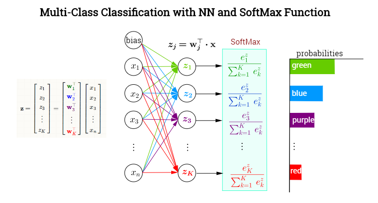{width=70% fig-align="center"}

::: {.small-text}
- softmax turns a collection of numbers into a probability distribution
- $z_i\rightarrow \text{softmax}(z_i)=p_i$ implies that $p_i\geq 0$ (because of the exponentiation) and $\sum p_i=1$ (because of the normalization in the denominator)
:::


## word2vec {#word2vec}

- word2vec  maps each word to a fixed-length vector, and these vectors can better express the similarity and analogy relationship among different words. 

::: {.small-text}
- Mikolov, T. et al. (2013) [Efficient Estimation of Word Representations in Vector Space. arXiv:1301.3781](https://arxiv.org/abs/1301.3781)
- Mikolov, T. et al. (2013) [Distributed representations of words and phrases and their compositionality. Advances in Neural Information Processing Systems. arXiv:1310.4546](https://arxiv.org/abs/1310.4546)
:::

- word2vec is a classic algorithm that was extremely influential in NLP before the advent of transformer based algorithms.
- The word2vec algorithm has several features that influenced the development of transformers and it is a good place to learn about how embeddings can be created.

::: {.mybox}
**One-hot vectors**:

Before explaining the word2vec algorithm, let's study why semantic vectors are an improvement over one-hot vectors
:::


## One-hot encoding

Sentence: *the quick brown fox jumps over the lazy dog* (9 tokens, vocabulary size $V = 8$)

| Word | brown | dog | fox | jumps | lazy | over | quick | the |
| :--- | :---: | :---: | :---: | :---: | :---: | :---: | :---: | :---: |
| **the** | 0 | 0 | 0 | 0 | 0 | 0 | 0 | <span style="color:blue">**1**</span> |
| **quick** | 0 | 0 | 0 | 0 | 0 | 0 | <span style="color:blue">**1**</span> | 0 |
| **brown** | <span style="color:blue">**1**</span> | 0 | 0 | 0 | 0 | 0 | 0 | 0 |
| **fox** | 0 | 0 | <span style="color:blue">**1**</span> | 0 | 0 | 0 | 0 | 0 |
| **jumps** | 0 | 0 | 0 | <span style="color:blue">**1**</span> | 0 | 0 | 0 | 0 |
| **over** | 0 | 0 | 0 | 0 | 0 | <span style="color:blue">**1**</span> | 0 | 0 |
| **the** | 0 | 0 | 0 | 0 | 0 | 0 | 0 | <span style="color:blue">**1**</span> |
| **lazy** | 0 | 0 | 0 | 0 | <span style="color:blue">**1**</span> | 0 | 0 | 0 |
| **dog** | 0 | <span style="color:blue">**1**</span> | 0 | 0 | 0 | 0 | 0 | 0 |

* A <span style="color:blue">one-hot vector</span> is a vector used to represent a categorical value in which exactly one element is 1 and all other elements are 0. Its length equals the vocabulary size $V$.

## One hot for nucleotides

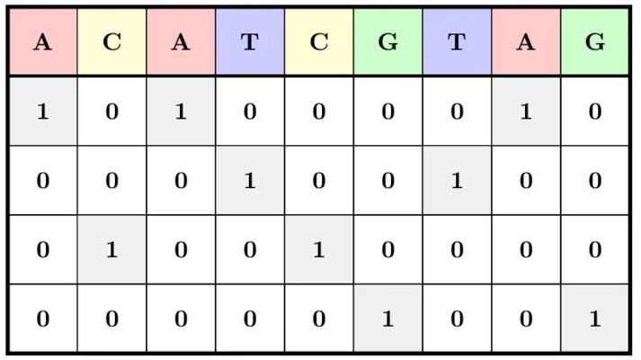{width=50% fig-align="center"}

* The DNA sequence ACATCGTAG with each base as a one-hot column (rows: A, T, C, G). Here each *column* is a token.

::: {.tiny-credit}
Image adapted from [illustrated-word2vec](https://jalammar.github.io/illustrated-word2vec/).
:::


## Semantic vector space of cars

:::: {.columns}

::: {.column width="70%"}

```{python}
#| echo: false
#| fig-align: center
cars_pca(figsize=(7.5, 6))
```

:::
::: {.column width="27%"}

::: {.small-text}

- This three dimensional space represents cars according to _size_, _color_, and _price_.
- We can represent an arbitrary car in this space. 
- Cars that are semantically similar (have similar attributes) are close to each other in this space
- In word2vec the axes are not chosen by hand: they are learned from data, typically with 100–1000 dimensions, and are not individually interpretable.
:::


:::
::::


## Semantics of one-hot vectors

- We would like to be able to test whether, say, "Man" and "Uncle" are relatively similar, but "Tofu" and "Airplane" are not very similar.
- The usual way of comparing vectors^[cosine similarity is defined for non-zero vectors] $\mathbf{x},\mathbf{y} \in \mathbb{R}^d$ is a cosine similarity (cosine of the angle between the vectors)

$$
\text{cosine similarity}(\mathbf{x},\mathbf{y}) =
\dfrac{\mathbf{x}^T\mathbf{y}}{\Vert \mathbf{x}\Vert  \Vert \mathbf{y}\Vert }
\in [-1,1]
$$

- cosine similarity between one-hot vectors of any two different words is 0
- One-hot vectors have no natural notion of similarity, e.g., the dot product between the vector for apple and pear would be zero.


## Word embeddings
```{python}
#| echo: false
#| fig-align: center
w2v_analogy()
plt.plot()
```

- Word embeddings are semantically meaningful representations of words: relations such as gender (red) and plural (blue) correspond to roughly constant vector offsets
- This supports analogies by vector arithmetic: $\mathbf{v}_{\text{king}} - \mathbf{v}_{\text{man}} + \mathbf{v}_{\text{woman}} \approx \mathbf{v}_{\text{queen}}$
- (The plot is a 2D projection of high-dimensional vectors)

::: {.tiny-credit}
Redrawn after Figure 2 of Mikolov T, et al. (2013) [Linguistic Regularities in Continuous Space Word Representations](https://aclanthology.org/N13-1090/)
:::

## word2vec

::: {.callout-note appearance="simple" icon=false}
Word2vec is a group of related models that are used to produce word embeddings, based on a series of extensions of the original Skip-gram model.
:::

* It is mainly  based on two different models: 
  - skip-gram (SG)
  - continuous bag of words (CBOW)^[Continuous bag of words, not covered in this lecture.]
* **word2vec** is a shallow, two-layer neural network trained to reconstruct linguistic contexts of words. 
* **Input**: a large corpus of text 
* **Output**: a vector space, typically of 100-1000 dimensions, with each unique word in the corpus being assigned a corresponding vector in the space. 
* Word vectors are positioned in the vector space such that words that share common contexts in the corpus are located in close proximity to one another in the space.


## distributional similarity

::: {.callout-note appearance="simple" icon=false}

- You shall know a word by the company it keeps J.R. Firth, 1957
- Dime con quien andas, y te diré quien eres (Don Quijote de la Mancha, 1615)
:::
 
* Word2vec essentially looks at the context in which a word appears
* The distribution of a word's neighbors in a large corpus of text approximates the *meaning* of the word

{ fig-align="center"}

## Goal of word2vec
::: {.callout-note appearance="simple" icon=false}
  Choose a [dense vector]{.emph} for each word that will be good at predicting which words it co-appears with
:::


 Define a model that predicts the context surrounding a center word $w_t$ using word vectors
$$
\begin{equation}
  p(\text{context}|w_t)=\ldots
\end{equation}
$$

 
* For position $t=1,\ldots,T$ in the training text, look at the context words within a window of size $m$ around $w_t$. The objective function $J(\Theta)$ is then
$$
J(\Theta)=\prod_{t=1}^{T} \prod_{\substack{-m\le j\le m\\ j\ne 0}} p(w_{t+j}\mid w_t;\Theta)
$$
* We can **simplify** the notation by writing $D$ for the set of all (center, outside) word pairs $(c,o)$ extracted from the text:
$$
J(\Theta)=\prod_{(c,o)\in D} p(o\mid c;\Theta)
$$
* Our goal is to find the parameters $\Theta$ that maximize it: $\hat{\Theta}=\arg\max_{\Theta} J(\Theta)$

## The score: how well do two words fit together?

::: {.callout-note appearance="simple" icon=false}
Everything in word2vec is built on one number: the **score** of a (center word, outside word) pair is the dot product of their vectors
:::

$$
s_{o,c}=\mathbf{u}_o^{T}\mathbf{v}_c=\sum_{i=1}^{d} u_{o,i}\,v_{c,i} = \Vert\mathbf{u}_o\Vert\,\Vert\mathbf{v}_c\Vert \cos\theta
$$ {#eq-w2v-score}

* **Large and positive** when the two vectors point in a similar direction: the words tend to occur together
* **Near zero** when the vectors are unrelated (perpendicular)
* **Negative** when they point in opposite directions: the words avoid each other
* This is the cosine similarity from before, without the normalization. Unlike one-hot vectors, whose dot product is always 0 for different words, dense vectors can give graded scores.

## Defining a loss function

* Rather than maximizing the objective function  $J(\Theta)$, it is more convenient to minimize the corresponding loss function

$$
\ell(\Theta)=-\log J(\Theta)= -\dfrac{1}{|D|} \sum_{(w,c)\in D} \log p(c|w,\Theta)
$$ {#eq-cost}


* We now need to define the term $p(c|w,\Theta)$. We will start off with the **softmax** with $o$: **outside word** and  $c$: **center word** for some skipgram defined by some $t$ and some $j$, i.e., $w_{t+j}$ is shown here as $o$ and $w_t$ is shown as $c$.

$$
 p(w_{t+j}|w_t,\Theta) =  p(o|c) = \dfrac{\exp (\mathbf{u}_{o}^{T}\mathbf{v}_c) }{\sum_{w=1}^{V} \exp (\mathbf{u}_{w}^{T}\mathbf{v}_c)}
$$ {#eq-loss-per-word}
 
 
* Here, $V$ is the total number of vocabulary of words (different from $T$ the total number of words in a large corpus (where individual words are repeated).

 
## Two vectors per word
::: {.callout-note appearance="simple" icon=false}
Each word actually has two vector representations, both in $\mathbb{R}^d$
:::

* $\mathbf{v}_c$ is the representation of a word when it is the center word of the window
* $\mathbf{u}_o$ is the representation of a word when it is an outside (context) word of the center word
* In this model the position of the context word in the window is not important: the same softmax is used for every offset $j$
* After training, the vectors $\mathbf{v}$ (or the average of $\mathbf{u}$ and $\mathbf{v}$) are used as the word embeddings
 
 
## word2vec: from one-hot vector to embedding
::: {.callout-note appearance="simple" icon=false}
The first layer is a lookup: multiplying the one-hot vector of the center word by the matrix $\mathbf{W}$ selects that word's vector.
:::

Let $\mathbf{x}_c \in \{0,1\}^{V}$ be the one-hot vector of the center word $c$ and let $\mathbf{W}\in\mathbb{R}^{d\times V}$ be a randomly initialized matrix whose columns are the center-word vectors. Then

$$
\mathbf{v}_c = \mathbf{W}\mathbf{x}_c
$$

$$
\underbrace{\begin{bmatrix}
  \ldots & \ldots & 0.2 & \ldots & \ldots \\
  \ldots & \ldots & -1.4 & \ldots & \ldots \\
  \ldots & \ldots & 0.3 & \ldots & \ldots \\
  && \vdots && \\
  \ldots & \ldots & 0.7 & \ldots & \ldots \\
  \ldots & \ldots & 0.6 & \ldots & \ldots
\end{bmatrix}}_{\mathbf{W}\;(d\times V)}
\underbrace{\begin{bmatrix} 0\\ 0\\ 1\\ 0\\ 0 \end{bmatrix}}_{\mathbf{x}_c\;(V\times 1)}
=
\underbrace{\begin{bmatrix} 0.2\\ -1.4\\ 0.3\\ \vdots \\ 0.7 \\ 0.6 \end{bmatrix}}_{\mathbf{v}_c\;(d\times 1)}
$$

## word2vec: calculate the loss

::: {.small-text}
We have a second matrix $\mathbf{U}\in\mathbb{R}^{V\times d}$ whose *rows* are the outside-word vectors $\mathbf{u}_w^{T}$ (whereas the *columns* of $\mathbf{W}$ are the center-word vectors).
Multiplying by $\mathbf{v}_c$ gives one score for every word in the vocabulary:
:::

$$
\underbrace{\begin{bmatrix}
  \mathbf{u}_1^{T} \\ \mathbf{u}_2^{T} \\ \mathbf{u}_3^{T} \\ \vdots \\ \mathbf{u}_{V}^{T}
\end{bmatrix}}_{\mathbf{U}\;(V\times d)}
\underbrace{\begin{bmatrix} 0.2\\ -1.4\\ 0.3\\ \vdots \\ 0.7 \\ 0.6 \end{bmatrix}}_{\mathbf{v}_c\;(d\times 1)}
=
\underbrace{\begin{bmatrix}
  \mathbf{u}_1^{T}\mathbf{v}_c \\ \mathbf{u}_2^{T}\mathbf{v}_c \\ \mathbf{u}_3^{T}\mathbf{v}_c \\ \vdots \\ \mathbf{u}_{V}^{T}\mathbf{v}_c
\end{bmatrix}}_{\text{scores}\;(V\times 1)}
$$

## word2vec: calculate the loss (2)

::: {.callout-note appearance="simple" icon=false}
To calculate the loss, we apply the softmax to the scores $\mathbf{U}\mathbf{v}_c$ and compare the result to the *truth* vector $\mathbf{y}$, a one-hot vector that marks the word that really occurred in the context.
:::

$$
\text{softmax}(\mathbf{U}\mathbf{v}_c) =
\begin{bmatrix} p_1\\ p_2\\ p_3\\ \vdots \\ p_{V-1} \\ p_{V} \end{bmatrix},
\qquad p_w = p(w \mid c)
$$

If the truth vector has a one at position $o$, the loss for this example is $-\log p_o$ (the cross-entropy between $\mathbf{y}$ and the predicted distribution). It is small when the model gives the true outside word a probability near 1.


## word2vec: the parameters
::: {.callout-note appearance="simple" icon=false}
As is usual in deep learning, we will train the model using gradient descent. We first collect all of the parameters, i.e., both the center vectors ($\mathbf{v}$) and the outside vectors ($\mathbf{u}$) of all words, in a single vector $\Theta$.
:::

$$
\Theta = \begin{bmatrix}
           \mathbf{v}_{aardvark} \\ \vdots \\  \mathbf{v}_{zebra} \\  \mathbf{u}_{aardvark} \\ \vdots \\  \mathbf{u}_{zebra}
          \end{bmatrix}
\in \mathbb{R}^{2dV}
$$

::: {.small-text}
There is a $d$-dimensional vector for each of the $V$ words, and each word is represented twice (as center and as outside word). All of this is flattened into a $2dV \times 1$ vector $\Theta$, which contains the columns of $\mathbf{W}$ and the rows of $\mathbf{U}$.
For example, with $V=100{,}000$ and $d=300$ there are $60$ million parameters.
:::


## gradient descent
::: {.callout-note appearance="simple" icon=false}
We use gradient descent^[Refer to previous two lectures for details] to find the vectors that minimize the loss.
:::

* For a single (center, outside) pair $(c,o)$ we need the gradient of $\log p(o\mid c)$. 
* The loss is $-\log p(o\mid c)$, so its gradient is the negative of this.
* We compute it with respect to the center vector $\mathbf{v}_c$; the gradient with respect to the outside vectors $\mathbf{u}_w$ is similar.

$$
\begin{eqnarray*}
\log p(w_{t+j}\mid w_t) &=& \log p(o\mid c) \\
&=& \log \dfrac{\exp (\mathbf{u}_{o}^{T}\mathbf{v}_{c})}{\sum_{w=1}^{V} \exp (\mathbf{u}_{w}^{T}\mathbf{v}_{c})} \\
&=& \mathbf{u}_{o}^{T}\mathbf{v}_{c} - \log \sum_{w=1}^{V} \exp (\mathbf{u}_{w}^{T}\mathbf{v}_{c})
\end{eqnarray*}
$$

We will differentiate the two terms separately.
 
## gradient descent

- For the first term we have:
$$
\nabla_{\mathbf{v}_c}\, \mathbf{u}_{o}^{T}\mathbf{v}_{c} = \frac{\partial}{\partial \mathbf{v}_{c}} \mathbf{u}_{o}^{T}\mathbf{v}_{c} = \mathbf{u}_{o}
$$

- For the second term, recall the chain rule $\frac{d}{dx} f(g(x)) = f^{\prime}(g(x))\cdot g^{\prime}(x)$. 
- Here $f=\log$ is the outer function, $g(\mathbf{v}_c)=\sum_{w=1}^{V} \exp(\mathbf{u}_w^{T}\mathbf{v}_c)$ is the inner function, and $\frac{d}{dx}\log x = \frac{1}{x}$. 
- We use $x$ as the summation index of the inner sum, to avoid confusion with the $w$ in the denominator.


$$
\frac{\partial}{\partial \mathbf{v}_{c}}  \log \sum_{w=1}^{V} \exp(\mathbf{u}_w^{T}\mathbf{v}_c) =
\dfrac{1}{\sum_{w=1}^{V} \exp(\mathbf{u}_w^{T}\mathbf{v}_c)}  \frac{\partial}{\partial \mathbf{v}_{c}}  \sum_{x=1}^{V} \exp(\mathbf{u}_x^{T}\mathbf{v}_c)
$$

::: {.tiny-credit}
Note that in this equation, $\log$ pays the part of the outer function $f$ and $\sum_{w=1}^{V} \exp(\mathbf{u}_w^{T}\mathbf{v}_c)$ is the inner function $g$; the first derivative of $\log x$ is $\dfrac{1}{x}$.
:::

## gradient descent (3)

We still need the derivative of the sum from the previous slide:

$$
\begin{aligned}
\frac{\partial}{\partial \mathbf{v}_{c}} \sum_{x=1}^{V} \exp(\mathbf{u}_x^{T}\mathbf{v}_c)
 &= \sum_{x=1}^{V}\frac{\partial}{\partial \mathbf{v}_{c}} \exp(\mathbf{u}_x^{T}\mathbf{v}_c) \\
 &= \sum_{x=1}^{V} \exp(\mathbf{u}_x^{T}\mathbf{v}_c) \frac{\partial}{\partial \mathbf{v}_{c}} \mathbf{u}_x^{T}\mathbf{v}_c \\
 &= \sum_{x=1}^{V} \exp(\mathbf{u}_x^{T}\mathbf{v}_c)\, \mathbf{u}_x
\end{aligned}
$$

* The first line holds because the derivative of a sum is the sum of the derivatives.
* The second line follows from the chain rule and the fact that $\frac{d e^x}{dx}=e^x$.

## gradient descent (4)

Pulling the parts together:

$$
\begin{aligned}
\frac{\partial}{\partial \mathbf{v}_{c}}  \log \dfrac{\exp (\mathbf{u}_{o}^{T}\mathbf{v}_{c})}{\sum_{w=1}^{V} \exp (\mathbf{u}_{w}^{T}\mathbf{v}_{c})}
&= \mathbf{u}_{o}  - \dfrac{1}{\sum_{w=1}^{V} \exp(\mathbf{u}_w^{T}\mathbf{v}_c)}  \sum_{x=1}^{V}  \exp(\mathbf{u}_x^{T}\mathbf{v}_c)\,\mathbf{u}_x \\
&= \mathbf{u}_{o}  -  \sum_{x=1}^{V} \dfrac{\exp(\mathbf{u}_x^{T}\mathbf{v}_c)}{\sum_{w=1}^{V} \exp(\mathbf{u}_w^{T}\mathbf{v}_c)}\,\mathbf{u}_x
\end{aligned}
$$


The second line holds because $\dfrac{1}{\sum_{w=1}^{V} \exp(\mathbf{u}_w^{T}\mathbf{v}_c)}$ is just a scalar and can be pulled into the sum.

The fraction inside the sum is exactly the <span style="color:blue">softmax</span> probability that word $x$ occurs as an outside word of the center word $c$:

$$
p(x\mid c)=\dfrac{\exp(\mathbf{u}_x^{T}\mathbf{v}_c)}{\sum_{w=1}^{V} \exp(\mathbf{u}_w^{T}\mathbf{v}_c)}
$$
 
## gradient descent (5)
::: {.callout-note appearance="simple" icon=false}
Therefore, the gradient actually has the form of an observed value ($\mathbf{u}_o$) subtracted by the expectation across all context words 
:::

$$
\frac{\partial}{\partial \mathbf{v}_{c}} \log p(o\mid c) = \mathbf{u}_{o} -  \sum_{x=1}^{V} p(x\mid c)\,\mathbf{u}_x
$$

* The probabilities $p(\cdot\mid c)=\text{softmax}(\mathbf{U}\mathbf{v}_c)$ form a vector of length $V$. In matrix form the gradient is $\mathbf{U}^{T}(\mathbf{y}-p(\cdot\mid c))$, where $\mathbf{y}$ is the one-hot truth vector.
* $\Theta$ has $2Vd$ entries, but for one training pair the gradient is nonzero only for $\mathbf{v}_c$ and the outside vectors $\mathbf{u}_w$.
* Note that $p(x|c)$ is a vector with dimensions $V\times 1$. 
* The gradients  would be calculated for all $2Vd$ parameters in the model, i.e., all $\mathbf{v}_c$ and  $\mathbf{u}_o$ 


## gradient descent (6)
::: {.callout-note appearance="simple" icon=false}
To minimize the loss $\ell(\Theta)$ we take a step against its gradient with learning rate $\eta$. For a single training pair $(c,o)$ (stochastic gradient descent) the update for the center vector is
:::

$$
\mathbf{v}_c \;\gets\; \mathbf{v}_c + \eta \left[ \mathbf{u}_{o} -  \sum_{x=1}^{V} p(x\mid c)\,\mathbf{u}_x \right]
$$

The plus sign appears because the loss is $-\log p(o\mid c)$, so its gradient is the negative of the bracket.

- $\eta$ is the learning rate
- $+\eta\,\mathbf{u}_o$ moves $\mathbf{v}_c$ towards the vector $\mathbf{u}_o$ of the word that actually occurred in the context
- $-\eta\,\mathbb{E}_{x\sim p(\cdot\mid c)}[\mathbf{u}_x]$ moves $\mathbf{v}_c$ away from the expected outside vector
- The expectation is taken over every word $x\in V$ in the vocabulary, using the model's own distribution $p(x\mid c)$ (the softmax output)
- The exact gradient is [expensive]{.emph}: the expectation touches every word vector in the vocabulary at every training step. 
- This is the practical bottleneck that motivates approximations like [negative sampling]{.emph}, which replaces the full sum with a small sample of "negative" words


## word2vec: scaling up
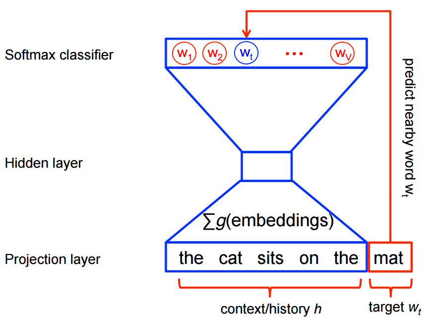{width=40% fig-align="center"}

* The softmax is very expensive: to compute and normalize one probability we need the score of **every** one of the $V$ words in the vocabulary, at every training step.

## word2vec: scaling up
::: {.callout-note appearance="simple" icon=false}
  word2vec therefore is trained to discriminate the real target words $w_t$ from $k$ imaginary (noise) words $\tilde{w}$, in the same context.
:::

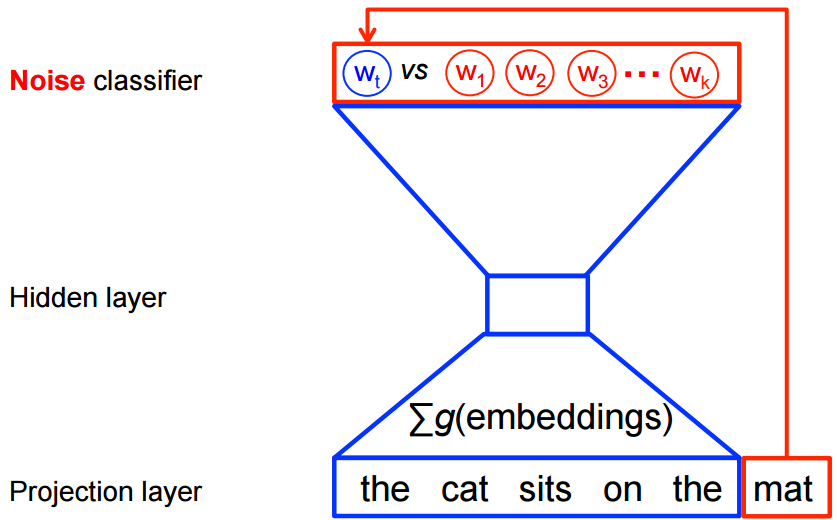{width=40% fig-align="center"}

## Negative sampling {#negsample}

- Consider a pair $(c,o)$ of a center word and an outside word
- The probability that this pair came from the corpus is $p(Z=1\mid c,o;\Theta)$ (i.e., it corresponded to a skip-gram in the actual data)
- The probability that the pair did not come from the corpus is $p(Z=0\mid c,o;\Theta) = 1 - p(Z=1\mid c,o;\Theta)$

* **Goal**: find parameters $\Theta$ that maximize the probability that all of the observed pairs indeed come from the data

$$
\begin{align*}
& \arg \max_{\Theta} \prod_{(c,o)\in D} p(Z=1\mid c,o;\Theta)\\
&=\arg \max_{\Theta} \log \prod_{(c,o)\in D} p(Z=1\mid c,o;\Theta)\\
&=\arg \max_{\Theta}  \sum_{(c,o)\in D} \log p(Z=1\mid c,o;\Theta)
\end{align*}
$$

* On its own this objective has a trivial solution (make every pair look real), which is why negative examples are needed


## Negative sampling (2)

- The probability $p(Z=1\mid c,o;\Theta)$ can be defined using the sigmoid function $\sigma(x) = \dfrac{1}{1+e^{-x}}$ applied to the same score as before:
- Recall $\mathbf{u}_o^{T}\mathbf{v}_c$ (c.f. @eq-w2v-score), the score of each pair of words
$$
p(Z=1\mid c,o;\Theta) = \sigma(\mathbf{u}_o^{T}\mathbf{v}_c) = \dfrac{1}{1 + e^{-\mathbf{u}_o^{T}\mathbf{v}_c}}
$$

We can now rewrite the objective function:

$$
\arg \max_{\Theta}  \sum_{(c,o)\in D} \log \sigma(\mathbf{u}_o^{T}\mathbf{v}_c)
$$

## Negative sampling (3): adding negative examples

- Maximizing only $\sum_{D}\log\sigma(\mathbf{u}_o^{T}\mathbf{v}_c)$ is not enough: it can be made large by making all scores large. We therefore add **negative examples**: a set $D^{\prime}$ of pairs $(c,\tilde{o})$ that did *not* come from the corpus. Each is made by pairing a center word with a randomly drawn word, which is presumed to be unrelated to it.
- We now maximize the probability that real pairs are labelled $Z=1$ and noise pairs are labelled $Z=0$:

$$
\begin{align*}
&\arg\max_{\Theta} \prod_{(c,o)\in D}p(Z=1\mid c,o;\Theta)
 \prod_{(c,\tilde{o})\in D^{\prime}}p(Z=0\mid c,\tilde{o};\Theta) \\
&= \arg\max_{\Theta} \sum_{(c,o)\in D}\log p(Z=1\mid c,o;\Theta)
 + \sum_{(c,\tilde{o})\in D^{\prime}} \log \bigl(1- p(Z=1\mid c,\tilde{o};\Theta)\bigr) \\
&= \arg\max_{\Theta} \sum_{(c,o)\in D}\log \sigma(\mathbf{u}_o^{T}\mathbf{v}_c)
 + \sum_{(c,\tilde{o})\in D^{\prime}} \log \sigma(-\mathbf{u}_{\tilde{o}}^{T}\mathbf{v}_c)
\end{align*}
$$

::: {.small-text}
* The second line takes the logarithm (the maximizer does not change, and the product becomes a sum). 
* The third line uses $p(Z=1\mid\cdot)=\sigma(\mathbf{u}^{T}\mathbf{v}_c)$ and the identity $1-\sigma(x)=\sigma(-x)$.^[See [lecture 4](./logreg.qmd)]
:::

## Negative sampling (4): choosing the negatives

- $D^{\prime}$ could contain every wrong word for every center word, up to $V-1$ pairs per positive pair, which would bring back the cost of the full softmax. Instead we **sample** the negatives.
- For each $(c,o)\in D$ we draw $k$ random words $\tilde{o}_1,\ldots,\tilde{o}_k$ and use the pairs $(c,\tilde{o}_1),\ldots,(c,\tilde{o}_k)$ as presumed negatives. So there are $k$ times as many negative as positive examples.
- The unigram distribution is the relative frequency of each word in the training corpus. Words $\tilde{o}_j$ are drawn from the unigram distribution **raised to the power 3/4** and renormalized:

$$
P_{n}(w)=
\frac{\mathrm{count}(w)^{3/4}}
{\sum_{w^{\prime}} \mathrm{count}(w^{\prime})^{3/4}}
$$

- This downweights frequent words and upweights rare ones. For example, relative frequencies $0.90,\ 0.09,\ 0.01$ become about $0.83,\ 0.15,\ 0.03$.

::: {.tiny-credit}
Mikolov T, Sutskever I, Chen K, Corrado GS, Dean J (2013) [Distributed representations of words and phrases and their compositionality. Advances in Neural Information Processing Systems 26](https://dl.acm.org/doi/10.5555/2999792.2999959).
:::


## Concept replacement {#concept}

The original word2vec method operates on individual words (tokens). However, many medical concepts span multiple tokens. For instance, <span style="background-color: #e0f2fe; padding: 2px 6px; border-radius: 4px;">non-small-cell lung carcinoma</span> would be treated by word2vec as three or five tokens (depending on how the hyphen is handled in preprocessing), but it represents a single medical concept.

- Some approaches collapse multiword concepts into a single token before embedding, by replacing each mention with a **concept ID**. For instance, <span style="background-color: #e0f2fe; padding: 2px 6px; border-radius: 4px;">non-small-cell lung carcinoma</span> can be replaced by its MeSH ID D002289.
- Synonyms ("NSCLC", "non small cell lung cancer", ...) are replaced by the same ID and therefore share one embedding.
- This requires concept recognition: finding the mentions in the text and linking them to the correct ID, a step that has errors of its own.


## latent knowledge about protein kinases and cancer (1)
::: {.callout-note appearance="simple" icon=false}
We used concept replacement as one of many steps to create concept embeddings to investigate protein kinases and cancer.
:::
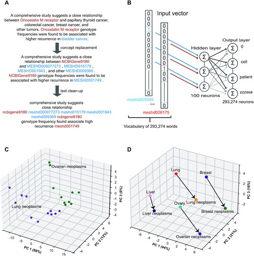{width=60% fig-align="center"}

## latent knowledge about protein kinases and cancer (2)
::: {.callout-note appearance="simple" icon=false}
Inhibiting protein kinases (PKs) that drive cancers has been an important topic in cancer therapy for years
:::

- We represented PKs and cancers as 100-dimensional concept vectors, using word2vec on ca. 10 million PubMed abstracts <!-- verify -->
- A random forest, trained on phase I–IV trial information from ClinicalTrials.gov, predicts the relevance of inhibiting a given PK for a given cancer

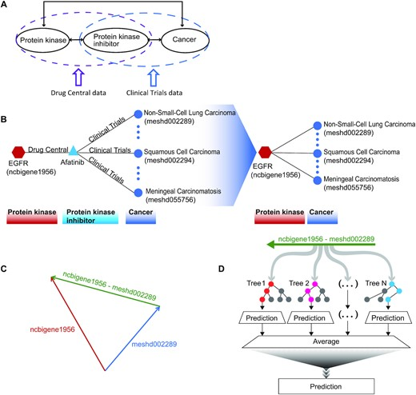{width=60% fig-align="center"}

## latent knowledge about protein kinases and cancer (3)
::: {.callout-note appearance="simple" icon=false}
Historical validation: we trained on data up to a given year and tested whether the highest-scoring PK–cancer pairs entered trials later. AUROC ranged from 77% to 86% and average precision from 28% to 41% <!-- verify; add the baseline precision (fraction of positive pairs) -->
:::

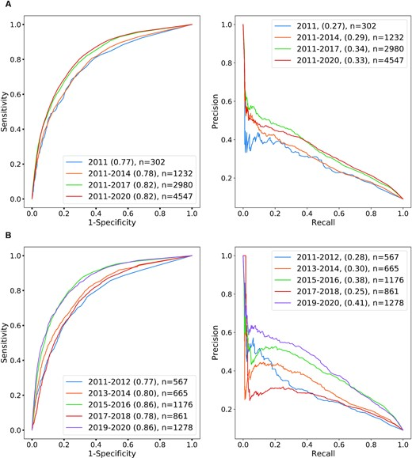{width=60% fig-align="center"}

::: {.tiny-credit}
Ravanmehr V, et al (2021) [Supervised learning with word embeddings derived from PubMed captures latent knowledge about protein kinases and cancer. NAR Genom Bioinform **3**:lqab113](https://pubmed.ncbi.nlm.nih.gov/34888523/).
:::


## Tokens {#token}


::: {.callout-important icon="true" appearance="default" title="The need for tokenization"}

* LLMs (and many other machine learning algorithms) process numbers rather than text
* Therefore, to process text, it first must be converted to numbers.
:::


:::: {.columns}

::: {.column width="50%"}

Tokenization by Open-AI 

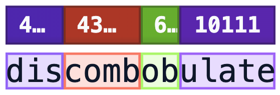{#fig-tokens width=80% fig-align="center"}

:::
::: {.column width="50%"}

* A __token__ is a piece of text that can be represented by an __integer__. 
* Here, we see an example GPT subword tokenization of the word *discombobulate*:
    - dis: 4220
    - comb: 43606
    - ob: 630
    - ulate; 10111
* The integer that is associated with the token is called __token ID__ or __token index__.^[See https://tiktokenizer.vercel.app/ for an app to visualize different tokenizing schemes.]

:::
:::


## Tokenization 

::: {.callout-note}
## Definition
 the process of converting a sequence of text into smaller parts, known as tokens. These tokens can be as small as characters or as long as words. 
:::


::: {.token-table}

| Tokenization Method | Example | Granularity | Pros | Cons |
|:---|:---|:---|:---|:---|
| **Word** | Full words | ["Machine", "learning"] | High semantic clarity | Massive vocabulary; fails on "unknown" words |
| **Subword** | Meaningful chunks | ["ma", "chine", "learn", "ing"] | Handles new words well | Slightly more complex to implement |
| **Character** | Individual letters | ["m", "a", "c", "h", "i", "n", "e", "l", "r", "g"] |  Tiny vocabulary; no "unknown" words | Loses semantic meaning; very long sequences |

:::


## Why not just use character embeddings?

Major problems with word embeddings

- There are extremely many unique words in natural language
- Words can have different lexical forms (run, runs, ran, running, ...)
- Out of vocabulary words cannot be represented


::: {.columns}

::: {.column width="40%"}
::: {.hl-container}
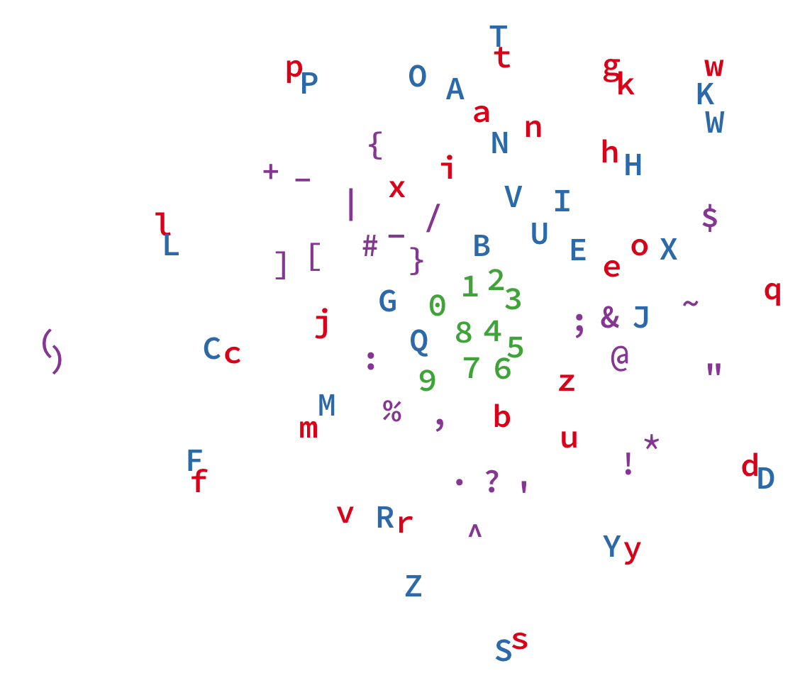{width="100%"}
:::

::: {.tiny-credit}
image credit: <https://github.com/minimaxir/char-embeddings>
:::
:::


::: {.column width="10%"}
:::


::: {.column width="50%"}
* Limitations of character embeddings
  - Unicode currently has $>$150K characters (growing!)
  - character-based embeddings ignore linguistic regularities (e.g., in English, 't' is more often followed by 'h' than by 'q')
  - requires a lot of memory to cover any given text in the context (there are more character embeddings than subword embeddings and more subword embeddings than word embeddings)

:::
:::

## Tokens are then converted to embeddings

- LLMs do not use tokens directly.
- Instead, an intermediate step converts input tokens to embeddings


::: {.callout-important icon="true" appearance="default" title="Embeddings"}

* Embeddings are dense numeric representations of tokens
* Advantages over integers
 - More text can be represented using fewer numbers
 - Semantic relations across tokens can be captured
:::

- During training, an LLM learns embeddings to represent individual tokens

```{python}
#| label: fig-polar
#| fig-cap: "coding tokens as embeddings"
#| fig-height: 2
import matplotlib.pyplot as plt
import matplotlib.patches as patches

# Data Setup
input_text = ["[CLS]", "I", "love", "to", "code", ".", "[SEP]"]
token_ids = [101, 2023, 2003, 1037, 7953, 1012, 102]
# Simulated embedding vectors (first 3 dimensions)
embeddings = [
    [0.03, -0.01, -0.02], [0.05, 0.01, 0.00], [-0.04, -0.02, -0.02],
    [0.01, -0.00, -0.04], [0.00, 0.00, -0.33], [0.01, -0.42, -0.71], [-0.07, 0.02, -0.03]
]

fig, ax = plt.subplots(figsize=(12, 6))
ax.set_xlim(0, 10)
ax.set_ylim(0, 10)
ax.axis('off')

# 1. Draw Tokenization Row
ax.text(0.5, 10, "I love to code.", fontsize=16, fontweight='bold')
ax.text(0.5, 8.1, "Tokenization", fontsize=16, fontweight='bold')
for i, (txt, tid) in enumerate(zip(input_text, token_ids)):
    x_pos = 1 + i*1.2
    # Text box
    ax.add_patch(patches.FancyBboxPatch((x_pos, 7), 1, 0.8, boxstyle="round,pad=0.1", fc="#fbe5c6", ec="gray"))
    ax.text(x_pos+0.5, 7.4, txt, ha='center', fontsize=11)
    # ID box
    ax.add_patch(patches.Rectangle((x_pos, 6.2), 1, 0.8, fc="#fff2cc", ec="gray"))
    ax.text(x_pos+0.5, 6.6, str(tid), ha='center', fontsize=11)

# 2. Draw Transition Arrow
ax.annotate('', xy=(5, 4.5), xytext=(5, 6), arrowprops=dict(facecolor='black', shrink=0.05, width=2))

# 3. Draw Embeddings Row
ax.text(0.5, 3.7, "Embeddings", fontsize=16, fontweight='bold')
for i, vec in enumerate(embeddings):
    x_pos = 1 + i*1.2
    ax.add_patch(patches.Rectangle((x_pos, 1), 1, 2.5, fc="#fbe5c6", ec="gray"))
    for j, val in enumerate(vec):
        ax.text(x_pos+0.5, 3 - j*0.6, f"{val:.4f}", ha='center', fontsize=9)
    ax.text(x_pos+0.5, 1.2, "...", ha='center')

plt.tight_layout()
plt.show()

import numpy as np
import matplotlib.pyplot as plt

r = np.arange(0, 2, 0.01)
theta = 2 * np.pi * r
fig, ax = plt.subplots(
  subplot_kw = {'projection': 'polar'} 
)
ax.plot(theta, r)
ax.set_rticks([0.5, 1, 1.5, 2])
ax.grid(True)
plt.show()
```


##  Byte Pair Encoding {#bytepair}

- Byte Pair Encoding (BPE) is a simple, greedy algorithm that builds a vocabulary by repeatedly merging the most frequent pair of tokens.
- BPE proceeds by repeatedly identifying the most frequently occurring pair of symbols
and replacing all occurrences of this pair with a new symbol, thereby shortening the text.
-  The
new symbols, together with the pairs they replace, are stored in a lookup-table, which allows the
reconstruction of the original text. 

## BPE 

- BPE is widely used in the preprocessing stage of training large language models 
- Originally introduced as a compression algorithm that repeatedly identifies the most frequently occurring pair of symbols
and replaces all occurrences of this pair with a new symbol, thereby shortening the text.

$$
\begin{alignat}{3}
\mathrm{aabaaaba} &\to \mathrm{XbXaba} &&\to \mathrm{YXaba} &&\to \mathrm{Zaba} \\
\mathrm{aabaaaba} &\to \mathrm{aXaaXa} &&\to \phantom{\mathrm{Y}}\mathrm{YaYa} &&\to \mathrm{ZZ}
\end{alignat}
$$

- Input $s= \mathrm{aabaaaba}$
- Top: BPE merge sequence ($\mathrm{aa} \to \mathrm{X}$, $\mathrm{Xb} \to \mathrm {Y}$, $\mathrm{YX}\to \mathrm{Z}$)
- Bottom: BPE merge sequence ($\mathrm{ab} \to \mathrm{X}$, $\mathrm{aX} \to \mathrm {Y}$, $\mathrm{Ya}\to \mathrm{Z}$)
- Compression utility of $\mathrm{aabaaaba} \to \mathrm{Zaba}$ is $8- 4= 4$
- Compression utility of $\mathrm{aabaaaba} \to \mathrm{ZZ}$ is $8-2=6$

## Problem definition

- Consider an input string $s$ over an alphabet $\Sigma$
- Represent the concatenation of strings $a$ and $b$ as $a\cdot b$ (somes we will show simply $ab$ when clear from context)
- The length of a string $a$: $|a|$, the $i^{th}$ character of the string is $a[i]$, and the substring $a[i]\cdot a[i+1]\cdot\cdot\cdot a[j]$ is $a[i:j]$
- A replacement rule is a function $\mathrm{replace}_{x\to y}$ that transforms a string $s$ by replacing all occurrences
of the string $x$ in $s$ with the string $y$. 
  - If $s$ does not contain $x$ then $\mathrm{replace}_{x\to y}(s) = s$
  - Otherwise $$\mathrm{replace}_{x\to y}(s) = s[1:i]\cdot y\cdot \mathrm{replace}_{x\to y}(s[i+|x| + 1:|s|)$$ where i is the smallest index for
which $s[i + 1 : i + |x|] = x$

## Probem definition (2)

- A sequence of replacement rules $\mathbb{R} = (\mathbb{R}_1,\ldots ,\mathbb{R}_k)$ with $\mathbb{R}_i = \mathrm{replace}_{a_ib_i\to c_i}$
, where $a_i, b_i$, and $c_i$ are symbols, is called a merge sequence of length $k$. 
Denoting $s^{\prime} =(\mathbb{R}_k \circ \ldots \circ \mathbb{R}_1)(s)$, where $\circ$ is function composition, we refer to $|s^{\prime}|$
 as the compressed length, and $|s| − |s^{\prime}|$ as the utility of$\mathbb{R}$ for $s$. 

- BPE starts with the input string $s$, it performs $k$ locally optimal full merge steps, always choosing a pair whose
replacement maximizes compression utility
- This leads to a vocabulary of $k$ tokens (why?)

## BPE algorithm

Choose a desired $k$ (vocabulary size) and the input text corpus $s$

- Let $s^{(0)} = s$
- Let $s^{(i)} = \mathbb{R}_i(s^{(i-1)})$ for $i\in k$
- Output $\mathbb{R} = (\mathbb{R}_1,\ldots ,\mathbb{R}_k)$ with $\mathbb{R}_i = \mathrm{replace}_{a_ib_i\to c_i}$
- Each $c_i$ is a new symbol not occuring in $s^{(j)}$ for $j<i$
- The pair $a_ib_i$ is chosen so that $|\mathbb{R}_i((s^{(i-1)})|$ is minimal

[HOMEWORK]{.hw-badge} You will implement a version of BPE

## BPE Applications

::: {.mybox}
### LLMs and BPE

Virutally every major LLM uses BPE to transform input text into number (tokens) that are processed by the model

- GPE
- Llama
- Mistral
- Claude
:::


## BPE Applications

- Balances between character-level (too slow, results in long sequences) and word-level (too many parameters for rare words, poor generalization).
- BPE handles rare words (e.g., not in training vocabulary) by falling back to smaller subwords or individual characters/bytes.
- Models learn morphological patterns (e.g., “ing”, “ed”, “tion”, “pre”, “un”) which may help with analysis of grammar
- Cross-lingual: May help with relating synonymous words in different languages (Produktion, production, producíon,...)

## BPE Applications

- Better parameter efficiency: Model spends capacity on meaningful patterns rather than memorizing every word variant.
- Consider the German word "Abwasserbehandlungsanlage"
  - If a model created a single token for this word, it would need to learn the meaning of the token from relatively rare mentions in the training data
  - If the model splits this into "Abwasser", "Behandlung(s)" and "Anlage", the meanings of these three tokens are inferred from a much richer context in the training data 
- Consider word families:
  - "happy": happy, happier, happiest, happily, happiness, unhappy, unhappier, unhappiest, unhappily, unhappiness
  - "nation": nations, national, nationally, nationalist, nationalists, nationalism, nationalistic, nationality, nationalities, nationalize, nationalized, nationalization, international, internationally, transnational, multinational.
- BPE often will extract a common root from families such as this -- the model learns one embedding for the shared root and separate embeddings for the inflectional/derivational endings

:::{.tiny-credit}
Sennrich, R, et al. (2016) [Neural Machine Translation of Rare Words with Subword Units](https://aclanthology.org/P16-1162/)
:::

## Strawberry

::: {.mybox}
**Older versions of GPT famously were not able to determine how many r's there are in the word strawberry
:::

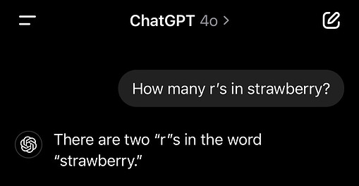{width=40% fig-align="center"}

- Why do you think this is?

## Strawberry tokens

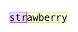{width=25% fig-align="center"}

- GPT had difficulties with letter-based calculations because it represents words with tokens
- Language models do not work with text the way that humans do!
- LLMs work with embedding vectors derived from tokens
- Sometimes those tokens and their embeddings correspond to our conceptualization of language
- More modern LLMs have been trained to deal with this issue, e.g., by writing a script to calculate the number of 'r's


## Sources

The sources used to prepare this lecture include

- Goldberg Y and Levy O (2014) [word2vec Explained: deriving Mikolov et al.'s negative-sampling word-embedding method, arXiv 1402.3722](https://arxiv.org/abs/1402.3722)
- Kozma L and Voderholzer J (2024) [Theoretical Analysis of Byte-Pair Encoding, arXiv  2411.08671](https://arxiv.org/abs/2411.08671)
- Mikolov, T. et al. (2013) [Efficient Estimation of Word Representations in Vector Space. arXiv:1301.3781](https://arxiv.org/abs/1301.3781)
- Mikolov, T. et al. (2013) [Distributed representations of words and phrases and their compositionality. Advances in Neural Information Processing Systems. arXiv:1310.4546](https://arxiv.org/abs/1310.4546)


