## Game plan

This lecture reviews information content, semantic similarity, Human Phenotype Ontology, and their use in differential diagnostics of Mendelian diseases.

* [Representing clinical data](#biomedical)
* [Information content](#ic)
* [Semantic similarity](#semsim)
* [Human Phenotype Ontology](#hpo)
* [Phenomizer](#phenomizer)
* [LIRICAL](#lirical)
* [Genomiser](#genomiser)


## Why is diagnosis so hard? {#diagnosis}

:::: {.columns}

::: {.column width="55%"}
* More than 10,000 rare diseases. Individually rare, together roughly **3.5–6 %** of the population^[Nguengang Wakap S et al. (2020) *Eur J Hum Genet* **28**:165–73]
* No clinician sees more than a handful of patients with any one of them
* Traditional first-tier testing diagnoses few patients: chromosomal microarray about **10 %**, exome sequencing about **36 %**, genome sequencing about **41 %** in children with suspected genetic disease^[Clark MM et al. (2018) *npj Genom Med* **3**:16. PMID 30002876]
* More recent pooled estimates for genome sequencing are about **30–35 %**^[Pandey R et al. (2025) *Genet Med*. PMID 40022598]
* Still, **most patients remain undiagnosed**
:::

::: {.column width="45%"}
| Sequenced | Variants per person |
|:--|--:|
| Genome | $\approx$ 4–5 million |
| Exome | $\approx$ 80,000 |
| Rare, protein-altering, predicted pathogenic by bioinformatics tools | $\approx$ tens |
| Rare, non-coding, predicted relevant  $\approx$ hundreds |
| **Disease-causing** | **1–2** |
:::

::::

::: {.callout-important appearance="simple"}
Sequencing typically yields tens to hundreds of **candidates**. HPO-based analysis prioritizes these candidates according to  **phenotypic** 
similarity.
:::

## Bioinformatics and Clinical Data:  {#blast}

* Most bioinformatics algorithms calculate similarity using some or other approach

:::: {.columns}

::: {.column width="58%"}
* **Margaret O. Dayhoff** (1925–1983) assembled the first collection of protein sequences, the *Atlas of Protein Sequence and Structure*, and is often called a founder of bioinformatics
* **PAM matrices**: she counted *accepted point mutations* in closely related proteins to measure how likely one residue is to replace another^[Dayhoff MO, Schwartz RM, Orcutt BC (1978) A model of evolutionary change in proteins. *Atlas of Protein Sequence and Structure* **5**(Suppl 3):345–352]
* The substitution score is a **log-odds ratio**: observed versus chance

$$
s(a,b) = \log \frac{q_{ab}}{p_a\,p_b}
$$

:::{.tiny-credit}
* **BLAST** sums these scores along an alignment, searches a whole database, and reports an **E-value** for the chance of such a score^[Altschul SF et al. (1990) *J Mol Biol* **215**:403–10. PMID 2231712]
:::

:::

::: {.column width="42%"}
{width="30%" fig-align="center"}

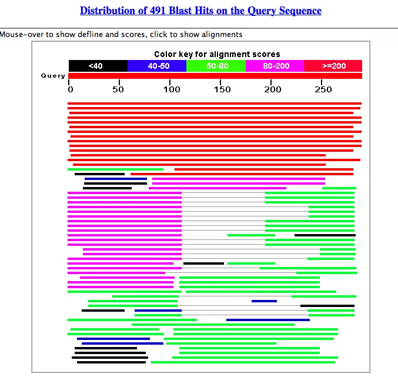{width="45%" fig-align="center"}
:::

::::


## Bioinformatics for Medicine? {#biomedical}

* How exactly do we calculate the similarity between diseases, symptoms, patients, and more?

::: {layout="[[1,1], [1,1]]"}
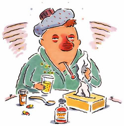{width="50%"}

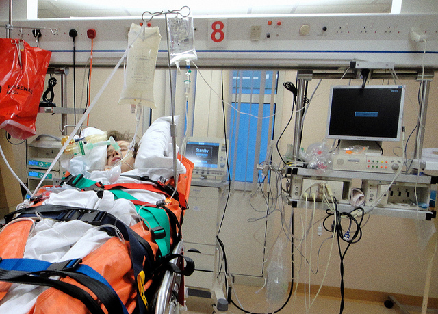{width="50%"}

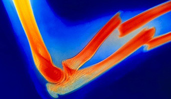{width="50%"}

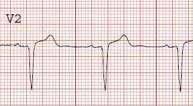{width="50%"}
:::

## A tale of two footballs
$$
\begin{equation*}
\mbox{American Football} = \mbox{Football} \neq
\mbox{Football} = \mbox{European Football} = \mbox{Soccer}
\end{equation*}
$$

::: {.columns}
::: {.column width="50%"}

{width="30%"}

A football $\ldots$

::: 
::: {.column width="50%"}

{width="30%"}

A football $\ldots$
::: 
::: 

When you see `football`, your computer sees: 
0100011001101111011011110111010001100010011000010110110001101100

## A tale of two fibrillations
$$
\begin{equation*}
\mbox{muscle fibrillation} = \mbox{fibrillation} \neq
\mbox{fibrillation} = \mbox{ventricular fibrillation}
\end{equation*}
$$

::: {.columns}
::: {.column width="50%"}

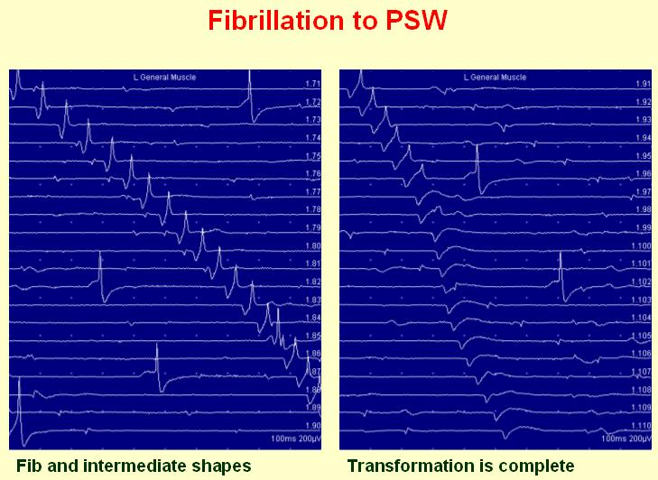{width="50%" fig-align="center"}

fibrillation $\ldots$

::: 
::: {.column width="50%"}

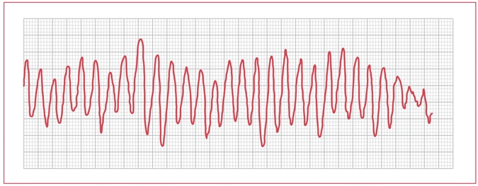{width="100%" fig-align="center"}

fibrillation $\ldots$
:::
:::


When you see  `fibrillation`, your computer sees: 
011001100110100101100010011100100110100101101100011011000110000101110100011010010110111101101110


## What is a phenotype ontology?

::: {.callout-note appearance="simple"}
### Core Purpose
Precise language (and thinking), interoperability, and improved database models to reliably capture and interpret phenotype information.
:::

* A **medical** phenotype ontology describes the individual manifestations of diseases:

    1. Signs
    2. Symptoms
    3. Laboratory findings
    4. Imaging studies
    5. *etc.*


::: {style="font-size: 0.45em; margin-top: 50px;"}
Robinson PN, Webber C (2014) [Phenotype ontologies and cross-species analysis for translational research. *PLoS Genet* **10**:e1004268](https://pubmed.ncbi.nlm.nih.gov/24699242/).
:::

## Deep Phenotyping
The precise and comprehensive analysis of phenotypic abnormalities.

- Individual components of the phenotype are observed and described using a controlled vocabulary.
- Deep phenotyping information is critical for:
  - Computational differential diagnostic tools.
  - Genotype-phenotype correlation.
  - Scientific examination of human disease.

::: {style="font-size: 0.45em; margin-top: 50px;"}
PN Robinson (2012) [Deep phenotyping for precision medicine. *Hum Mutat* **33**:777–780](https://pubmed.ncbi.nlm.nih.gov/22504886/). Special Issue of Human Mutation on Deep Phenotyping
:::


## Ontologies for Medicine and Translational Research

::: {.callout-note appearance="simple"}
### Core Purpose
 Ontologies have two major (interrelated) __use cases__
:::

- Interoperability between databases
- Foundation for algorithms and computational tools


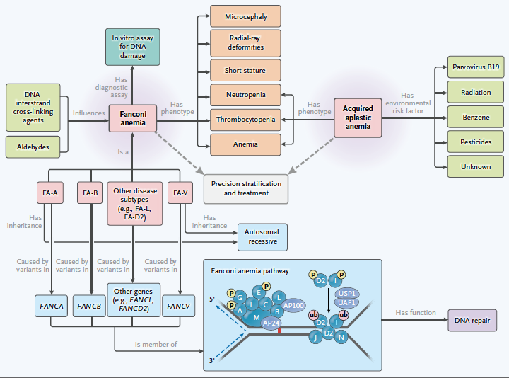{fig-align="center" width="75%"}


## Ontologies: Interoperability
 
::: {.columns}
::: {.column width="50%"}

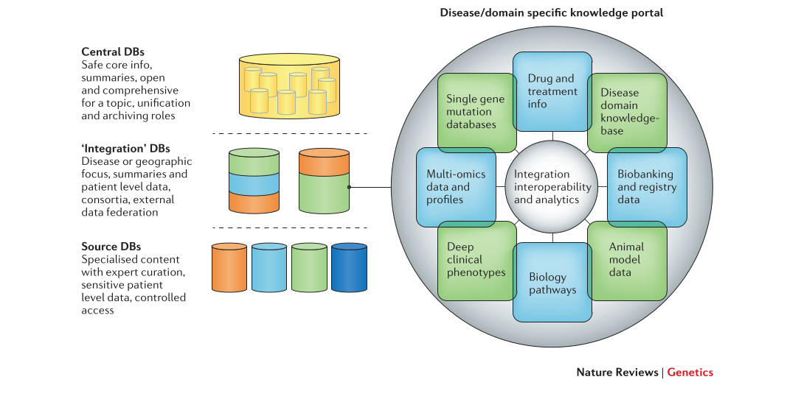
                

:::
::: {.column width="50%"}

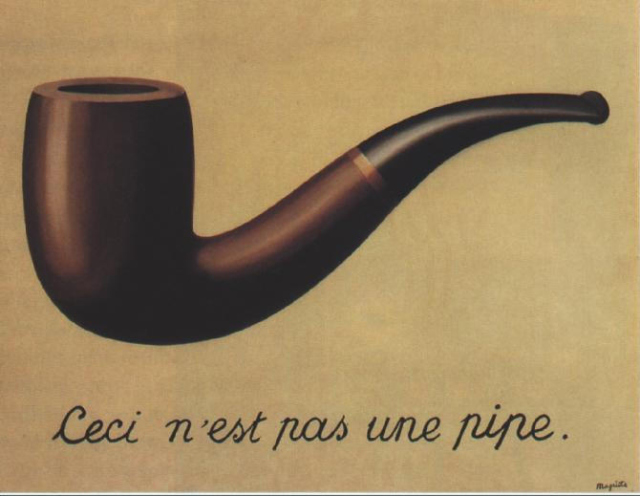{width="50%"}

:::
:::

* Human genetics is becoming a data-driven science
* Global Alliance for Genomics and Health (GA4GH) and other groups are
defining standards to exchange and integrate information between databases
across the globe
* This is particularly difficult for __clinical data__!

::: {.tiny-credit}
Brookes and Robinson (2015) [Human genotype-phenotype databases: aims,challenges and
opportunities, *Nature Reviews Genetics* **16**:702-15](https://pubmed.ncbi.nlm.nih.gov/26553330/)
:::

## Interoperability: What's the problem?

- Phenotypic descriptions that are very evocative for
humans^[Unfortunately computers, being significantly dumber than humans, don't quite "get" it...]:
    - myopathic electromyography
    - still walking 25 years after onset

* The following descriptions mean the same thing to you: `generalized amyotrophy`, 
`generalized muscle atrophy`, `muscular atrophy, generalized`,
(etc)
* Many publications have little^[or none at all] information about the actual phenotypic features seen in patients with particular diseases and variants
* Databases cannot talk to one another about phenotypes


{width="50%" fig-align="center"}


## Ontologies: Interoperability

::: {.callout-note appearance="simple"}
An ontology provides a **standardised "Term"** for each entity in its domain that can be used for data exchange.
:::

| Field | Description |
|:---|:---|
| **ID** | HP:0000256 |
| **Name** | Macrocephaly |
| **Definition** | Occipitofrontal (head) circumference greater than 97th centile compared to appropriate, age matched, sex-matched normal standards. Alternatively, an apparently increased size of the cranium. |
| **Synonyms** | Large head, big head, large cranium, large calvaria, Increased head circumference, ... |
| **Xrefs** | MeSH:D058627, UMLS:C0221355, SNOMED CT:19410003, ICHPT:T0028, EoM:1d53660e657259f0, ... |
| **Translations** | 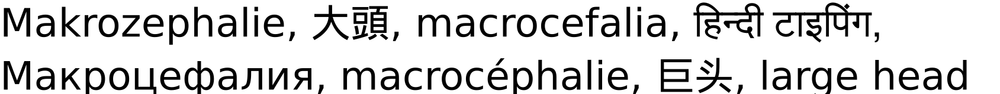{width="60%"} |


## The Human Phenotype Ontology {#hpo}

:::: {.columns}

::: {.column width="60%"}
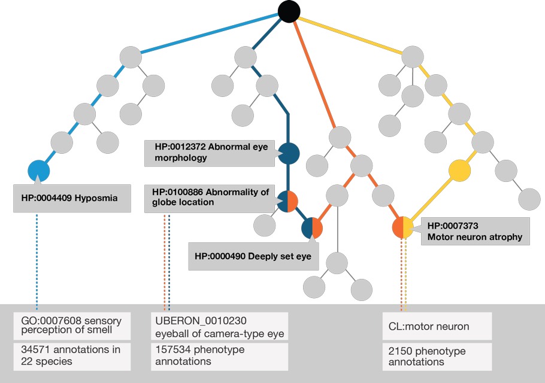{fig-align="center" width="100%" style="background-color: white; border: 1px solid #ddd;"}
:::

::: {.column width="40%"}
::: {style="font-size: 0.35em; line-height: 0.9;"}
Robinson Am J Hum Genet 2008  
Köhler Am J Hum Genet 2009  
Robinson Clin Genet. 2010  
Schulz BMC Bioinformatics. 2011  
Köhler Hum Mutat. 2012  
Bauer Bioinformatics 2012  
Köhler Nucleic Acids Res 2014  
Köhler J Med Genet 2014  
Zemojtel Sci Transl Med. 2014  
Robinson PLoS Genet. 2014  
Robinson Genome Res. 2014  
Groza Am J Hum Genet 2015  
Groza Database (Oxford). 2015  
Smedley Nat Protoc 2015  
Smedley Genome Med. 2015  
Smedley Am J Hum Genet. 2016  
Köhler Nucleic Acids Res 2017  
Vasilevsky Nat Genet 2018  
Köhler Nucleic Acids Res 2019  
Köhler Curr Protoc Hum Genet. 2019  
Carmody Orphanet J Rare Dis. 2020  
Köhler Nucleic Acids Res 2021  
Dhombres Am J Med Genet C 2022  
Gargano Nucleic Acids Res 2024
:::
:::

::::

::: {.small style="margin-top: -10px;"}
* **>19,000 terms**
* 244,440 annotations for **8,223 monogenic or chromosomal diseases**
* [http://www.human-phenotype-ontology.org](https://hpo.jax.org/app/)
:::


## Ontology Probabilities & Information Content {#ic}

:::: {.columns}

::: {.column width="40%"}
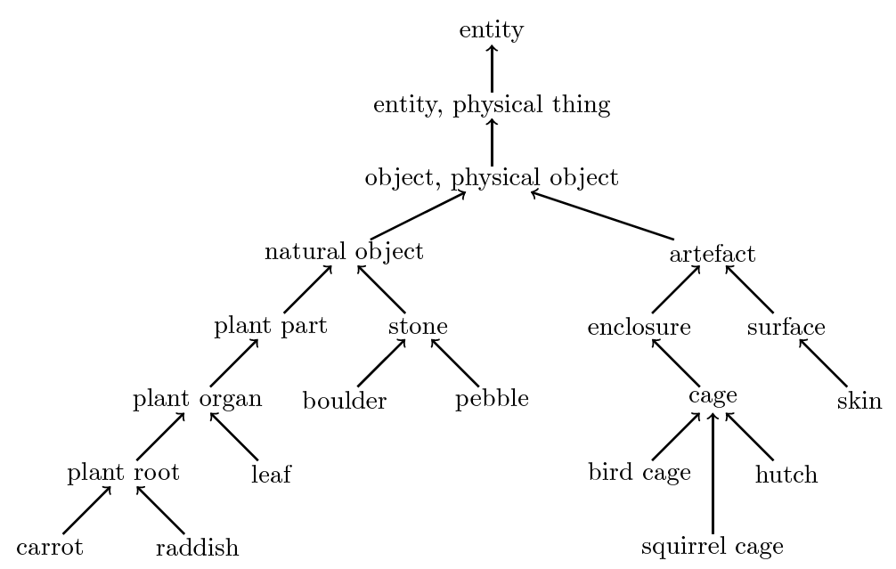{fig-align="center"}
:::

::: {.column width="60%"}
### Example: WordNet Excerpt

* **Hierarchy:** Every `pebble` is a `stone`, and every `stone` is a `natural object`.
* **The Root:** Every concept is a descendant of `entity`.

    * $p(\text{entity}) = 1$
    * $p(c)$ is the probability that a randomly chosen item is an instance of $c$ or of one of its descendants (Resnik 1995).
    * Information Content: $-\log 1 = 0$
:::

::::

::: {.callout-note appearance="simple"}
Knowing a random term is a descendant of **entity** provides no added information. Conversely, the probability of a specific term like **pebble** is much lower, meaning its **Information Content** is correspondingly higher.
:::

## Information content (IC)

* Inheritance: $x$ `instance_of` $A$ and $A$ `is_a` $B$ $\implies$ $x$ `instance_of` $B$
* **Monotonicity**: $p$ is a monotonically increasing function as we move up the hierarchy. 
    * If $c_i$ `is_a` $c_j$, then $p(c_i) \leq p(c_j)$.
* **Root Probability**: If the ontology has a unique root node $r$, then $p(r)=1$.

$$
\text{IC}(t) = -\log p(t)
$${#eq-IC-def}

| | $p$ | IC |
|---|---|---|
| general term (e.g. root) | high (1) | low (0) |
| specific term | low | high |


## The unit of IC

The base $b$ of the logarithm sets the unit:

:::: {.columns}

::: {.column width="45%"}
| base $b$ | unit |
|:---:|:---|
| 2 | *bit* |
| $e$ | *nat* |
| 10 | *hartley* |

Unless stated otherwise, $\log$ is the natural log. Numerical examples use bits.
:::

::: {.column width="55%"}
**Identities**

$$
\begin{aligned}
\log xy &= \log x + \log y \\
\log \tfrac{1}{x} &= -\log x \\
\log_b x &= \frac{\log x}{\log b}
\end{aligned}
$$
:::

::::

::: {.callout-note appearance="simple"}
Changing the base multiplies every IC by the **same constant**, so rankings never change.
Example: $p=\tfrac{1}{256}$ is 8 bits $\approx$ 5.55 nats $\approx$ 2.41 hartleys.
:::


## Entropy: average information content

A random variable $X$ takes values $x_1,\dots,x_n$ with probabilities $p_1,\dots,p_n$
($\sum p_i = 1$). Shannon's **information content** (surprisal) of an outcome:

$$
\text{IC}(x) = \log_2\frac{1}{p(x)} = -\log_2 p(x)
$$

The **entropy** is the *expected* information content:

$$
H(X) = \sum_{i=1}^n p_i \,\log_2\frac{1}{p_i} = \mathbb{E}\big[\text{IC}(X)\big]
$$

* IC measures one outcome (the uncertainty about $X$ before we observe it.)
* Entropy averages it. 
* The idea of entropy will return in the lectures on neural networks (cross-entropy).


## Entropy: two extremes

* **No uncertainty**: one outcome has $p=1$ (the others have $p=0$, with $0\log 0 := 0$)
$$
H(X) = 1\cdot\log_2 1 = 0
$$
* **Maximal uncertainty**: all outcomes equally likely, $p_i = 1/n$
$$
H(X) = \log_2 n
$$

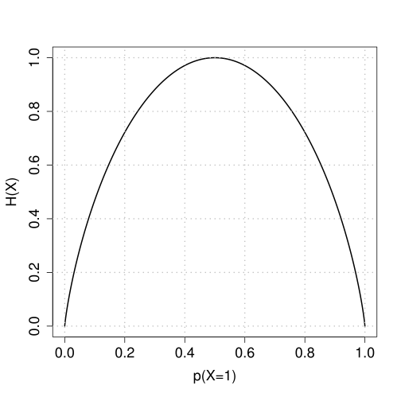{fig-align="center" width="45%"}

Coin toss: $H$ peaks at 1 bit when $p(\mathtt{1})=0.5$.


## Information Content in Gene Ontology (GO)

In the setting of GO, the probability of a term $t$ is the probability that a **randomly chosen** gene product (usually: protein) is annotated to that term.

* **The Root Term**: Assuming all genes are annotated to the root (the most general term):
    * $p(\text{root}) = 1$
    * $\text{IC}(\text{root}) = -\log_2(1) = 0$
* A gene annotated to a term is also annotated to **all of its ancestors** (true-path rule), so
  $$p(t) = \frac{\#\text{genes annotated to } t \text{ or its descendants}}{\#\text{all annotated genes}}$$
* Terms used for many genes have **low** IC. Terms used for very few genes have **high** IC.

::: {.callout-note}
This reflects "surprise": discovering a gene is annotated to the root is expected, while discovering a rare, specific annotation provides significant information.
:::


## IC: Numerical Examples

Assume we have a set of **256 annotated genes**:

| Genes Annotated to Term | Probability $p(t)$ | IC calculation ($-\log_2 p(t)$) | IC Value (bits) |
|:---|:---|:---|:---|
| 256 (All) | $256/256 = 1$ | $-\log_2(1)$ | **0** |
| 4 | $4/256$ | $-\log_2(4/256) = 8 - 2$ | **6** |
| 2 | $2/256$ | $-\log_2(2/256) = 8 - 1$ | **7** |
| 1 (Unique) | $1/256$ | $-\log_2(1/256)$ | **8** |


## Resnik similarity {#semsim}

* $\mathcal{A}(t_1,t_2)$ = the **common ancestors** of $t_1$ and $t_2$ (a term counts as its own ancestor)
* The **most informative common ancestor** (MICA) is the one with the highest IC:

$$
a^{*} = \arg\max_{a\in \mathcal{A}(t_1,t_2)} \text{IC}(a)
$$

* Resnik similarity is the IC of the MICA:

$$
\mathrm{sim}(t_1, t_2) = \text{IC}(a^{*}) = \max_{a \in \mathcal{A}(t_1, t_2)} [-\log p(a)]
$$ {#eq-mica}

::: {.callout-note appearance="simple"}
In a tree, the MICA is simply the lowest common ancestor. In a DAG (HPO allows several parents) there can be several incomparable common ancestors, and the max picks the most informative one.
:::

## Semantic similarity: An example

{fig-align="center" width="90%"}


## Semantic similarity: MICA of lion and cheetah

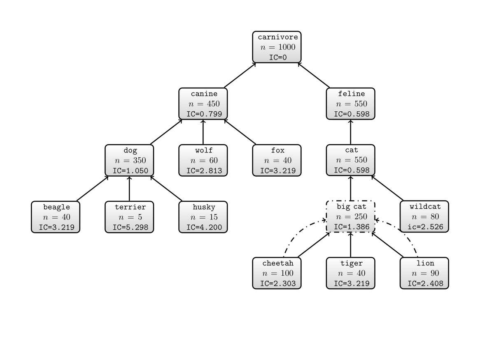{fig-align="center" width="90%"}


## Semantic similarity: MICA of beagle and wildcat

{fig-align="center" width="90%"}


## From terms to sets {#termsets}

Diseases are annotated with **sets** of terms, $I_1$ and $I_2$ (for HPO: the phenotypic features of the disease).
Resnik compares two terms. To compare two sets, find the **best match** for each term:

$$
\mathrm{sim}(I_1 \rightarrow I_2) = \frac{1}{|I_1|} \sum_{t_1 \in I_1} \max_{t_2 \in I_2} \mathrm{sim}(t_1, t_2)
$$

* For every term in $I_1$, take its most similar term in $I_2$ (Resnik similarity)
* Then average over $I_1$


## Example: two diseases {.smaller}

:::: {.columns}

::: {.column width="35%"}
```{mermaid}
%%| fig-width: 4
flowchart TD
  A["A<br/>IC = 0"] --> B["B<br/>IC = 0.2"]
  B --> C["C<br/>IC = 1.5"]
  B --> D["D<br/>IC = 1.0"]
  B --> E["E<br/>IC = 0.5"]
  D --> F["F<br/>IC = 1.2"]
  D --> G["G<br/>IC = 2.0"]
  E --> G
```

Disease $d_1$: $I_1=\{C, F\}$  
Disease $d_2$: $I_2=\{F, G\}$
:::

::: {.column width="65%"}
| $t_1 \in I_1$ | $\mathrm{sim}(t_1, F)$ | $\mathrm{sim}(t_1, G)$ | best match |
|:--|--:|--:|--:|
| $C$ | $\text{IC}(B)=0.2$ | $\text{IC}(B)=0.2$ | **0.2** |
| $F$ | $\text{IC}(F)=1.2$ | $\text{IC}(D)=1.0$ | **1.2** |

$$
\mathrm{sim}(d_1 \rightarrow d_2) = \tfrac{1}{2}\,[0.2 + 1.2] = 0.7
$$

* The other direction gives $\mathrm{sim}(d_2 \rightarrow d_1) = \tfrac{1}{2}\,[1.2 + 1.0] = 1.1$, so the measure is **asymmetric**
* A symmetric score averages both directions: $\tfrac{1}{2}(0.7 + 1.1) = 0.9$
:::

::::


## From similarity to diagnosis

A patient query $Q$ is a set of HPO terms. A disease $d$ is also a set. The same best-match idea gives:

$$
\mathrm{sim}(Q \rightarrow d) = \frac{1}{|Q|} \sum_{s \in Q} \max_{t \in d} \mathrm{sim}(s, t)
$$

| Query term | Noonan | | Opitz | |
|:--|:--|--:|:--|--:|
| Downward slanting palpebral fissures | same term | 3.78 | Abnormality of the eyelid (MICA) | 2.45 |
| Hypertelorism | same term | 3.05 | same term | 3.05 |
| **average** | | **3.42** | | **2.75** |

Rank all diseases by this score. This is the **Phenomizer**.


## Phenotypic Similarity Algorithms {#phenomizer}

::: {.callout-note appearance="simple"}
**Goal**: Calculate a similarity between a set of query terms and computational disease models.
:::

::::: {.columns}

:::: {.column width="33%"}

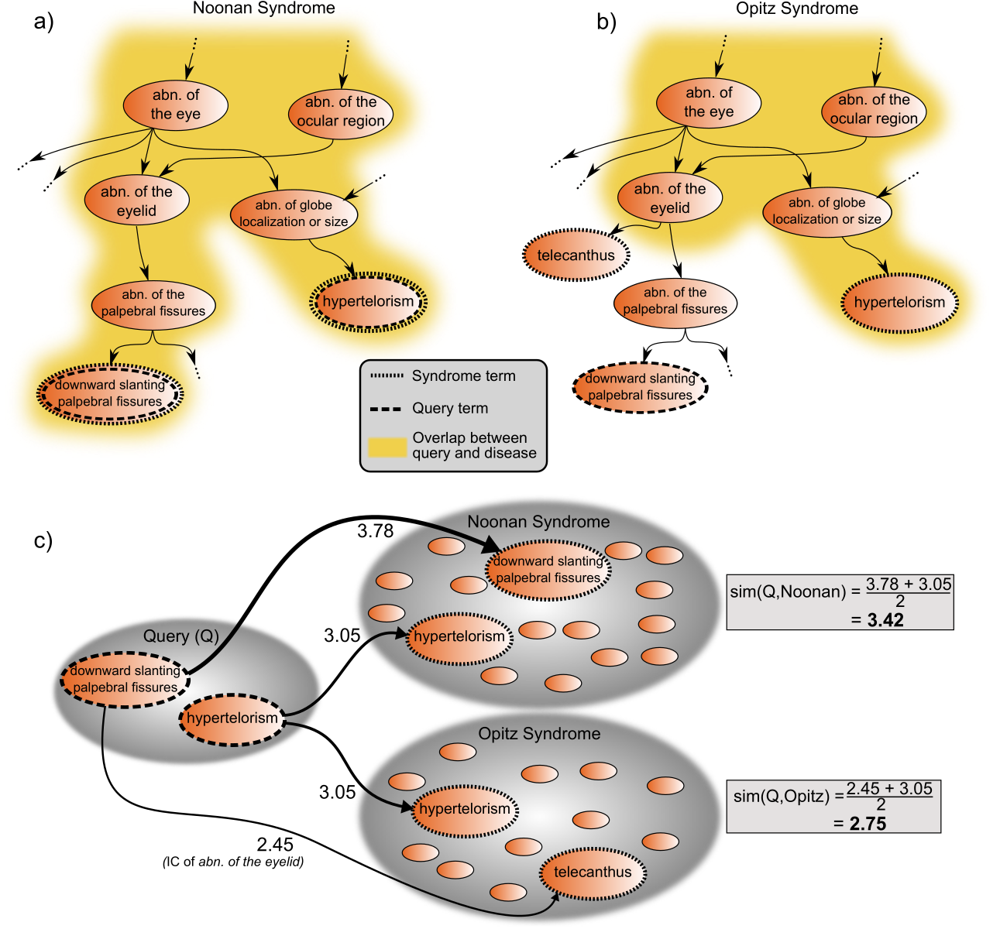{width="100%"}

::::


:::: {.column width="33%"}

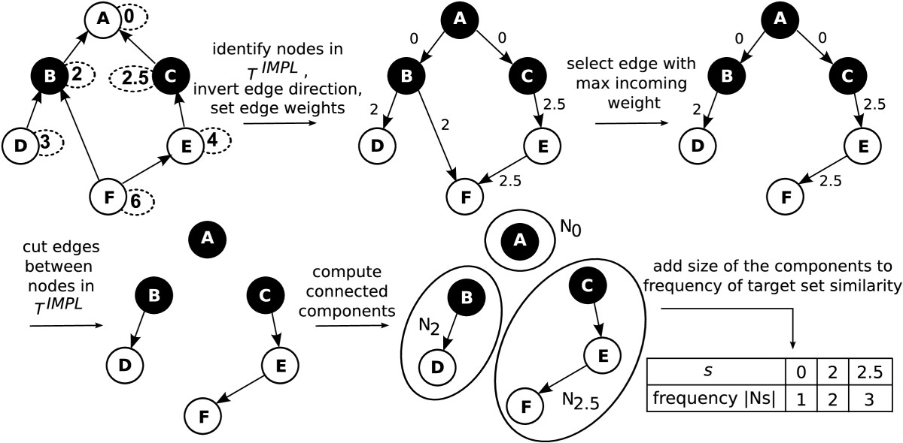{width="100%"}

::::


:::: {.column width="33%"}

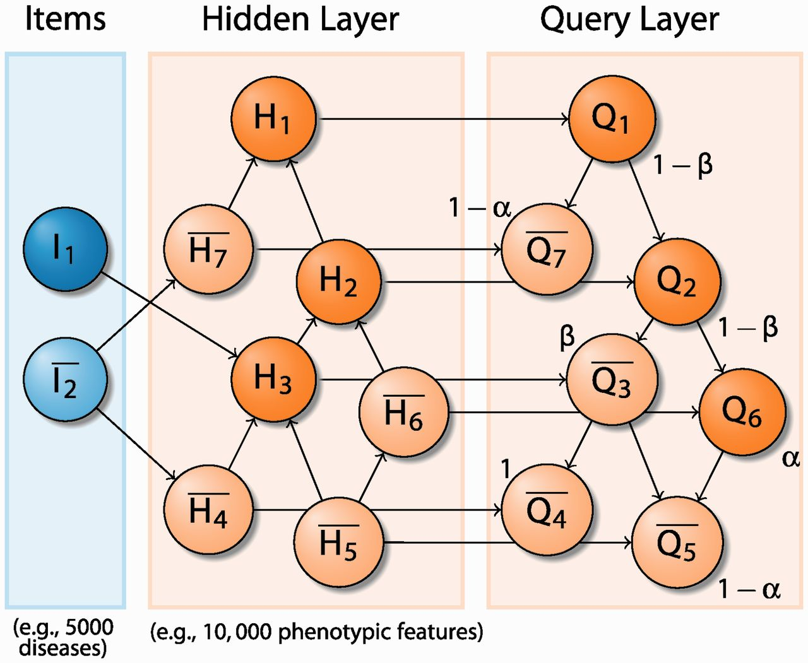{width="100%"}

::::
:::::

::::: {.columns}

:::: {.column width="33%"}

::: {style="font-size: 0.8em;"}

**Phenomizer**  
Köhler et al. (2009)  *Am J Hum Genet* **85**:457-64

:::
::::

:::: {.column width="33%"}
::: {style="font-size: 0.8em;"}

**Exact Score Distribution** 

Schulz MH et al (2011)  *BMC Bioinformatics* **12**:441

:::
::::

:::: {.column width="33%"}
::: {style="font-size: 0.8em;"}

**BOQA** 

Bauer et al. (2012) *Bioinformatics* **28**:2502-8

:::
::::

:::::

::: {.small}
* Today, we will go into detail about two phenotype matching algoriths, Phenomizer and LIRICAL.
:::


## Ontological Diagnostics

{fig-align="center" width="50%"}

$$\text{sim}(\color{orange}{Q} \rightarrow \color{blue}{d}) = \text{avg} \left[ \sum_{s \in \color{orange}{Q}} \max_{t \in \color{blue}{d}} \text{sim}(s,t) \right]$$

::: {layout-ncol=2}
::: {.card}
[$\color{orange}{Q}$: Query terms]{style="border: 1px solid #ccc; padding: 10px;"}
:::

::: {.card}
[$\color{blue}{d}$: Disease terms]{style="border: 1px solid #ccc; padding: 10px;"}
:::
:::


## The Phenomizer

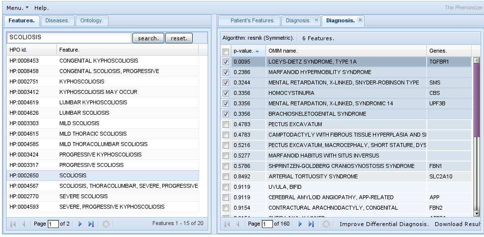{fig-align="center" width="60%"}

::: {.small-text}
* The **Phenomizer**: The first algorithm/software tool for supporting differential diagnostics with semantic similarity analysis
* Sebastian Köhler et al. (2009) Clinical Diagnostics with Semantic Similarity Searches in Ontologies. *Am J Hum Genet*, **85**:457--64.
* Online version supported 2009-2022...no longer available.
:::


## The query

::: {.mybox}
**Query terms**:
 The HPO is frequently used to create a set of terms that accurately describe the observed clinical abnormalities of an individual being evaluated for suspected rare genetic disease. 
:::

:::: {.columns}
::: {.column width="50%"}
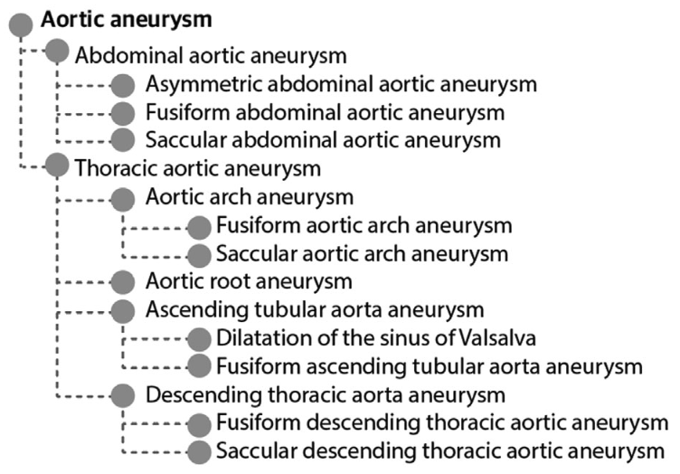{width="75%" fig-align="center"}
:::
::: {.column width="50%"}

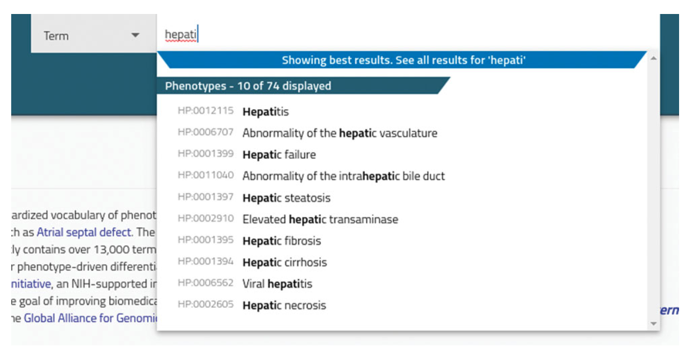{fig-align="center"}


:::
::::

- Physicians choose terms to represent the clinical anomalies seen in a patient^[The word "patient" is a role played by an individual who presents for medical treatment or diagnostics, but does not describe the individual him- or herself. In many contexts, the word "individual" is preferred.]
- Many tools are available. Some tools enable users to choose HPO terms by navigating the HPO hierarchy or by using autocomplete functions.


## The query
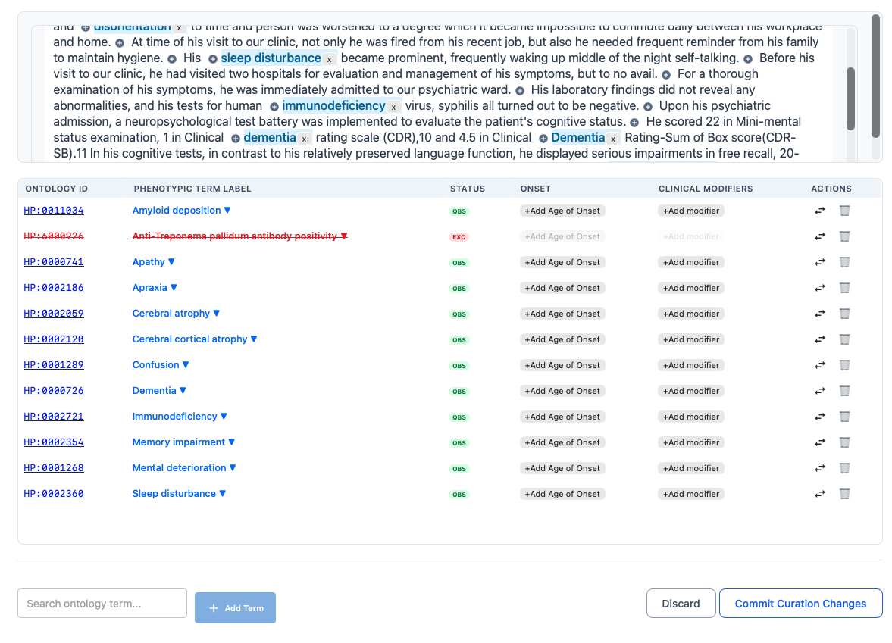{fig-align="center"}

- Various text mining (named entity recognition) tools are available

::: {.small-text}
- For more information on how to choose HPO terms to represent clinical data, see 
[Köhler S, et al., (2019) Encoding Clinical Data with the Human Phenotype Ontology for Computational Differential Diagnostics. Curr Protoc Hum Genet](https://pubmed.ncbi.nlm.nih.gov/31479590/)
- [phenoboard](https://github.com/P2GX/phenoboard)
:::

## Disease model(s)

::: {.mybox}
**Disease model**:
 The HPO is frequently used to create a set of terms that accurately describe the observed clinical abnormalities of an individualbeing evaluated for suspected rare genetic disease. 
:::

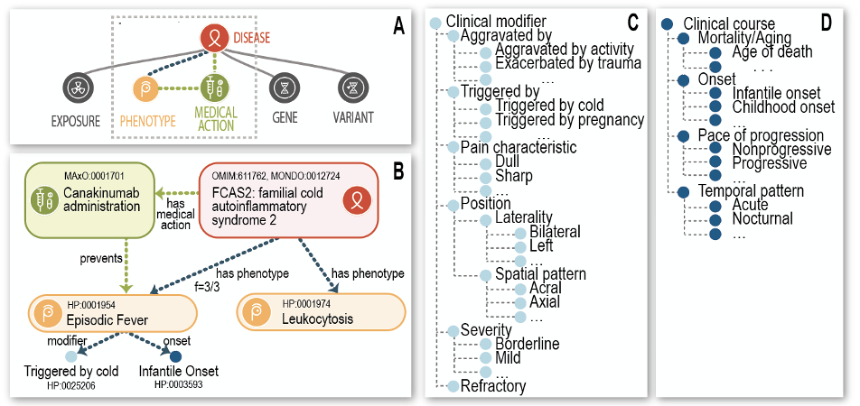{fig-align="center"}

- The HPO project has $>8000$ disease models 
- Algorithms such as Phenomizer compare the query with each model to determine a ranked list of models that best match the query
- Algorithms differ in how they calculate the strength of the **match**


## Fuzzy, specificity weighted matching


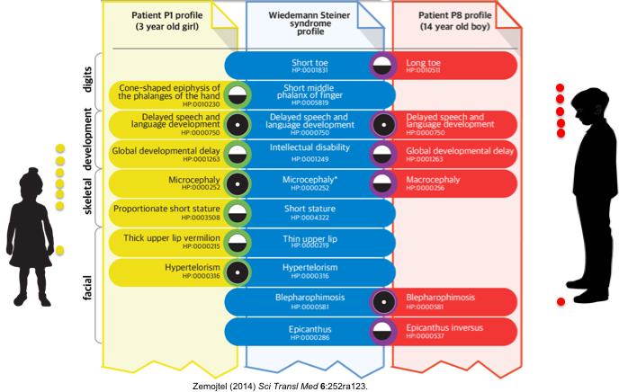{fig-align="center"}

## Example

**query**:

- Pulmonic stenosis [HP:0001642](https://hpo.jax.org/browse/term/HP:0001642)
- Upslanted palpebral fissure [HP:0000582](https://hpo.jax.org/browse/term/HP:0000582)
- Proportionate short stature [HP:0003508](https://hpo.jax.org/browse/term/HP:0003508)
- Headache [HP:0002315](https://hpo.jax.org/browse/term/HP:0002315)

For demo purposes, let's create two simplified disease models

:::: {.columns}
::: {.column width=50%}
**Noonan syndrome type 1 (NS1)**

- Pulmonic stenosis [HP:0001642](https://hpo.jax.org/browse/term/HP:0001642)
- Short stature [HP:0004322](https://hpo.jax.org/browse/term/HP:0004322)
- Downslanted palpebral fissures [HP:0000494](https://hpo.jax.org/browse/term/HP:0000494)
:::
::: {.column width=50%}
**Neurodevelopmental disorder 1 (NDD1)**

- Short stature [HP:0004322](https://hpo.jax.org/browse/term/HP:0004322)
- Primary microcephaly [HP:0011451](https://hpo.jax.org/browse/term/HP:0011451)
- Gray matter heterotopia [HP:0002282](https://hpo.jax.org/browse/term/HP:0002282)
:::
::::

## Example


| Query term                   | Noonan syndrome 1              | NS1 score | Neurodevelopmental disorder 1     | NDD1 score |
|:------------------------------|:--------------------------------|----------:|:-----------------------------------|-----------:|
| Pulmonic stenosis              | Pulmonic stenosis               |      4.19 | Phenotypic abnormality             |       0.00* |
| Upslanted palpebral fissure     | Downslanted palpebral fissure    |     2.59* | Phenotypic abnormality             |       0.00* |
| Proportionate short stature     | Short stature                   |      1.91* | Short stature                      |       1.91* |
| Headache                       | Phenotypic abnormality          |      0.00* | Abnormality of the nervous system |       0.51* |
| **Sum**                        |                                  |  **8.69** |                                    |   **2.42** |

:::{.small-text }
* Information content of *Upslanted palpebral fissure* is 3.46, that of *Downslanted palpebral fissure* is 3.01. To calculate the most informative common ancestor, we go to their common parent *Slanting of the palpebral fissure* 
[HP:0200006](https://hpo.jax.org/browse/term/HP:0200006), which has an IC of 2.59
* *Short stature* is the direct parent of *Proportionate short stature*, and so the MICA is the IC of *Short stature*
* Noonan syndrome 1 receives a higher score than Neurodevelopmental disorder 1, and so NS1 would be ranked before NDD1
* The same process is performed for all 8500 candidate diseases to generate the final ranking (**prioritization**)
:::

## Example

The table in the previous slide demonstrates how to calculate the phenomizer score
$$
\mathrm{sim}(Q\rightarrow D) = \mathrm{avg} \sum_{s\in Q}\max_{t\in D}\mathrm{sim}(s,t)
$$
- $\mathrm{sim}(s,t)$ is calculated as the IC of the most informative common ancestor (MICA), see @eq-mica.


::: {.mybox}
**From raw score to *p*-value**:

Raw similarity scores aren't directly comparable across diseases:

- A disease with **many annotated terms** has more chances for a lucky match
- A **small, specific** query profile behaves differently than a large, vague one
:::

- To make the Phgenomizer score comparable across 8500 diseases, we want to know:
    *How much does a score actually support a disease, given the query's and the disease's HPO term count and specificity?*

## Empirical *p*-value via simulation

For each candidate disease $D$:

1. Generate $N$ **random query profiles** of the same size as the observed query (terms sampled from the HPO term/annotation universe)
2. Compute the fuzzy similarity score between each random query and $D$, exactly as for the real query
3. This builds a **null distribution** of scores specific to $D$'s phenotype profile and the query size
4. Empirical *p*-value:

$$
p = \frac{\#\{\text{random scores} \geq \text{observed score}\}}{N}
$$

- Diseases are then ranked by $p$-value rather than raw score, making rankings comparable across diseases with very different profile sizes
- This was the basis of the original Phenomizer algorithm


## Empirical *p*-value via simulation

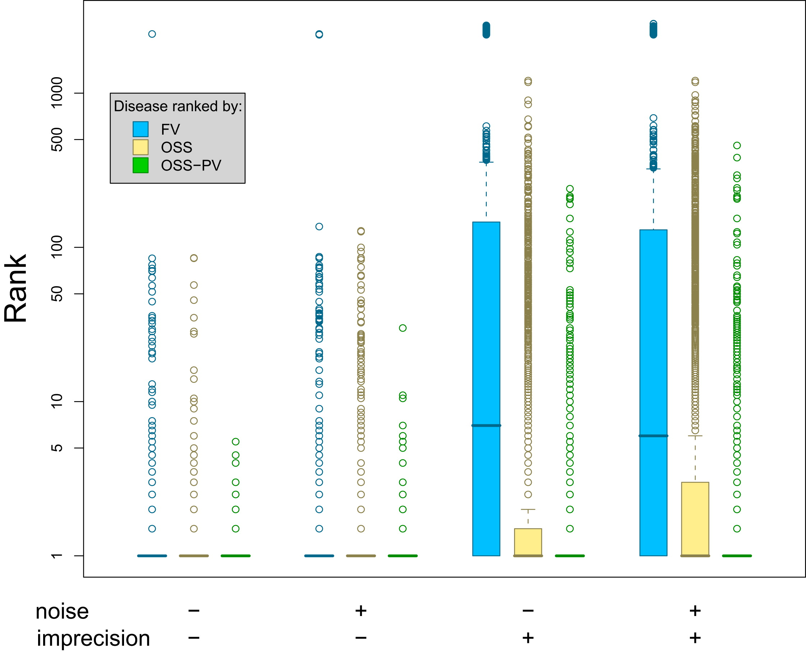

- Feature vector (FV) method, ontological similarity search (OSS), and p value (OSS-PV)

::: {.small-text}
Köhler S, et al. (2009) [Clinical diagnostics in human genetics with semantic similarity searches in ontologies. 
*Am J Hum Genet* **85**:457-64](https://pubmed.ncbi.nlm.nih.gov/19800049/)
:::

## LIRICAL{#lirical}

- LIRICAL is a newer phenotypic-driven prioritization algorithm that leverages the likelihood ratio test

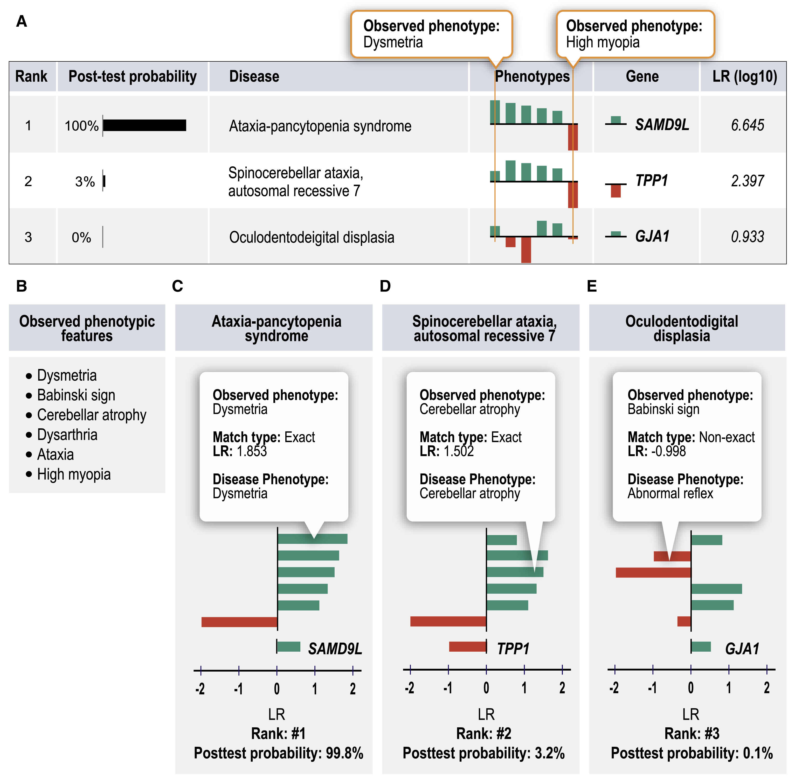{ width="50%" fig-align="center"}

- We will first explain the basic concepts of the likelihood ratio test (LRT) and then present LIRICAL in more detail.


## Likelihood Ratio Test: Intuition

Recall Bayes' law:
$$
P(A\mid B) = \frac{P(B\mid A)\cdot P(A)}{P(B)}
$$ {#eq-bayes}

- Suppose that Suppose that A is the presence (D+) or absence (D–) of a disease 
- Suppose B represents the result of a diagnostic test (x) fulfils, say the test result being abnormal. 
- Then

$$
P(D^{+}\mid x=\mathrm{abn}) = \frac{P(x=\mathrm{abn}\mid D^{+})\cdot P(D^{+})}{P(x=\mathrm{abn})}
$$ {#eq-bayes-present}

## Likelihood ratio: derivation {.smaller}

:::: {.columns}

::: {.column width="48%"}
For the **presence** and **absence** of disease given an abnormal test result:

$$
P(D^{+}\mid x) = \frac{P(x\mid D^{+})\,P(D^{+})}{P(x)}
$$

$$
\begin{align}
P(D^{-}\mid x) &= 1 - P(D^{+}\mid x) \\
&= \frac{P(x\mid D^{-})\,P(D^{-})}{P(x)}
\end{align}
$$ {#eq-bayes-absent}

Here $x$ stands for $x=\mathrm{abn}$.
:::

::: {.column width="52%"}
**Divide** the first by the second. $P(x)$ cancels, and $P(D^{-}) = 1 - P(D^{+})$:

$$
\underbrace{\frac{P(D^{+}\mid x)}{1-P(D^{+}\mid x)}}_{\text{post-test odds}} =
\underbrace{\frac{P(x\mid D^{+})}{P(x\mid D^{-})}}_{\text{likelihood ratio}}
\times
\underbrace{\frac{P(D^{+})}{1 - P(D^{+})}}_{\text{pre-test odds}}
$$
:::

::::

## Likelihood ratio: interpretation

::: {.mybox}
$$
\text{post-test odds} = \text{LR} \times \text{pre-test odds}
$$
:::

* This is the equation used in the Bayesian approach to interpreting test results
* The factor $\text{LR} = \dfrac{P(x\mid D^{+})}{P(x\mid D^{-})}$ is the **likelihood ratio**. For a test result $r$ we write $\text{LR}(r)$
* **How many times more (or less) likely** a test result is in people **with** the disease than in people **without** it
    * $\text{LR} > 1$: the result supports the disease
    * $\text{LR} < 1$: the result argues against it
    * $\text{LR} = 1$: the result is uninformative

::: {.tiny-credit}
Habibzadeh F, Habibzadeh P (2019) [The likelihood ratio and its graphical representation. *Biochem Med (Zagreb)*](https://pubmed.ncbi.nlm.nih.gov/31015780/)
:::

## Review: odds vs. probabilities {.smaller}

Odds and probability both describe uncertainty:

:::: {.columns}

::: {.column width="50%"}
$$
\text{odds} = \frac{P(\text{event})}{P(\text{not event})} = \frac{p}{1-p}
$$ {#eq-odds}

@eq-odds implies

$$
p = \frac{\text{odds}}{1+\text{odds}}
$$

* **Probability** ranges from 0 to 1
* **Odds** range from 0 to $\infty$
:::

::: {.column width="50%"}
| Probability | Odds | Reads as |
|------------:|-----:|:---------|
| 50 % | 1.00 | 1 : 1 |
| 90 % | 9.00 | 9 : 1 |
| 2 % | 0.0204 | $\approx$ 1 : 49 |

For $p = 2\%$: odds $= \dfrac{0.02}{1-0.02} \approx 0.0204$

::: {.callout-note appearance="simple"}
For small $p$, probability and odds are nearly equal. They diverge as $p \to 1$.
:::
:::

::::

## LIRICAL: motivation

::: {.columns}
::: {.column width="50%"}
::: {.tiny}
- Current WES/WGS detection rate: $\sim 40-50\%$
- But prevailing algorithms don't help us realize that there are no good candidates. #1 may still be poor.
:::
:::
::: {.column width="50%"}
::: {.tiny}
- Some phenotypic features may support a diagnosis while others do not
- Prevailing algorithms don't help users interpret the relative contribution of individual HPO terms to the computational ranking
:::
:::
:::

::: {.columns}
::: {.column width="50%"}
{width="90%" fig-align="center"}
:::
::: {.column width="50%"}
{width="90%" fig-align="center"}
:::
:::

## LIRICAL: Calculating the likelihood ratio

$$
\rm{LR}=\dfrac{P(x|\mathcal{D})}{P(x|\neg \mathcal{D})}
$$ {#eq-LR-def}

The definition of the LR can be extended to multiple tests. Suppose $X=(x_1,x_2,\cdots,x_n)$ is an array of $n$ test results. Under the assumption that the tests are independent, $\rm{LR}(X)$ is defined as:

$$
\frac{{\rm{{Pr}}}(X|\mathcal{D})}{{\rm{Pr}}(X|\neg \mathcal{D})} = \frac{{\rm{Pr}}(x_1,x_2,\cdots,x_n|\mathcal{D})}{{\rm{{Pr}}}(x_1,x_2,\cdots,x_n|\neg \mathcal{D})}
 = \prod_{i=1}^{n} \dfrac{{\rm{{Pr}}}(x_i|\mathcal{D})}{{\rm{Pr}}(x_i|\neg \mathcal{D})}
$$ {#eq-lrprod}

- With this equation, one can calculate a likelihood ratio for a set of query HPO terms
- But how exactly do we calculate $\dfrac{P(x|\mathcal{D})}{P(x|\neg \mathcal{D})}$?

## $\dfrac{P(h_i|\mathcal{D})}{P(h_i|\neg \mathcal{D})}$

- Calculating $P(h_i|\mathcal{D})$, the probability of an individual with disease $D$ to have HPO term $h_i$, is easy
- If the HPO annotations for $D$ include the HPO term $h_i$, then $P(h_i|\mathcal{D})$ is equal to the frequency of that term in the HPO annotations for the disease

```bash 
OMIM:614669	Auriculocondylar syndrome 2		HP:0000347	PMID:16114046	PCS		22/31		PHPO:skoehler[2012-10-17]
```
- The above line is one of 285603 lines in the `phenotype.hpoa` file 
- It specifies the frequency of Micrognathia [HP:0000347](https://hpo.jax.org/browse/term/HP:0000347) in individuals with *Auriculocondylar syndrome 2*
- It is less obvious how to specify $P(h_i|\neg \mathcal{D})$ - the frquency of $h_i$ in individuals without disease $D$.
- In principle, we could collect data on the general population, omitting individuals with $D$, and estimate the population prevalence of $h_i$
- This is both impossible and also not a good model of the diagnostic situation in medical genetics (individuals who present for diagnosis are not an unbiased selection from the general population)

## $P(h_i|\neg \mathcal{D})$

- LIRICAL therefore makes the assumption that every individual in the population has some Mendelian disease. 
- Then we can estimate $P(h_i|\neg \mathcal{D})$ as follows (with a total of $N$ Mendelian diseases)
$$
P(h_i\mid \neg D_j) = \frac{1}{N-1}\sum_{k\neq j} P(h_i\mid D_k) \approx \frac{1}{N}\sum_{k} f_{i}^{D_k}
$$

- Here, $f_{i}^{D_k}$ is the frequency of HPO term $i$ in individuals with disease $k$
- This is the key assumption ("trick") that allows us to apply the likelihood ratio framework to HPO-based differential diagnostic support
- There are many details about how to calculate $f_{i}^{D_k}$ in different situations and how to true-path rule is applied
- The next slide gives an impression of the algorithms.^[These details will not be covered in the exams]
- LIRICAL also introduces an approach to estimate likelihood ratios for genotypes that we will not cover here.

## LIRICAL: Calculating the likelihood ratio $P(h\mid\mathcal{D})$ 

:::: {.columns}
::: {.column width="55%"}
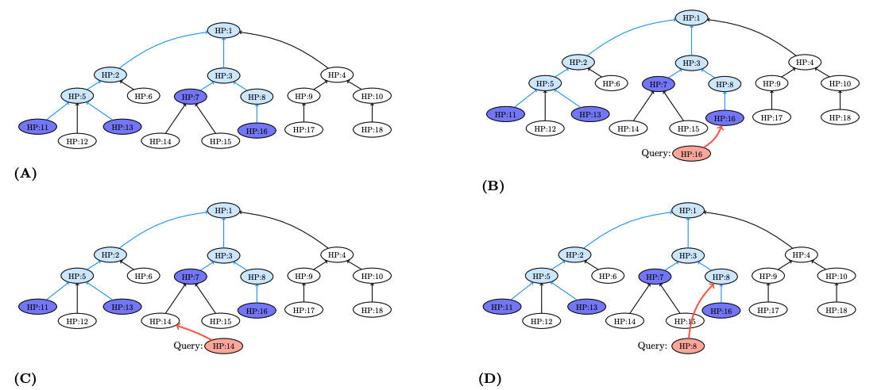{fig-align="center" width="100%"}
:::
::: {.column width="45%"}
Disease model: four annotated terms (dark blue). Ancestors inherit the annotations (light blue).

| Panel | Query | Match | $P(h\mid\mathcal{D})$ |
|:-:|:-:|:--|:--|
| B | HP:16 | exact | $f_{16}$ |
| C | HP:14 | child of HP:7 | $f_{7}/2$ |
| D | HP:8 | parent of HP:16 | $f_{16}$ |

For C: HP:7 has two children, so each gets half of $f_7$.
:::
::::


## LIRICAL: Posterior probabilities improve interpretation of rankings

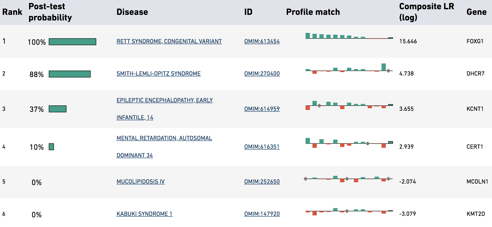{width="100%" fig-align="center"}

- LIRICAL provides estimates of posttest probabilities

## LIRICAL: Performance on 384 published case reports

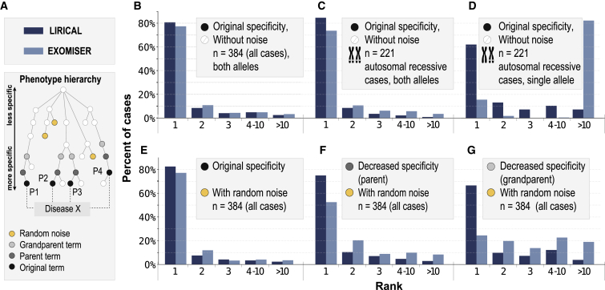{width="100%" fig-align="center"}

## LIRICAL: Detailed disease output page

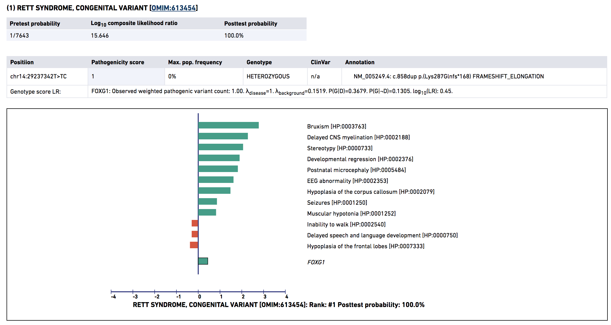{width="90%" fig-align="center"}


::: {.tiny-credit}
Robinson PN et al., Interpretable Clinical Genomics with a Likelihood Ratio Paradigm  
*Am J Hum Genet* 2020;**107**:403-417  
:::


## Beyond the exome: non-coding Mendelian mutations {#genomiser}

:::: {.columns}

::: {.column width="50%"}
* Protein-coding sequence is only about **1.5 %** of the genome
* A typical genome has over **4 million** variants
* Exome sequencing misses mutations in regulatory regions
* **Goal:** find the causal variant in the *whole* genome, using the phenotype

We curated **453 Mendelian non-coding mutations** and annotated **26 genomic attributes** across the whole genome.
:::

::: {.column width="50%"}
| Category | Count |
|:--|--:|
| 5′ UTR | 153 |
| Promoter | 142 |
| RNA gene | 65 |
| 3′ UTR | 43 |
| Enhancer | 42 |
| MicroRNA gene | 5 |
| Imprinting control region | 3 |
| **Total** | **453** |
:::

::::

## ReMM: predicting regulatory Mendelian mutations

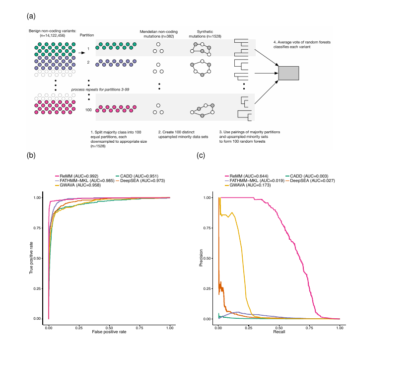{fig-align="center" width="62%"}

* A random-forest score trained on a **very imbalanced** problem: 382 disease mutations against about 14 million benign variants
* ROC curves look excellent for every method (AUC 0.95–0.99), but **precision–recall** shows the real difference: ReMM 0.64 versus at most 0.17 for the others^[Smedley D et al. (2016) *Am J Hum Genet* **99**:595–606. PMID 27569544]

## ReMM: Extreme class imbalance and SMOTE {.smaller}

:::: {.columns}

::: {.column width="46%"}
* **Problem:** 14,122,456 putatively benign sites versus **406** non-coding Mendelian mutations (≈ 1 : 35,000). A classifier can be "99.99% accurate" by always saying benign
* **SMOTE** (synthetic minority over-sampling technique): create new positives by **interpolating** between a positive and one of its $k = 5$ nearest positive neighbours in the space of the 26 genomic attributes

```{=html}
<svg viewBox="0 0 300 170" width="75%" style="display:block;margin:0 auto;border:1px solid #ccc;background:#fff">
  <circle cx="25"  cy="22" r="5" fill="#bbb"/>
  <circle cx="235" cy="30" r="5" fill="#bbb"/>
  <circle cx="160" cy="140" r="5" fill="#bbb"/>
  <line x1="50" y1="125" x2="205" y2="55" stroke="#999" stroke-width="1.5" stroke-dasharray="5,4"/>
  <circle cx="50"  cy="125" r="7" fill="#1a3c6e"/>
  <circle cx="205" cy="55"  r="7" fill="#1a3c6e"/>
  <circle cx="112" cy="97"  r="7" fill="#fff" stroke="#c0392b" stroke-width="2.5"/>
  <text x="36"  y="148" font-size="14" font-style="italic">x</text>
  <text x="196" y="42"  font-size="14" font-style="italic">x<tspan font-size="10" dy="3">nn</tspan></text>
  <text x="92"  y="82"  font-size="14" font-style="italic" fill="#c0392b">x<tspan font-size="10" dy="3">new</tspan></text>
</svg>
```

$$x_{\text{new}} = x + u\,(x_{\text{nn}} - x), \qquad u \sim \mathrm{Uniform}(0,1)$$
:::

::: {.column width="4%"}
:::

::: {.column width="50%"}
**How we used it in ReMM** (per partition, repeated 100 times):

1. Split the benign sites randomly into **100 partitions**
2. Add **all 406 positives** to every partition
3. SMOTE ($k = 5$): add **812 synthetic** positives (2× the positive class), giving **1,218** positives
4. Under-sample the benign sites to **3,654** (3× the enlarged positive class)
5. Train a **random forest** (10 trees)

Final **ReMM score** = average probability of the 100 forests ("hyper-ensemble"), between 0 and 1
:::

::::

::: {.tiny-credit}
Chawla NV et al. (2002) *J Artif Intell Res* **16**:321–357. Smedley D et al. (2016) *Am J Hum Genet* **99**:595–606 (PMID 27569544)
:::


## Genomiser: combining phenotype and variant evidence

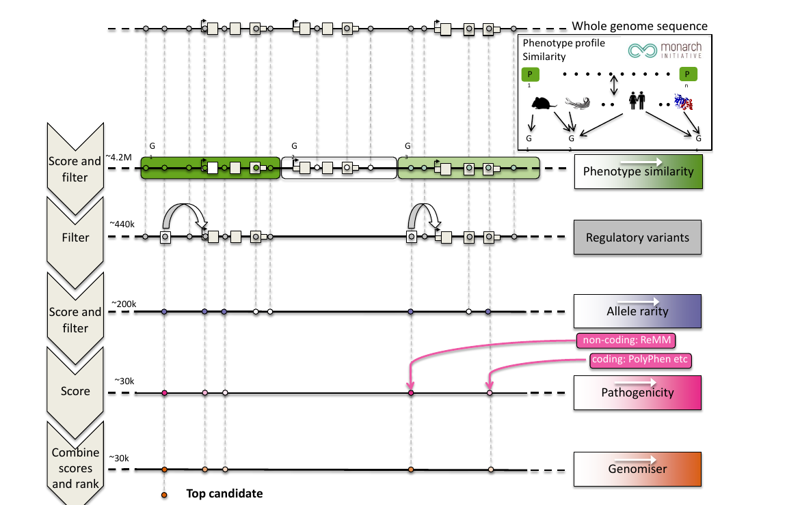{fig-align="center" width="80%"}

* Genes are scored by **phenotype similarity** (patient's HPO terms vs. human, mouse and zebrafish phenotypes)
* Variants are filtered by regulatory region and allele rarity, then scored for pathogenicity (non-coding: **ReMM**, coding: PolyPhen etc.)
* Phenotype and variant scores are **combined** into one rank: about 4.2 million variants down to a top candidate

## Genomiser: an example {.smaller}

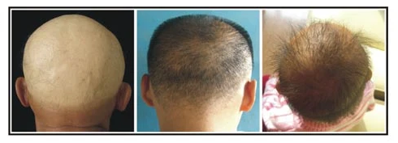{fig-align="center" width="50%"}

:::: {.columns}

::: {.column width="52%"}
We spiked `chr8:21988220 A>T` (`c.-320T>A` in the human hairless homolog, *HR*) into the genome of a healthy 1000 Genomes individual (NA20538).

Genomiser received only a limited, noisy set of HPO terms for **Marie Unna hereditary hypotrichosis**.
:::

::: {.column width="48%"}
| Evidence | Score |
|:--|--:|
| ReMM score of the variant | 0.990 |
| Phenotype score of *HR* | 0.998 |
| **Rank** | **1 of > 4 million variants** |
:::

::::

::: {.tiny-credit}
* [Wen Y, et al. (2009) Loss-of-function mutations of an inhibitory upstream ORF in the human hairless transcript cause Marie Unna hereditary hypotrichosis. _Nat Genet_ **41**:228-33](https://pubmed.ncbi.nlm.nih.gov/19122663/)
:::

## Genomiser: combining phenotype and variant evidence

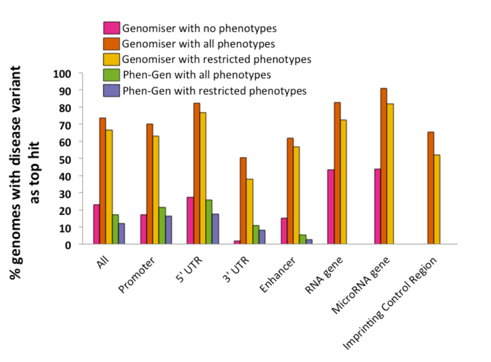{fig-align="center" width="52%"}

* With phenotypes, Genomiser ranks the causal variant **first in about 75 %** of simulated genomes. Without them, in about 23 %^[In the published paper, 77 % of simulated genomes. Smedley D et al. (2016) PMID 27569544]


## Sources

- [Albert A (1982) On the use and computation of likelihood ratios in clinical chemistry. *Clin Chem*  **28**:1113-9](https://pubmed.ncbi.nlm.nih.gov/7074890/): Excellent introduction to the mathematics of LRs
- [Khinchin - Mathematical Foundations of Information Theory-Dover Publications (1957)](https://www.amazon.de/Mathematical-Foundations-Information-Advanced-Mathematics/dp/0486604349) Another excellent introduction to the mathemastics of LRs
- [Robinson PN et al. (2020) Interpretable Clinical Genomics with a Likelihood Ratio Paradigm. *Am J Hum Genet* **107**:403-417](https://pubmed.ncbi.nlm.nih.gov/32755546/)
- [Köhler S, et al. (2009) Clinical diagnostics in human genetics with semantic similarity searches in ontologies. *Am J Hum Genet* **85**:457-64](https://pubmed.ncbi.nlm.nih.gov/19800049/)
- [Smedley D, et al. (2016) A Whole-Genome Analysis Framework for Effective Identification of Pathogenic Regulatory Variants in Mendelian Disease. _Am J Hum Genet_ **99**:595-606](https://pubmed.ncbi.nlm.nih.gov/27569544/)
