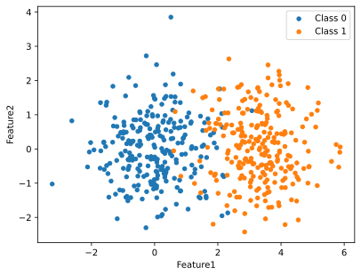
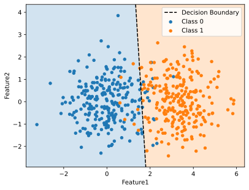
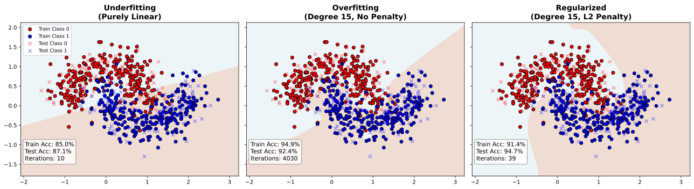
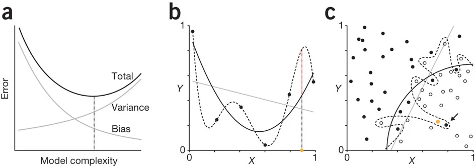

## Overview: Logistic regression 

::: {.callout-note title="Game plan"}
Logistic regression shares some characteristics with neural networks including 
the weighted sum and activation function (for single neurons) and gradient-descent 
training loop. Studying logistic regression therefore serves as 
a [good preparation for understanding neural networks]{style="color: green; font-weight: bold;"}. 
:::

* [Logistic regression: Introduction](#intro)
* [Sigmoid function](#sigmoid)
* [Gradient descent](#graddesc)
* [Python](#python)
* [Overfitting](#overfit)
* [Regularization](#regularization)


## Logistic Regression {#intro}

Logistic Regression (LogReg) is one of the most common machine learning algorithms. It can be used to predict the probability of an event occurring based on a given labeled data set.

- Email analysis (Is an email spam or not?)
- Sentiment analysis (is a movie review positive or negative?)
- Medical diagnostics (is a given diagnosis present or absent?)

::: {.callout-note appearance="simple"}
We will go over the algorithm in detail, because it is an excellent preparation for understanding neural networks.
:::

```{python}
#| echo: false
#| fig-align: center
import sys
import matplotlib.pyplot as plt
sys.path.append('utils')
from logreg import plot_logreg_neuron
plot_logreg_neuron()
plt.show()
```


## Logistic regression: review

::: {.mybox}
The basics are explained very well by Wikipedia
:::

* A group of 20 students spends between 0 and 6 hours studying for an exam. How does the number of hours spent studying affect the probability of the student passing the exam?

::: {.small-text}
| **Hours: $x_i$** | 0.50 | 0.75 | 1.00 | 1.25 | 1.50 | 1.75 | 1.75 | 2.00 | 2.25 | 2.50 | 2.75 | 3.00 | 3.25 | 3.50 | 4.00 | 4.25 | 4.50 | 4.75 | 5.00 | 5.50 |
|:---|:---:|:---:|:---:|:---:|:---:|:---:|:---:|:---:|:---:|:---:|:---:|:---:|:---:|:---:|:---:|:---:|:---:|:---:|:---:|:---:|
| **Pass: $y_i$** | 0 | 0 | 0 | 0 | 0 | 0 | 1 | 0 | 1 | 0 | 1 | 0 | 1 | 0 | 1 | 1 | 1 | 1 | 1 | 1 |

: Exam pass/fail outcome by hours studied. {#tbl-exam-pass}
:::

* Goal: Model the probability of passing given the hours studied


:::{.tiny-credit}
[Wikipedia entry for logistic regression](https://en.wikipedia.org/wiki/Logistic_regression)
:::


## The logistic function

- The logistic function has the form
$$
p(x) = \frac{1}{1+e^{-\tfrac{x-\mu}{s}}}
$$ {#eq-logistic-fxn}

- $\mu$ is the location parameter (the curve's midpoint, $p(\mu)=\tfrac{1}{2}$) and $s$ is the scale parameter.
- Rewriting with $\beta_0 = -\tfrac{\mu}{s}$ and $\beta_1=\tfrac{1}{s}$ gives
$$
p(x) = \frac{1}{1+e^{-(\beta_0 + \beta_1x)}}
$$ {#eq-logistic-fxn2}

## Fitting the exam data

:::: {.columns}
::: {.column width="40%"}
- $p(x_k)$ is the probability of passing given $x_k$ hours studied
- Fitted: $\beta_0 \approx -4.08$, $\beta_1 \approx 1.505$
- 50% pass probability at $x=-\beta_0/\beta_1\approx 2.7$ hours
:::
::: {.column width="60%"}
```{python}
#| echo: false
#| fig-align: center
import sys
import matplotlib.pyplot as plt

sys.path.append('utils')
from logreg import logreg_example
logreg_example(figsize=(5,3.5))
plt.show()
```
:::
::::

## Log odds

- Our model: $p(x) = \dfrac{1}{1+e^{-(\beta_0 + \beta_1x)}}$ is the probability of passing after $x$ hours of study
- The **odds** of passing are $\dfrac{p}{1-p}$; the **log odds** are their natural logarithm.
- Let $z=\beta_0+\beta_1x$. Then $p=\dfrac{1}{1+e^{-z}}$ and $1-p=\dfrac{e^{-z}}{1+e^{-z}}$, so

$$
\frac{p}{1-p} = \frac{1}{e^{-z}} = e^{z}
\qquad\Longrightarrow\qquad
\ln\left(\frac{p}{1-p}\right) = z = \beta_0 + \beta_1x
$$

- The log odds are **linear** in $x$: $\beta_1$ is the change in log odds per additional hour studied ($\beta_1 = 1.505$ in our example)

## Odds ratio

- $e^{\beta_1} = e^{1.505}\approx 4.5$ is the **odds ratio**
- Each additional hour **multiplies the odds** of passing by 4.5
- Example: at $x\approx 2.7$ h, $p=0.5$ (odds 1:1). One hour later the odds are 4.5:1, i.e., $p = 4.5/5.5\approx 0.82$.

::: {.callout-warning appearance="simple"}
The *odds* are multiplied by 4.5, not the probability. The change in probability depends on where you start.
:::

## More than one predictor

- With $n$ predictors, the model becomes

$$
p(\mathbf{x}) = \frac{1}{1+e^{-(\beta_0 + \beta_1x_1 + \beta_2x_2+\cdots+\beta_nx_n)}}
$$ {#eq-logistic-fxn3}

- Machine-learning notation: the bias is $b=\beta_0$, and the weight vector is $\mathbf{w}=(\beta_1,\ldots,\beta_n)$, so the exponent is $-(\mathbf{w}\cdot\mathbf{x}+b)$
- Each $\beta_j$ is the change in log odds per unit of $x_j$, *holding the other predictors fixed*


## The five components of Logistic Regression

::: {.callout-note appearance="simple"}
### 1. Feature Representation
For each input $x$, we have a vector: $\mathbf{x} = [x_1, x_2, \ldots, x_n]$
:::

::: {.callout-tip appearance="simple"}
### 2. Classification Function
A weighted sum $z=\mathbf{w}\cdot\mathbf{x}+b$ passed through the **sigmoid** $\sigma(z) = \frac{1}{1 + e^{-z}}$ gives the probability $\hat{y}$ of the positive class
:::

::: {.callout-important appearance="simple"}
### 3. Objective Function
The **cross-entropy loss** measures how well the model is performing
:::

::: {.callout-warning appearance="simple"}
### 4. Optimization
**Gradient Descent** is used to minimize the loss and find the best weights.
:::

::: {.callout-caution appearance="simple"}
### 5. Prediction
The **learned model** can be used to classify new data points.
:::

## LogReg: Features

For each input $x$, we create a vector of features: $\mathbf{x} = [x_1, x_2, \ldots, x_n]$.

**There are many different ways of generating a feature vector:**


- Raw numerical data: If the input data is numerical with $n$ dimensions, each of the dimensions can act as a feature
- Polynomial & interaction features: We can add interaction terms ($x_ix_j$) or polynomial features (e.g., $x_i^7$) if this makes sense for the classification task
- Images: Flatten pixel values (e.g., an $8\times 8$ image would have 64 features)
- Text to vector: e.g.,  count word occurrences across a vocabulary
- Domain-specific feature engineering

::: {.callout-note appearance="simple" title="Example"}
In the Python exercise for this lecture, we will 
generate two dimensional points with overlapping Gaussian distributions, but in general, the 
features can also be created (e.g., by counting positive and negative words for sentiment analysis).
:::


## Weights and bias

::: {.callout-note appearance="simple" title="Weights"}
LogReg learns a vector of weights and a bias term to solve the classification task
:::

- [Linear combination of input features]{style="color: green; font-weight: bold;"}: each feature value is multiplied by its weight, and the bias is added
- $x_{i,j}$ is the $j^{th}$ feature of the $i^{th}$ data point

$$
z_i = \sum_{j=1}^n w_jx_{i,j} + b = \mathbf{w}\cdot \mathbf{x}_i + b
$$ {#eq-lrweights}

- $w_j$: how strongly feature $j$ pushes toward the positive class (its sign gives the direction)
- $b$: the score when all features are zero
- This is analogous to the sum computed at an individual neuron in a neural network

## Sigmoid {#sigmoid}

::: {.callout-note appearance="simple" title="Sigmoid function"}
To create a probability, we transform $z$ through the sigmoid function $\sigma(z)$
:::

- The sigmoid takes any real number $z\in(-\infty,\infty)$ and [squashes]{style="color: green; font-weight: bold;"} it into the interval $(0,1)$

$$
\sigma(z) = \frac{1}{1+e^{-z}} = \frac{1}{1+\exp(-z)}
$$

:::: {.columns}

::: {.column width="50%"}

- **Interpretation:** $P(y=1 \mid \mathbf{x}, \mathbf{w}, b)$, a probability for classification
- $\sigma(0)=0.5$; $\sigma(z)\to 1$ as $z\to\infty$ and $\sigma(z)\to 0$ as $z\to-\infty$
- $\sigma(z) > 0.5 \Leftrightarrow z > 0$: whenever $z = \mathbf{w}\cdot \mathbf{x} + b$ is positive, the model predicts class 1

:::
::: {.column width="50%"}
```{python}
#| echo: false
#| fig-width: 2
#| fig-height: 1.5
#| fig-align: center
import sys
import matplotlib.pyplot as plt

sys.path.append('utils') 
from logreg import sigmoid_plot
sigmoid_plot(figsize=(3,2))
plt.show()
``` 
:::
::::


## Sigmoid: A convenient identity

* The probability of class 1 is $\sigma(z)$
* The probability of class 0 is $1-\sigma(z)$. 
* $1-\sigma(x) = \sigma(-x)$

<table class="no-border">
<tbody>
<tr class="fragment"><td>$1-\sigma(x)$</td><td>$= 1- \dfrac{1}{1+e^{-x}}$</td><td>$\bullet$ definition of $\sigma(x)$</td></tr>
<tr class="fragment"><td></td><td>$= \dfrac{1+e^{-x} - 1}{1+e^{-x}}$</td><td>$\bullet$ common denominator</td></tr>
<tr class="fragment"><td></td><td>$= \dfrac{e^{-x}}{1+e^{-x}} \cdot \dfrac{e^{x}}{e^{x}}$</td><td>$\bullet$ multiply by $1=\frac{e^x}{e^x}$</td></tr>
<tr class="fragment"><td></td><td>$= \dfrac{1}{1+e^{x}}$</td><td>$\bullet$ simplify</td></tr>
<tr class="fragment"><td></td><td>$= \sigma(-x)$</td><td>$\bullet$ definition of $\sigma(-x)$</td></tr>
</tbody>
</table>

## Logit

- Recall the **odds** $\dfrac{p}{1-p}$. The **logit** is the natural log of the odds:
$$\operatorname{logit}(p)=\ln\left(\frac{p}{1-p}\right),\qquad p\in(0,1)$$
- The linear score $z=\mathbf{w}\cdot\mathbf{x}+b$ can be any real number, while $p=\sigma(z)$ lies in $(0,1)$
- The sigmoid takes $z\mapsto p$, and the logit takes $p\mapsto z$. They are **inverses**:
$$
\sigma(\operatorname{logit}(p)) = p \qquad\text{and}\qquad \operatorname{logit}(\sigma(z)) = z
$$
- So logistic regression models the logit of the probability as a *linear* function: $\operatorname{logit}\big(P(y=1\mid\mathbf{x})\big)=\mathbf{w}\cdot\mathbf{x}+b$

## Proof: $\sigma(\operatorname{logit}(p)) = p$

<table class="no-border">
<tbody>
<tr class="fragment"><td>$\sigma(\operatorname{logit}(p))$</td><td>$= \dfrac{1}{1 + e^{-\ln\left( \frac{p}{1-p} \right)}}$</td><td>$\bullet$ substitute logit for $z$ in the sigmoid</td></tr>
<tr class="fragment"><td></td><td>$= \dfrac{1}{1 + e^{\ln\left( \frac{1-p}{p} \right)}}$</td><td>$\bullet$ apply $-\ln(A) = \ln(1/A)$</td></tr>
<tr class="fragment"><td></td><td>$= \dfrac{1}{1 + \frac{1-p}{p}}$</td><td>$\bullet$ identity: $e^{\ln(A)} = A$</td></tr>
<tr class="fragment"><td></td><td>$= \dfrac{1}{\frac{p + 1 - p}{p}}$</td><td>$\bullet$ common denominator, $1=\tfrac{p}{p}$</td></tr>
<tr class="fragment"><td></td><td>$= \dfrac{1}{1/p}$</td><td>$\bullet$ numerator is $p+1-p=1$</td></tr>
<tr class="fragment"><td></td><td>$= p$</td><td></td></tr>
</tbody>
</table>

## Proof: $\operatorname{logit}(\sigma(z)) = z$

<table class="no-border">
<tbody>
<tr class="fragment"><td>$\operatorname{logit}(\sigma(z))$</td><td>$= \ln\left(\dfrac{\sigma(z)}{1-\sigma(z)}\right)$</td><td>$\bullet$ definition of logit</td></tr>
<tr class="fragment"><td></td><td>$= \ln\left(\dfrac{1/(1+e^{-z})}{e^{-z}/(1+e^{-z})}\right)$</td><td>$\bullet$ $1-\sigma(z)=\frac{e^{-z}}{1+e^{-z}}$ (identity slide)</td></tr>
<tr class="fragment"><td></td><td>$= \ln\left(\dfrac{1}{e^{-z}}\right) = \ln\left(e^{z}\right)$</td><td>$\bullet$ cancel $1+e^{-z}$</td></tr>
<tr class="fragment"><td></td><td>$= z$</td><td>$\bullet$ $\ln(e^z)=z$</td></tr>
<tr class="fragment"><td>[Therefore]{style="color: green; font-weight: bold;"}</td><td>the logit is the inverse of the sigmoid</td><td></td></tr>
</tbody>
</table>


## Learning a classification rule 

-  We need to learn the parameters of the model $\mathbf{w}$ and $b$:

$$
\begin{array}{c c c c c}
\mathbf{x}& \longrightarrow & \hat{y} = \sigma(z)=\sigma(\mathbf{w}\cdot\mathbf{x}+b) & \longrightarrow &\text{class } 0 \text{ or } 1\\
\text{\small Input features} & & \text{\small Output probability} & &  \text{\small Decision} \\
\end{array}
$$

- The class label $y$ is 1 (true) or 0 (false)
- The model output $\hat{y}=P(y = 1|x)$ is a real number between 0 and 1

::: {.callout-note}
## Classification Decision Rule
$$
\mathrm{classification}(x) = 
\begin{cases}
1 & \text{if }\hat{y} > 0.5 \\
0 & \text{otherwise}
\end{cases}
$$
:::

## Loss function

- Training should bring our prediction $\hat{y}$ close to the true label $y$
- The **loss** $\mathcal{L}(\hat{y}, y)$ measures the error for one example (we average it over the training set to get the **cost** $J$)
- The same loss function is commonly used for logistic regression and  for neural networks, the **cross-entropy loss**.
- Recall that our classifier output is $\hat{y} = \sigma(\mathbf{w}\cdot\mathbf{x} + b)$

- For logistic regression with binary classification, $y$ can be either 0 or 1, but $\hat{y}$ is a probability that ranges from 0 to 1.
- We measure the difference with the loss function $\mathcal{L}(\hat{y}, y)$


## Likelihood of one example

- The label is **Bernoulli**: $P(y=1\mid\mathbf{x})=\hat{y}$ and $P(y=0\mid\mathbf{x})=1-\hat{y}$
- Both cases in one expression:
$$
P(y\mid\mathbf{x}) = \hat{y}^{\,y}(1-\hat{y})^{1-y}
$$
- Taking the (natural) log gives the **log-likelihood**:
$$
\log P(y\mid\mathbf{x}) = y\log\hat{y} + (1-y)\log(1-\hat{y})
$$
- This reduces to $\log\hat{y}$ when $y=1$ and to $\log(1-\hat{y})$ when $y=0$

## Cross-entropy loss

- We want to *maximize* the likelihood. Since we minimize losses, we multiply by $-1$ to get the negative log-likelihood, known as the **cross-entropy loss**:

$$
\mathcal{L}_{CE}(\hat{y}, y)
= - y\log\hat{y} - (1-y)\log(1-\hat{y})
$$

- With $\hat{y} = \sigma(\mathbf{w}\cdot \mathbf{x} + b)$ this is equivalent to

$$
\mathcal{L}_{CE}
= - y\log\sigma(\mathbf{w}\cdot \mathbf{x} + b) - (1-y)\log(1-\sigma(\mathbf{w}\cdot \mathbf{x} + b))
$$


## Loss function
- $- y\log\sigma(\mathbf{w}\cdot \mathbf{x} + b) - (1-y)\log(1-\sigma(\mathbf{w}\cdot \mathbf{x} + b))$ is equivalent to the following piecewise loss function
$$
\mathcal{L}(\sigma(z), y) = \begin{cases}
-\log \sigma(z) & \text{if } y_i = 1 \\
-\log (1 - \sigma(z)) & \text{if } y_i = 0 \\
\end{cases}
$$

- If $y_i=1$, then as $\sigma(z) \rightarrow 1$, the loss $\mathcal{L}(\sigma(z), y) \rightarrow 0$.

```{python}
#| echo: false
#| fig-width: 6
#| fig-height: 5
#| fig-align: center
import sys
import matplotlib.pyplot as plt

sys.path.append('utils') 
from logreg import plot_loss
plot_loss(figsize=(4,3))
plt.show()
``` 

::: {.small-text}
- Also, if $y_i=0$, then the loss approaches zero as  $\sigma(z)\rightarrow 0$
:::

## Loss function (sanity check)

$$
\mathcal{L}_{CE}(\hat{y}, y)
= - y\log\sigma(\mathbf{w}\cdot \mathbf{x} + b) - (1-y)\log(1-\sigma(\mathbf{w}\cdot \mathbf{x} + b))
$$

- Note that if we predict (correctly) for a true example that $\hat{y}=1$, then the second term drops out and we have

$$
\mathcal{L}_{CE}(\hat{y}, y)
= - 1\log 1  = 0
$$

- Similar things apply for a correct prediction of a negative example as  $\hat{y}=0$
- The loss for one example ranges from 0 to infinity ($-\log 0$)

## Optimizing the loss

::: {.callout-note appearance="simple" title="Optimization Goal"}
To create a high-performing classifier, we minimize the **Cost Function** $J(\theta)$, which is the average loss over the entire training set of $m$ examples.
:::

- If we symbolize the parameters (weights, bias) of the logistic regression as $\theta$, our objective function is:

$$
J(\theta) = \frac{1}{m} \sum_{i=1}^{m} \mathcal{L}(\hat{y}^{(i)}, y^{(i)})
$$

- We seek $\hat{\theta}$, the parameters that minimize the loss

$$
\hat{\theta} = \arg\min_{\theta} J(\theta)
$$

- The logistic regression cost is convex: there are no local minima, so gradient descent finds the global minimum (if one exists)


##  Gradient descent {#graddesc}

::: {.callout-note appearance="simple" title="Basic idea of gradient descent"}
The gradient descent algorithm finds the gradient
of the loss function at the current point and moves the parameters in the opposite direction.
:::

- Given a learning rate $\eta$ and the gradient of the weights and bias:
- Each iteration of the GD updates the weights and bias

$$
\begin{aligned}
\mathbf{w} &\leftarrow \mathbf{w} - \eta\,\nabla_{\mathbf{w}} J \\
b &\leftarrow b - \eta\,\frac{\partial J}{\partial b}
\end{aligned}
$$
- We will explain how the gradient is calculated and then return to the mechanics of the gradient descent algorithm.

## The Gradient

Another commonly encountered notation is the [gradient]{style="color: green; font-weight: bold;"}, 
which by convention is represented as a column vector

$$
\nabla f(\mathbf{x}) = 
\begin{bmatrix} \dfrac{\partial f}{\partial \mathbf{x}} \end{bmatrix}^T
=
\begin{bmatrix} \dfrac{\partial f}{\partial x_1}\\ \dfrac{\partial f}{\partial x_2} \\ \cdots \\ \dfrac{\partial f}{\partial x_n} \end{bmatrix}  
$$ {#eq-gradient}


::: {.callout-note}
- $f(x)$ is a scalar
- We take the first derivative of $f(x)$ with respect to each of the $n$ components of $\mathbf{x}$
- We will have more to say about matrix calculus in a future lecture.
:::


## Gradient descent

```{python}
#| echo: false
#| fig-width: 6
#| fig-height: 5
#| fig-align: center
import sys
import matplotlib.pyplot as plt

sys.path.append('utils') 
from logreg import gdexample
gdexample(figsize=(5,4))
plt.show()
``` 

- We iteratively take steps towards the minimum (in the direction opposite to the slope of the function)
- But how do we calculate the slope?


## Calculating derivatives

We need to update each component of the weight vector $\mathbf{w}$, e.g., $w_j$ based on the first derivative of the loss 
$\mathcal{L}=\mathcal{L}_{CE}(\hat{y}, y)$ with respect to the component.

- Apply the chain rule twice

$$
\frac{\partial \mathcal{L}}{\partial w_j} = \frac{\partial \mathcal{L}}{\partial \sigma_i} 
\cdot \frac{\partial  \sigma_i}{\partial w_j} =
\frac{\partial \mathcal{L}}{\partial \sigma_i} 
\cdot \frac{\partial  \sigma_i}{\partial z_i}
\cdot \frac{\partial  z_i}{\partial w_j}
$$ {#eq-chain-lr-loss}


## Derivation and chain rule


-  [HOMEWORK]{.hw-badge}  To understand the derivations (and to understand backprop in the next lecture!), it is essential to be familiar with the chain rule. We will practice in the practical.

:::: {.columns}

::: {.column width="50%"}
- If $f$ and $g$ are differentiable functions, then
$$
\left(f(g(x))\right)^{\prime} = f^{\prime}(g(x))\cdot g^{\prime}(x)
$$

- The chain rule can also be written as follows. If $y=f(u)$ and $u=g(x)$, then 
$$
\dfrac{dy}{dx} =\dfrac{dy}{du}\dfrac{du}{dx}
$$

:::
::: {.column width="50%"}
Examples

- **Power Rule**: $y = (5+3x)^5$
  - Let $u = 5+3x$, so $y = u^5$
  - $\frac{dy}{du} = 5u^4$ and $\frac{du}{dx} = 3$
  $$\frac{dy}{dx} = 5(5+3x)^4 \cdot 3 = 15(5+3x)^4$$
:::
::::


## Question {.center background-color="#ffe1f5"}

{width=20%}

* How does the chain rule work for $\frac{dy}{dx} = \frac{d}{dx}\sin(4x+3)$?

## Answer

$$
\frac{dy}{dx} = \frac{d}{dx}\sin(4x+3)
$$

- Use the chain rule to evaluate this expression!

::: {.incremental}
- [What is $u$?]{.question}
- Let $u = 4x+3$, so $y = \sin(u)$
- [What is $\tfrac{dy}{du}$?]{.question}
- $\frac{dy}{du} = \cos(u)$
- [What is $\tfrac{du}{dx}$?]{.question}
- $\tfrac{du}{dx}=\tfrac{d}{dx}4x+3 = 4$
- [Use the chain rule!]{.question}
- $\frac{dy}{dx} = \tfrac{dy}{du}\cdot \tfrac{du}{dx} = \cos(u) \cdot 4 = \cos(4x+3) \cdot 4 = 4\cos(4x+3)$
:::


## Calculating derivatives

- Let's return to the calculation of the derivative of the loss function for  coefficient $w_j$  of logistic regression (@eq-chain-lr-loss)

$$
\frac{\partial \mathcal{L}}{\partial w_j} =
\underbrace{\frac{\partial \mathcal{L}}{\partial \sigma_i}}_{\text{Part A}}
\cdot \underbrace{\frac{\partial  \sigma_i}{\partial z_i}}_{\text{Part B}}
\cdot \underbrace{\frac{\partial  z_i}{\partial w_j}}_{\text{Part C}}
$$

- In the following slides, we will calculate the three parts separately.


## Part A: $\frac{\partial \mathcal{L}}{\partial \hat{y}}$

<table class="no-border">
<tbody>
<tr class="fragment"><td>$\dfrac{\partial \mathcal{L}}{\partial \hat{y}}$</td><td>$= -\dfrac{\partial }{\partial \hat{y}} [y \ln \hat{y} + (1-y) \ln(1-\hat{y})]$</td><td>$\bullet$ Using $\hat{y}=\sigma(wx+b)$</td></tr>
<tr class="fragment"><td></td><td>$= -y \dfrac{\partial }{\partial \hat{y}}\ln \hat{y} - (1-y)\dfrac{\partial }{\partial \hat{y}}\ln(1-\hat{y})$</td><td>$\bullet$ Move constants out of derivative</td></tr>
<tr class="fragment"><td></td><td>$= -\dfrac{y}{\hat{y}} - (1-y) \dfrac{-1}{1-\hat{y}}$</td><td>$\bullet$  Recall $\dfrac{d \ln x}{dx} = \dfrac{1}{x}$</td></tr>
<tr class="fragment"><td></td><td>$= -\dfrac{y}{\hat{y}} + \dfrac{1-y}{1-\hat{y}}$</td><td>$\bullet$  Simplify signs</td></tr>
<tr class="fragment"><td></td><td>$= \dfrac{-y(1-\hat{y}) + \hat{y}(1-y)}{\hat{y}(1-\hat{y})}$</td><td>$\bullet$  Common denominator</td></tr>
<tr class="fragment"><td></td><td>$= \dfrac{-y + y\hat{y} + \hat{y} - y\hat{y}}{\hat{y}(1-\hat{y})}$</td><td>$\bullet$  Expand numerator</td></tr>
<tr class="fragment"><td></td><td>$= \dfrac{\hat{y} - y}{\hat{y}(1-\hat{y})}$</td><td>$\bullet$  Final result</td></tr>
</tbody>
</table>


## Part B: derivative of the sigmoid activation function

<table class="no-border">
<tbody>
<tr class="fragment"><td>$\dfrac{d\sigma(x)}{dx}$</td><td>$= \dfrac{d}{dx} \dfrac{1}{1+e^{-x}}$</td><td></td></tr>
<tr class="fragment"><td></td><td>$= \dfrac{-1}{(1+e^{-x})^2}\cdot (-e^{-x})$</td><td>$\bullet$ chain rule with $u=1+e^{-x}$</td></tr>
<tr class="fragment"><td></td><td>$= \dfrac{e^{-x}}{(1+e^{-x})^2}$</td><td>$\bullet$ simplify</td></tr>
<tr class="fragment"><td></td><td>$= \dfrac{1}{1+e^{-x}} \cdot \dfrac{e^{-x}}{1+e^{-x}}$</td><td>$\bullet$ rearrange</td></tr>
<tr class="fragment"><td></td><td>$= \sigma(x) \cdot \dfrac{e^{-x}}{1+e^{-x}}$</td><td>$\bullet$ definition of $\sigma(x)$</td></tr>
<tr class="fragment"><td></td><td>$= \sigma(x) \cdot \dfrac{1 + e^{-x} - 1}{1+e^{-x}}$</td><td>$\bullet$ add 1, subtract 1</td></tr>
<tr class="fragment"><td></td><td>$= \sigma(x) \cdot \left( \dfrac{1 + e^{-x} }{1+e^{-x}} -\dfrac{1}{1+e^{-x}} \right)$</td><td>$\bullet$ rearrange</td></tr>
<tr class="fragment"><td></td><td>$= \sigma(x) \cdot \left( 1 -\sigma(x) \right)$</td><td>$\bullet$ simplify using definition of $\sigma(x)$</td></tr>
</tbody>
</table>


##  derivative of the sigmoid activation function

- Thus we get the fascinating result that

$$
\frac{d\sigma(x)}{dx} = \sigma(x)(1-\sigma(x))
$$

- Substituting and remembering that we define
$$
\hat{y} = \sigma(\mathbf{w}\cdot\mathbf{x} + b)
$$
we get
$$
\underbrace{\frac{\partial  \sigma_i}{\partial z_i}}_{\text{Part B}} = \hat{y}(1- \hat{y})
$$


## Part C: $\frac{\partial z}{\partial w_j}$: Gradient of the $z$ with respect to the Weight $w_j$
 Then since $z = w_1x_1 + w_2x_2 + \dots + b$, the derivative with respect to $w_j$ is simply the feature it is multiplied by:
 $$
 \frac{\partial z}{\partial w_j} = x_j
 $$


## Putting it all together


 $$
 \frac{\partial \mathcal{L}}{\partial w_j} = \underbrace{\left[ \frac{\hat{y} - y}{\hat{y}(1-\hat{y})} \right]}_{\text{Part A}} \cdot \underbrace{\left[ \hat{y}(1-\hat{y}) \right]}_{\text{Part B}} \cdot \underbrace{x_j}_{\text{Part C}}
 $$
 
 - Thanks to cancelations, we are left with
 
$$
\begin{align*}
\frac{\partial \mathcal{L}}{\partial w_j} &= (\hat{y} - y)x_j
\end{align*}
$$


::: {.callout-note appearance="simple" title="Intuition"}
The gradient is a product of the error and the value of the input.

- The Error ($\hat{y} - y$): How wrong were we?
- The Input ($x_j$): How much did this specific feature contribute to that wrong prediction?
:::


## Bias term

-  [HOMEWORK]{.hw-badge}  You will adapt this example.  The term for the partial derivative of the bias can be determined analogously to be

$$
\frac{\partial \mathcal{L}}{\partial b} = (\hat{y} - y)
$$

- In the homework, you will be asked to derive this formally.

# Gradient descent

```{python}
#| echo: false
#| fig-align: center
import sys
import matplotlib.pyplot as plt

sys.path.append('utils') 
from ann_plots import plot_gd
plot_gd()
plt.show()
``` 

## Basic idea of gradient descent

* Update the weights and biases 
$$
\begin{align*}
\mathbf{w} &\leftarrow \mathbf{w} - \eta\,\nabla_{\mathbf{w}} J \\
b &\leftarrow b - \eta\,\frac{\partial J}{\partial b} \\
\end{align*}
$$

* Let's do one simple example -- finding the minimum of a function

$$
f(x) = 7x^2 + 3x-9
$$

* It is straightforward to find the minimum analytically by setting the derivative to zero

$$
\begin{align*}
\dfrac{df}{dx} (7x^2 + 3x-9) &= 14x +3 = 0 \\
x &= - \dfrac{3}{14}
\end{align*}
$$

* To use gradient descent to solve this equation, we need to define the update equation based on the first derivative and a step size $\eta$^[$\eta$="eta"]

$$
x \leftarrow x-\eta (14x +3 )
$$

## Gradient descent example

```{python}
#| echo: true
#| fig-align: center
#| fig-width: 3
#| fig-height: 3
#| out-width: "25%"
import numpy as np
import matplotlib.pylab as plt

def f(x):
  return 7*x**2 + 3*x - 9

def d(x):
  return 14*x + 3

# first guess

eta = 0.03
# plot
x = np.linspace(-1, 1.5, 1000)
plt.figure(figsize=(3, 3))
plt.plot(x, f(x))
t = 1
for i in range(15):
  plt.plot(t, f(t), marker='o', color='r')
  t = t - eta*d(t)
print(f"Solution: {t:.4f} (-3/14={-3/14:.4f})")
plt.axvline(x=t, color='blue', linestyle='--', linewidth=0.8)
```


## Gradient descent: Overshoot

```{python}
#| echo: false
#| fig-align: center
#| fig-width: 3
#| fig-height: 3
#| out-width: "25%"
import numpy as np
import matplotlib.pylab as plt

def f(x): 
    return 7*x**2 + 3*x - 9

def d(x): 
    return 14*x + 3

# High learning rate to cause overshooting
eta = 0.13  

# Plotting the parabola
x = np.linspace(-1.5, 1.5, 1000)
plt.figure(figsize=(5, 5))
plt.plot(x, f(x), 'k', alpha=0.3, label='f(x)')

t = 1.2 # Starting point
history_x = [t]
history_y = [f(t)]

for i in range(10):
    # Calculate gradient descent step
    t = t - eta * d(t)
    
    # Store history for dotted lines
    history_x.append(t)
    history_y.append(f(t))

# Plot the path with dotted lines and markers
plt.plot(history_x, history_y, linestyle='--', color='r', marker='o', label=rf'Path ($\eta$={eta})')

plt.axvline(-3/14, color='g', linestyle=':', label='Minimum')
plt.legend()
plt.show()

print(f"Final Solution: {t:.4f} (Target: {-3/14:.4f})")
```

* Same code as in the previous example, but learning rate increased from $\eta = 0.03$ to $\eta=0.13$

## Stochastic gradient descent

* If we write the loss as

$$
\mathcal{L} = L(\Theta; \mathbf{x},y)
$$

* This means that we are including __all__ training data ($\mathbf{x},y$)
* Gradient descent needs $\frac{\partial L}{\partial \Theta}$, which is obtained by backprop
* __batch training__ refers to averaging over all training data
* As the volume of training data increased, it became less sensible to pass all data to the model for each gradient descent step.
* __minibatch training__ refers to using a subset of all data for each gradient descent step.
* Minibatch and one-at-a-time (stochastic) GD is noisy compared to full batch training
* In non-convex problems such as neural networks, the noise can help escape poor local minima (not relevant for logistic regression, which is convex)
* minibatch size is a hyperparameter, but typically the order of examples is randomized and chunks of data are chosen until all samples have been used.

## Updates
If the following is the derivative rule for one example
$$
\frac{\partial \mathcal{L}}{\partial w_j} = (\sigma(z_i)  - y_i)x_{i,j}
$$
then the following is the cost across a batch with m examples
$$
\frac{\partial C}{\partial w_j} = \frac{1}{m}\sum_{i=1}^m(\sigma(z_i)  - y_i)x_{i,j}
$$
- The update rule for $w_j$ is thus
$$
w_j \leftarrow w_j - \eta \frac{\partial C}{\partial w_j} 
$$

## Gradient descent: pseudocode

- We will usually possess multiple labeled examples to train the logistic regression
- pseudocode for full-batch gradient descent (GD)

$$
\begin{array}{ll}
\hline
\mathbf{Algorithm:} & \text{Gradient Descent Update} \\
\hline
1: & \text{Initialize } \mathbf{w} \in \mathbb{R}^d, b \in \mathbb{R} \\
2: & \textbf{for } i \leftarrow 1 \text{ to } \text{iterations } \textbf{do} \\
3: & \quad \hat{\mathbf{y}} \leftarrow \sigma(\mathbf{Xw} + b) \\
4: & \quad \mathbf{w} \leftarrow \mathbf{w} - \eta \frac{1}{m} \mathbf{X}^T(\hat{\mathbf{y}} - \mathbf{y}) \\
5: & \quad b \leftarrow b - \eta \frac{1}{m} \sum_{i=1}^{m}(\hat{y}_i - y_i) \\
6: & \textbf{end for} \\
\hline
\end{array}
$$


- **Stochastic GD** means that we calculate the gradient after each training example and adjust the parameters ($\theta$) by adjusting $\theta$ in the direction opposite the gradient
- **mini-batch GD** means that we calculate the gradient after looking at a subset of training examples.

## Batch and Mini-batch training

- **Stochastic GD** is called stochastic because it chooses a single random
example at a time
- **Full-Batch GD** trains over all examples before adjusting parameters
- Since the total Cost $J$ is the average of all individual losses ($\frac{1}{m} \sum \mathcal{L}$), the derivative of the total cost is simply the average of the individual derivatives:$$\frac{\partial J}{\partial w_j} = \frac{1}{m} \sum_{i=1}^{m} (\hat{y}^{(i)} - y^{(i)}) x_j^{(i)}$$
- In **Mini-batch GD**, we train on a group of examples at a time, and take the average loss of these examples.
- Modern hardware lets mini-batch training be vectorized for efficiency 


## Python implementation (from scratch) {#python}

:::: {.columns}
:::{.column width="48%"}

- We will show how to perform LR "from scratch" to promote understanding
- Usually, it is recommendable to use library code (scikit-learn etc.) for actual analysis
-  [HOMEWORK]{.hw-badge}  You will adapt this example 
- Here we have created points from two classes and want to learn LR parameters for classification

:::
:::{.column width="48%"}



:::
::::


## Sigmoid

- To code up a simple version of logistic regression from scratch, we will need five main items. The sigmoid is the simplest.

$$
\sigma(z) = \frac{1}{1+e^{-z}} = \frac{1}{1+\exp(-z)}
$$

::: {style="font-size: 1.4em;"}
```python
import numpy as np
import typing
import numpy.typing as npt

def sigmoid(z: npt.NDArray) -> npt.NDArray:
    return 1 / (1 + np.exp(-z))
```
:::

-  NumPy N-Dimensional Array: the function takes an array and returns an array


## Cost function

::: {style="font-size: 1.4em;"}
```python
def cost_function(
    X: npt.NDArray, 
    y: npt.NDArray, 
    w: npt.NDArray, 
    b: float
) -> float:
    m = len(y)  # Define m based on the number of labels
    cost_sum = 0.0

    for i in range(m):
        # np.dot between vectors returns a scalar, b is a float
        z = float(np.dot(w, X[i]) + b)
        g = sigmoid(z)

        cost_sum += -y[i] * np.log(g) - (1 - y[i]) * np.log(1 - g)

    return (1 / m) * cost_sum
```
:::

- i.e., we calculate the Binary Cross-Entropy Cost Function
$$
C(w,b) = \frac{1}{m} \sum_{i=1}^{m} \mathcal{L}(\sigma(z_i), y_i)
$$


##  Gradient Function

:::: {.columns}
::: {.column width=60%}

::: {style="font-size: 1.4em;"}
```python
def gradient_function(
    X: npt.NDArray, 
    y: npt.NDArray, 
    w: npt.NDArray, 
    b: float
) -> typing.Tuple[float, npt.NDArray]:
    m, n = X.shape  # m = examples, n = features
    grad_w = np.zeros(n)
    grad_b = 0.0

    for i in range(m):
        z = float(np.dot(w, X[i]) + b)
        g = sigmoid(z)
        error = g - y[i]
        grad_b += error
        
        for j in range(n):
            grad_w[j] += error * X[i, j]

    # Average the gradients over all examples
    grad_b = (1 / m) * grad_b
    grad_w = (1 / m) * grad_w

    return grad_b, grad_w
```
:::
:::
::: {.column width=10%}
:::
::: {.column width=30%}


 Compute derivatives of the cost function

 * $\dfrac{\partial C}{\partial w_j} = \frac{1}{m}\sum_{i=1}^m(\sigma(z_i)  - y_i)x_{i,j}$
 * $\dfrac{\partial C}{\partial b} = \frac{1}{m}\sum_{i=1}^m(\sigma(z_i)  - y_i)$

:::
::::

## Gradient descent

::: {style="font-size: 1.4em;"}
```python
def gradient_descent(X: npt.NDArray, 
    y: npt.NDArray, 
    eta: float, 
    iterations: int
) -> typing.Tuple[npt.NDArray, float]:
    n = X.shape[1]
    w = np.zeros(n)
    b = 0

    for i in range(iterations):
        grad_b, grad_w = gradient_function(X, y, w, b)
        if i % 1000 == 0:
            print(f"Iteration {i}: Cost {cost_function(X, y, w, b)}")

        w = w - eta * grad_w
        b = b - eta * grad_b
    return w, b
```
:::

* eta ($\eta) is the learning rate
*  $$w_j \leftarrow w_j - \eta \frac{\partial C}{\partial w_j}$$
* $$b \leftarrow b - \eta \frac{\partial C}{\partial b}$$

## Prediction

::: {style="font-size: 1.4em;"}
```python
def predict(
    X: npt.NDArray, 
    w: npt.NDArray, 
    b: float
) -> npt.NDArray:
    m = X.shape[0]
    preds = np.zeros(m)

    for i in range(m):
        z = np.dot(w, X[i]) + b
        g = sigmoid(z)

        preds[i] = 1 if g >= 0.5 else 0
    
    return preds
```
:::


$$
pred(i) = \begin{cases}
1& \text{if }\sigma(z_i) >= 0.5 \\
0& \text{if }\sigma(z_i) < 0.5 \\
\end{cases}
$$


## Running

::: {style="font-size: 1.4em;"}
```python 
learning_rate = 0.01
iterations = 10000

final_w, final_b = gradient_descent(X_train, y_train, learning_rate, iterations)

predictions = predict(X_train, final_w, final_b)
accuracy = np.mean(predictions == y_train) * 100
print(f"training accuracy: {accuracy:.2f}%")
````


```bash
Iteration 0: Cost 0.6863856844505929
Iteration 1000: Cost 0.24893304312617473
Iteration 2000: Cost 0.19455725857907238
Iteration 3000: Cost 0.17109379033874833
Iteration 4000: Cost 0.15808906650231236
Iteration 5000: Cost 0.1498628871067555
Iteration 6000: Cost 0.14421883627612167
Iteration 7000: Cost 0.14012775640570907
Iteration 8000: Cost 0.13704269179323025
Iteration 9000: Cost 0.13464584006217875
training accuracy: 95.60%
```
:::

## Decision boundary
- As mentioned above, the decision boundary for the output of the sigmoid function is typically taken to be 0.5:
$$
\begin{align*}
\sigma(z) = \sigma(w_1x_{1} + w_2x_2 + b) &= 0.5 \\
w_1x_{1} + w_2x_2 + b &= 0\\
x_2 &= -\frac{w_1}{w_2}x_1 - \frac{b}{w_2}\\
\end{align*}
$$
Therefore, the slope of the decision boundary is $-\frac{w_1}{w_2}$ and the intercept is $-\frac{b}{w_2}$.

Plotting this, we get




## Overfitting {#overfit}

- Here we generate data from two classes with a somewhat more complex decision boundary




- Underfitting: Logistic regression with x,y values (same as above)
- Overfitting: 15th-degree polynomial features as input to the logistic regression model
- Balanced fit: Applying L2 regularization to second model


## Overfitting

::: {.callout-quote appearance="simple"}
"With four parameters I can fit an elephant and with five I can make him wiggle his trunk."
--- *John von Neumann*
:::

### Measuring Model Performance
Model fit can be assessed using the difference between predictions and reality:

* **Prediction Error:** Difference between the model's predictions and *new* data.
* **Estimation Error:** Difference between the estimated and *true* parameter values.
* Both types of error are driven by two competing forces, which are heavily dictated by **model complexity**[^1]:


{fig-align="center" width="25%"}


[^1]: Lever J, et al. (2016) Model selection and overfitting. *Nature Methods* 13:703–704.

## The Bias-Variance Tradeoff


::: {.columns}

::: {.column width="50%"}
#### [Bias]{#bias-text style="color: #2ca02c; font-weight: bold;"}
* Error introduced by using a predictive model that is incapable of capturing the underlying structure.
* **Underfitting:** Models that are too simple have **high bias** and low variance.
:::

::: {.column width="50%"}
#### [Variance]{#variance-text style="color: #d62728; font-weight: bold;"}
* Error due to excessive sensitivity to small fluctuations and noise in the training data.
* **Overfitting:** Overly complex models typically have low bias and **high variance**.
:::

:::



## Training, validation and test data

We split the labeled data into three disjoint sets:

| Set | Used for | How often |
|:---|:---|:---|
| **Training** | fitting the parameters $\mathbf{w}, b$ (minimizing $J$) | every gradient step |
| **Validation** | choosing hyperparameters ($\lambda$, learning rate, polynomial degree, threshold) | repeatedly, during development |
| **Test** | estimating performance on new data | **once**, at the very end |

- Typical splits: 60/20/20 or 70/15/15
- Training error is optimistic, because the parameters were fit to exactly those examples
- Overfitting shows up as **low training error but higher validation error**

## Using the splits correctly

- **Never tune on the test set.** Otherwise it becomes a second validation set and the final estimate is biased
- **Split first, then preprocess.** Compute scaling or feature selection on the training set only; otherwise information leaks from the test data (*data leakage*)
- **Keep related samples together.** Several samples from one patient or family must go into the same split
- **Stratify** so each split has about the same fraction of positives (important for rare diseases)
- The "training accuracy: 95.6%" on our earlier slide says nothing about new data

## $k$-fold cross-validation

::: {.small-text}
Useful if data are scarce
:::

1. Split the training data into $k$ equal folds (e.g., $k=5$)
2. For each fold: train on the other $k-1$ folds and evaluate on the held-out fold
3. Average the $k$ validation scores
4. Pick the hyperparameter (e.g., $\lambda$) with the best average score, retrain on all training data, and evaluate once on the test set

## Regularization {#regularization}
::: {.callout-quote appearance="simple" title="Regularization"}
a technique used to enhance the generalization ability of 
machine learning models by adding a penalty term to the loss function. 
:::

- We will focus on L2 regularization here (but see also Lasso and Elastic Net)
- For simplicity, let's focus for now on linear regression with a standard linear model[^2]:

$$
Y = \beta_0 + \beta_1X_1 + \ldots + \beta_pX_p
$$

- If the true relationship between the
response and the predictors is approximately linear, the least squares
estimates will have low bias. 
- If $n \gg p$ — that is, if $n$, the number of
observations, is much larger than $p$, the number of variables—then the
least squares estimates tend to also have low variance, and hence will
perform well on test observations. 
- if $n$ is not much larger
than $p$, then there can be a lot of variability in the least squares fit,
resulting in overfitting and consequently poor predictions on future
observations not used in model training. 
- If $p>n$, there is no
longer a unique least squares coefficient estimate: there are infinitely many solutions. Each of these least squares solutions gives zero error
on the training data, but typically very poor test set performance
due to extremely high variance

[^2]: Material adapted from James, G., Witten, D., Hastie, T., & Tibshirani, R. (2013). An introduction to statistical learning (1st ed.) [PDF]. Springer.

# Shrinkage

::: {.callout-note appearance="simple" title="Shrinkage"}
Shrinkage (also known as
**regularization**) has the effect of reducing variance. 
:::

- Today, we will focus on **L2 regularization** (Ridge regression)
- Lasso regression and elastic net regression are also important techniques to learn about


## 🧮 The Regularized Cost Function
We add an L2 penalty term to the standard cross-entropy loss function:

$$
J(\mathbf{w}) = -\frac{1}{m} \sum_{i=1}^{m} \left[ y^{(i)} \log(a^{(i)}) + (1 - y^{(i)}) \log(1 - a^{(i)}) \right] + \frac{\lambda}{2m} \|\mathbf{w}\|_2^2
$$ {#eq-l2-logistic}

Where the L2 norm penalty is defined as:
$$
\|\mathbf{w}\|_2^2 = \sum_{j=1}^{n} w_j^2
$$


::: {.callout-note appearance="simple" icon=false style="background-color: #f8f9fa; border-left: 4px solid #2c3e50;"}
### 🔑 Key Parameters

* **$\lambda$ (Lambda):** The regularization strength hyperparameter.
* **If $\lambda = 0$:** Standard logistic regression (potential overfitting).
* **If $\lambda \to \infty$:** Weights are driven toward zero (underfitting).
:::


## Gradient of Log-Loss with L2 Regularization

To train our regularized model, we need the gradient of the objective function $J(\mathbf{w})$, which combines our standard cross-entropy loss $\mathcal{L}$ and the L2 penalty.

Using the sum rule for differentiation, we take the derivative of both parts with respect to weight $w_j$:

$$
\frac{\partial J(\mathbf{w})}{\partial w_j} = \underbrace{\frac{\partial}{\partial w_j}\left[-\frac{1}{m}\sum_{i=1}^{m}\Big(y^{(i)}\log \hat{y}^{(i)} + (1-y^{(i)})\log(1-\hat{y}^{(i)})\Big)\right]}_{\text{Standard Gradient}} + \underbrace{\frac{\partial}{\partial w_j} \left( \frac{\lambda}{2m} \sum_{k=1}^{n} w_k^2 \right)}_{\text{L2 Derivative}}
$$ {#eq-l2-gradient-split}

Evaluating the derivative of the penalty term (where $\frac{\partial}{\partial w_j}(w_j^2) = 2w_j$), and using the per-example result $(\hat{y}-y)x_j$ from earlier averaged over the $m$ examples, we get:

$$
\frac{\partial J(\mathbf{w})}{\partial w_j} = \underbrace{\frac{1}{m}\sum_{i=1}^{m}(\hat{y}^{(i)} - y^{(i)})\,x_j^{(i)}}_{\text{Prediction Error}} + \underbrace{\frac{\lambda}{m} w_j}_{\text{Weight Penalty}}
$$ {#eq-l2-gradient-final}


## 💡 Intuition for Gradient Descent Updates

When we update our weights ($w_j \leftarrow w_j - \alpha \frac{\partial J}{\partial w_j}$)
 using @eq-l2-gradient-final, the L2 term (i.e., weight penalty) alters the step:

* **The average error $(\hat{y} - y)x_j$:** Same as above!
* **The Weight Penalty $\frac{\lambda}{m} w_j$:**  The larger a weight grows, the harder gradient descent penalizes it, effectively preventing any single feature from dominating the model.

<br>

- The Sum of convex Functions is convex
- The above  total cost function $J(\mathbf{w})$ is composed of two distinct components
$$J(\mathbf{w}) = \mathcal{L}_{\text{cross-entropy}}(\mathbf{w}) + \mathcal{L}_{\text{L2}}(\mathbf{w})$$
- The standard  negative log-likelihood (cross-entropy loss) for logistic regression is  convex.
- L2 penalty ($\frac{\lambda}{2m}\|\mathbf{w}\|_2^2$) is a quadratic function ("bowl shaped"), which is strictly convex.
- Thus logistic regression with L2 penalty has a unique solution
- We still need to decide which value to use for $\lambda$, which is a [hyperparameter]{style="color: green; font-weight: bold;"}.
- The optimal value of $\lambda$ can be estimated with $k$-Fold Cross-Validation

-  [HOMEWORK]{.hw-badge} You will receive code for "do-it-yourself" logistic regression in Python and be asked to add L2 regularization.


## Sources and Suggested Reading


- James, G., et al. (2023). [An introduction to statistical learning. Springer](https://link.springer.com/book/10.1007/978-3-031-38747-0)
- Sperandei S (2014) [Understanding logistic regression analysis. _Biochem Med (Zagreb)_ **24**:12-8](https://pmc.ncbi.nlm.nih.gov/articles/PMC3936971/)
- Bewick V, et al. (2005) [Statistics review 14: Logistic regression _Crit Care_ **9**:112-8](https://pubmed.ncbi.nlm.nih.gov/15693993/)