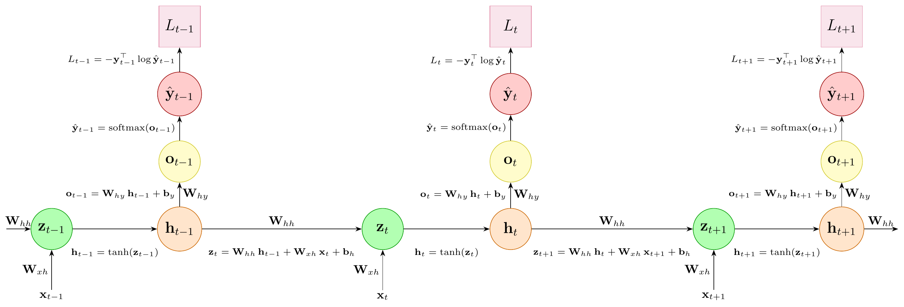
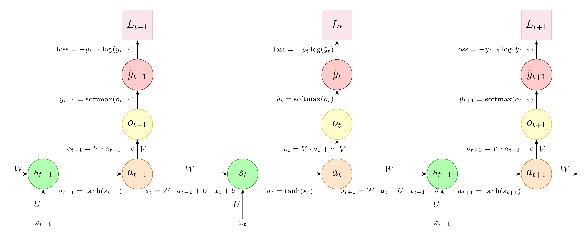
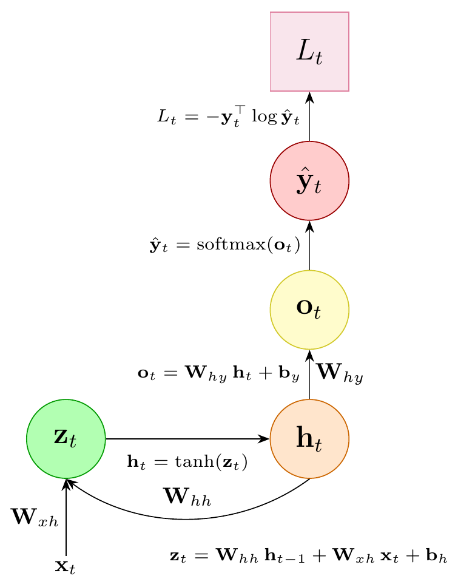
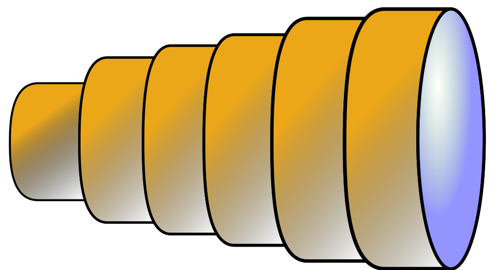
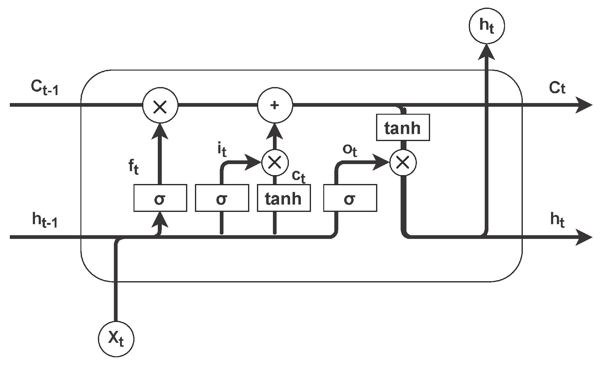

```{python}
#| include: false
import sys
sys.path.append('utils')
import matplotlib.pyplot as plt
from rnn_plots import *
```


## Overview: RNNs and LSTMs

::: {.mybox}
Biomedical data  are often arranged as sequences: clinical notes, visit histories, ICU time series, DNA and protein sequences.
:::

* [**RNNs**](#rnns)
* [**Toy example**](#toy)
* [**Training RNNs**](#training)
* [**Python**](#python)
* [**LSTMs**](#lstm)
* [**RNN language models**](#rnn-lm)


## RNNs: Modelling sequences {#rnns}

::: {.callout-important  icon=false title="Sequences"}

- a sentence (sequences of words)
- a time series (sequence of numbers)
- a patient's visit history (Sequence of observations and measures at different times) 

:::


It is not straightforward to model sequences with standard ANNs

- **Variable length**: For sequences, inputs can have arbitrary length, but an ANN needs a fixed-size input vector
- **Order matters**: e.g.,  "Cat chases dog" differs from "Dog chases cat"
- **No sharing across positions**: a pattern learned at position $i$ is not recognized at position $j$

## RNNs: Overview

::: {.callout-important icon=false title="Recurrent Neural Networks"}

Unlike feed-forward networks, Recurrent Neural Networks (RNNs) introduce a hidden state ($\mathbf{h}_t$)
that acts as a "memory," carrying information from time step $t-1$ to time step $t$.

- process a sequence **one element at a time**, in order
- **reuse the same weights** at every step, so any sequence length works
- the hidden state **summarizes what has been seen so far**
- can produce an output at every step, or only at the end

:::

{width=40% fig-align="center"}

::: {.tiny-credit}
* Mienye ID et al (2024) [Recurrent Neural Networks: A Comprehensive Review of Architectures, Variants, and Applications, Information 15(9), 517](https://www.mdpi.com/2078-2489/15/9/517).
:::


## RNN: Basic idea

::: {style="width: 65%; margin: 0 auto;"}
```{python}
#| echo: false
#| fig-align: center
plot_rnn(show_equations=False, highlight="f")
plt.show()
```
:::


::: {.small-text}
- **Key idea**: an RNN keeps a hidden state that is updated as the sequence is processed

- **Key idea**: an RNN keeps a hidden state that is updated as the sequence is processed

$$
\mathbf{h}_t = f(\mathbf{h}_{t-1}, \mathbf{x}_t)
= \tanh(\mathbf{W}_{xh}\mathbf{x}_t + \mathbf{W}_{hh}\mathbf{h}_{t-1} + \mathbf{b}_h)
$$

| Symbol | Meaning |
|:--|:----------------------------------------------------------------|
| $\mathbf{x}_t$ | input at time $t$ |
| $\mathbf{h}_{t-1}$ | previous state ($\mathbf{h}_0$ is usually zeros) |
| $\mathbf{h}_t$ | new state |
| $\mathbf{b}_h$ | bias vector |
| $f$ | state-update function, with learnable matrices $\mathbf{W}_{xh}$ and $\mathbf{W}_{hh}$ |
:::

## RNN: Output

::: {style="width: 65%; margin: 0 auto;"}
```{python}
#| echo: false
#| fig-align: center
plot_rnn(show_equations=False, highlight="g")
plt.show()
```
:::

::: {.small-text}
- A **separate function** turns the hidden state into the output, at each step if needed

$$
\mathbf{y}_t = g(\mathbf{W}_{hy}\mathbf{h}_t + \mathbf{b}_y)
$$

| Symbol | Meaning |
|:--|:----------------------------------------------------------------|
| $\mathbf{W}_{hy}$ | learnable matrix: hidden dimension → output dimension |
| $\mathbf{b}_y$ | bias vector |
| $g$ | output activation: **chosen to match the task**, e.g., *softmax*, *sigmoid*, *linear* |
:::


## RNN types

:::: {.columns}

::: {.column width="65%"}

```{python}
#| echo: false
#| fig-align: center
plot_sequence_models(figsize=(10,6))
plt.show()
```

:::
::: {.column width="34%"}

- **Many-to-one**: e.g., sequence of words, predict whether text is positive or negative (sentiment analysis)
- **One-to-many**: e.g., image captioning. From one image, create a sequence of words to describe the image
- **Many-to-many (aligned)**: one output for each input, e.g. part-of-speech prediction, or tagging each token in a note as part of a phenotype mention
- **Many-to-many (encoder-decoder)**: e.g., translation

::: {.tiny-credit}
See: Das S, et al (2023) [Recurrent Neural Networks (RNNs): Architectures, Training Tricks, and Introduction to Influential Research](https://pubmed.ncbi.nlm.nih.gov/37988518/)
:::

:::
::::


## Activation Functions

- As we discussed in previous lectures, the activation function plays a crucial role by introducing non-linearity that enables the network to learn and represent complex patterns. 
- One commonly used activation function in RNNs is the [hyperbolic tangent (tanh)]{style="color: green; font-weight: bold;"}. 

:::: {.columns}

::: {.column width="45%"}
### tanh
The tanh function squashes any real-valued input down to a symmetric, zero-centered range of **$[-1, 1]$**.

$$
\tanh(z) = \frac{e^z - e^{-z}}{e^z + e^{-z}}
$$ {#eq-tanh}

<br>
:::

::: {.column width="55%"}

```{python}
#| echo: false
#| fig-align: center
plot_tanh()
plt.show()
```

:::
::::


## Understanding the hidden state {#toy}

- To demonstrate that a hidden state can actually "remember" previous steps, 
Let us construct _by hand_ an RNN that outputs the **increase** $x_t - x_{t-1}$ when the input goes up, and $0$ otherwise.^[Adapted from an example (output 1 if both $x_t$ and $x_{t-1}$ are 1) in the Stanford [CS231N lecture on RNNs](https://www.youtube.com/watch?v=6niqTuYFZLQ).]

- The general equation for the hidden state pre-activation is:
$$
\mathbf{z}_t = \mathbf{W}_{hh}\mathbf{h}_{t-1} + \mathbf{W}_{xh} \mathbf{x}_t
$$
- In this toy example, we define the hidden state to be a $2\times 1$ column vector that memorizes both the current input and the immediate history.
$$
\begin{align*}
\mathbf{z}_t^{(2\times 1)} &= \mathbf{W}_{hh}^{(2\times 2)}\, \mathbf{h}_{t-1}^{(2\times 1)} + \mathbf{W}_{xh}^{(2\times 1)}\, x_t^{(1\times 1)} \\
\mathbf{h}_t^{(2\times 1)} &= \mathrm{ReLU}(\mathbf{z}_t^{(2\times 1)})
\end{align*}
$$

::: {.small-text}
We set the biases to zero and use ReLU rather than tanh because it makes the arithmetic exact.
:::

## Understanding the hidden state (2)

- We define these two matrices as follows

```python
w_xh = np.array([[1], [0]])
w_hh = np.array([[0, 0],  [1, 0]])
```

- This corresponds to 
$$
\begin{align*}
\mathbf{z}_t^{(2\times 1)} &= \mathbf{W}_{hh}^{(2\times 2)} \mathbf{h}_{t-1}^{(2\times 1)} + \mathbf{W}_{xh}^{(2\times 1)} \mathbf{x}_t^{(1\times 1)} \\
 &= \begin{bmatrix} 0 & 0 \\ 1 & 0 \end{bmatrix} \begin{bmatrix} h_{1, t-1} \\ h_{2, t-1} \end{bmatrix}+ \begin{bmatrix} 1\\0\end{bmatrix} \begin{bmatrix}x_t\end{bmatrix} \\
&= \begin{bmatrix} 0  \\ 1\cdot h_{1, t-1} + 0\cdot h_{2, t-1}  \end{bmatrix}  + \begin{bmatrix} 1 \cdot x_t \\ 0 \cdot x_t \end{bmatrix} \\
&= \begin{bmatrix} 0  \\  h_{1, t-1}  \end{bmatrix} + \begin{bmatrix} x_t \\ 0  \end{bmatrix} \\
&= \begin{bmatrix} x_t \\  h_{1, t-1}  \end{bmatrix}  \\
\end{align*} 
$$

- That is, the combined state pre-activation ($\mathbf{z}_t$) consists of two numbers: the current input ($\mathbf{x}_t$) and the first element of the previous hidden state ($h_{1, t-1}$)

## Understanding the hidden state (3)

Assuming non-negative inputs $x_t \ge 0$, applying the $\text{ReLU}$ function produces:
$$
\mathbf{h}_t = \text{ReLU}(\mathbf{z}_t) = \begin{bmatrix} x_t \\ h_{1, t-1} \end{bmatrix} = \begin{bmatrix} x_t \\ x_{t-1} \end{bmatrix}
$$

Thus

- Row 1 of $\mathbf{h}_t$ always receives $x_t$ via $\mathbf{W}_{xh}$.
- Row 2 of $\mathbf{h}_t$ receives the previous input $x_{t-1}$, copied from row 1 via $\mathbf{W}_{hh}$.

::: {.small-text}
For non-negative inputs $x_t \ge 0$:

- Row 1 of $\mathbf{h}_t$ always receives $x_t$ via $\mathbf{W}_{xh}$.
- Row 2 of $\mathbf{h}_t$ receives the previous value of row 1, i.e. $x_{t-1}$, via $\mathbf{W}_{hh}$.
- At $t=1$ we have $\mathbf{h}_0 = \mathbf{0}$, so row 2 starts at $0$.
:::

## Understanding the hidden state (4)

- Our next step is to produce the output
```python
y_t = relu(w_hy @ h_t.flatten())
```
This corresponds to
$$
y_t = \text{ReLU}\left( w_{hy} h_t \right)
$$

- $w_{hy}$ is a 1D row weight vector (or 1D array of shape $(2,)$).
- $h_t$ is a column vector of shape $(2, 1)$:

$$
h_t = \begin{bmatrix} h_{1, t} \\ h_{2, t} \end{bmatrix} = \begin{bmatrix} x_t \\ x_{t-1} \end{bmatrix}
$$
- Expanding the dot product using the weights 
$$
\begin{align*}
\mathbf{W}_{hy}\mathbf{h}_t &= \begin{bmatrix} 1 & -1 \end{bmatrix} \begin{bmatrix} h_{1, t} \\ h_{2, t} \end{bmatrix} \\    
 &= h_{1, t} - h_{2, t} \\    &= x_t - x_{t-1}    
 \end{align*}
 $$


## Understanding the hidden state (5)

Applying the Activation Function ($\text{ReLU}$):

- Finally, the scalar result passes through the element-wise $\text{ReLU}$ function to ensure the output is non-negative:
$$y_t = \text{ReLU}(x_t - x_{t-1}) = \max(0, x_t - x_{t-1})$$
- If $x_t > x_{t-1}$, the output is positive ($x_t - x_{t-1}$). 
- If $x_t \le x_{t-1}$, the output floors at $0$.


> * Of course, real RNNs are trained to learn the parameters of the network, but we have shown in this simple example that the architecture of an RNN can be made to *remember* past information
> * In the following slides, we will show how RNNs are trained.

## RNN Forward Pass Algorithm {#training}

::: {.small-text}
**Inputs:**

- A sequence of input vectors $\mathbf{X} = \langle\mathbf{x}_1, \mathbf{x}_2, \dots, \mathbf{x}_T\rangle$
- Parameter matrices $\mathbf{W}_{xh}, \mathbf{W}_{hh}, \mathbf{W}_{hy}$ and bias vectors $\mathbf{b}_h, \mathbf{b}_y$
- Output activation $g$ (e.g. softmax); the hidden activation is $\tanh$

**Output:** A sequence of predicted output vectors $\mathbf{Y} = \langle\mathbf{y}_1, \mathbf{y}_2, \dots, \mathbf{y}_T\rangle$
:::

### **Algorithm:**

$$
\begin{aligned}
&\text{1. } \mathbf{h}_0 \leftarrow \mathbf{0} & \bullet \text{Initialize the hidden state with zeros} \\
&\text{2. } \mathbf{Y} \leftarrow \langle \rangle & \bullet \text{Initialize an empty sequence to store outputs} \\
&\text{3. } \textbf{for } t \leftarrow 1 \textbf{ to } T \textbf{ do} & \bullet \text{Iterate over sequence} \\
&\text{4. } \quad \mathbf{z}_t \leftarrow \mathbf{W}_{hh}\mathbf{h}_{t-1} + \mathbf{W}_{xh}\mathbf{x}_t + \mathbf{b}_h & \bullet \text{Combine past memory and new input} \\
&\text{5. } \quad \mathbf{h}_t \leftarrow \tanh(\mathbf{z}_t) & \bullet \text{Compute the updated hidden state} \\
&\text{6. } \quad \mathbf{y}_t \leftarrow g(\mathbf{W}_{hy}\mathbf{h}_t + \mathbf{b}_y) & \bullet \text{Generate the prediction for time step } t \\
&\text{7. } \quad \mathbf{Y} \leftarrow \mathbf{Y} \parallel \langle\mathbf{y}_t\rangle & \bullet \text{Append the output to the sequence} \\
&\text{8. } \textbf{end for} & \\
&\text{9. } \textbf{return } \mathbf{Y} &
\end{aligned}
$$


## Training RNNs

::: {.callout-tip appearance="minimal" icon=false style="background-color: #fafbfc; border-left: 4px solid #34495e; font-size: 0.85em;" title="Training"}
As with ANNs, we use a training set, a loss function, and backpropagation to train the RNN.
:::

- Three weight matrices (plus biases) are learned, and they are **shared across all time steps**:
  - $\mathbf{W}_{xh}$: input → hidden
  - $\mathbf{W}_{hh}$: hidden → hidden (the recurrent connection)
  - $\mathbf{W}_{hy}$: hidden → output
- A loss $L_t$ is computed at each time step that has a target, and the total loss is
$$
L = \sum_{t=1}^{T} L_t
$$
- For a many-to-one task such as sentiment prediction, only the last step has a target, so $L = L_T$


## Training of RNNs

{width=75% fig-align="center"}


<div style="font-size: 11px; line-height: 1.2;">

| | | |
|:---|:---|:---|
| **$W$**: recurrent weights | **$s$**: hidden pre-activation | **$L$**: loss |
| **$U$**: input weights | **$a$**: hidden state | **$x$**: input vector |
| **$V$**: output weights | **$o$**: output scores (before softmax) | **$y$**: true target |
| **$b$**: hidden bias vector | **$c$**: output bias vector | **$\hat{y}$**: predicted probabilities |

</div>


## Training of RNNs: Forward pass

:::: {.columns}

::: {.column width="60%"}

{width=75% fig-align="center"}

:::
::: {.column width="40%"}

$$
\begin{align*}
z_t &= \mathbf{W}_{hh}\mathbf{h}_{t-1} + \mathbf{W}_{xh}\mathbf{x}_{t} + b  \\
h_t &= \tanh(z_t)   \\
o_t &= \mathbf{W_{hy}\mathbf{h}_t + \mathbf{b}_y  \\
\hat{\mathbf{y}}_t &= \mathrm{softmax}(o_t) \\
L_t &= -\mathbf{y}_t^\top \log \hat{\mathbf{y}}_t  \\
\end{align*}
$$

$L_t$ is the **cross-entropy loss** at step $t$
:::
::::

## Backpropagation Through Time (BPTT)

- The gradients are calculated layer by layer  from the last time step towards the initial time step.
- We will not present a derivation of the gradients, which is mainly analogous to the derivation we presented for ANNs 
- The one exception is the fact that the gradients for the hidden state weights depend on previous time points

$$
\begin{align*}
\mathbf{h}_t &= \tanh(\mathbf{W}_{xh}\mathbf{x}_t + \mathbf{W}_{hh}\mathbf{h}_{t-1} + \mathbf{b}_h) \\
&=\tanh(\mathbf{W}_{xh}\mathbf{x}_t + \mathbf{W}_{hh}\tanh(\mathbf{W}_{xh}\mathbf{x}_{t-1} + \mathbf{W}_{hh}\mathbf{h}_{t-2} + \mathbf{b}_h)  + \mathbf{b}_h) \\
&=\tanh(\mathbf{W}_{xh}\mathbf{x}_t + \mathbf{W}_{hh}\tanh(\mathbf{W}_{xh}\mathbf{x}_{t-1} + \mathbf{W}_{hh}\tanh(\mathbf{W}_{xh}\mathbf{x}_{t-2} + \mathbf{W}_{hh}\mathbf{h}_{t-3} + \mathbf{b}_h) + \mathbf{b}_h)  + \mathbf{b}_h) \\
&=\ldots
\end{align*}  
$$

{width=40% fig-align="center"}


## The Vanishing and Exploding Gradient Problems

- Backpropagating from step $t$ to an earlier step $t-n$ multiplies together many Jacobian matrices:

$$
\frac{\partial \mathbf{h}_t}{\partial \mathbf{h}_{t-n}} = \prod_{k=t-n}^{t-1} \mathbf{J}_k,
\qquad
\mathbf{J}_k = \frac{\partial \mathbf{h}_{k+1}}{\partial \mathbf{h}_k}
= \mathrm{diag}\!\left(1-\mathbf{h}_{k+1}^2\right)\mathbf{W}_{hh}
$$

- If the Jacobians are "small" (norm below 1), the product shrinks toward zero as $n$ grows: **vanishing gradients**
- If they are "large" (norm above 1), it grows without bound: **exploding gradients**

- **Vanishing**: the gradient signal from distant time steps is too weak to update the weights, so the network cannot learn long-term dependencies
- **Exploding**: updates become huge and unstable, so the loss jumps around or becomes NaN

::: {.small-text}
Mienye ID et al (2024) [Recurrent Neural Networks: A Comprehensive Review of Architectures, Variants, and Applications, Information **15**:517](https://www.mdpi.com/2078-2489/15/9/517).
:::


## Vanishing and Exploding Gradients: Intuition

- To gain intuition about why gradients vanish owing to repeated (Jacobian) matrix multiplications, consider a symmetric matrix $A$, so the product is $A^n$


$$
A = \begin{bmatrix} 0.65 & 0.15 \\ 0.15 & 0.65 \end{bmatrix}
$$

- Its eigenvalues solve $\det(A - \lambda I) = 0$, which gives

$$
\lambda_1 = 0.8, \quad \lambda_2 = 0.5
$$

- The corresponding eigenvectors form the columns of $P$:

$$
P = \begin{bmatrix} 1 & 1 \\ 1 & -1 \end{bmatrix}, \quad
P^{-1} = \begin{bmatrix} 0.5 & 0.5 \\ 0.5 & -0.5 \end{bmatrix}
$$

## Vanishing and Exploding Gradients: Intuition (2)

- Any diagonalizable matrix can be factored as

$$
A = P D P^{-1}
$$

- where $D$ is the diagonal matrix of eigenvalues, here

$$
D = \begin{bmatrix} 0.8 & 0 \\ 0 & 0.5 \end{bmatrix}
$$

- When we multiply the matrix by itself many times, the intermediate $P^{-1}P = I$ terms cancel:

$$
\begin{align*}
A^n &= (P D P^{-1}) (P D P^{-1}) \cdots (P D P^{-1}) \\
&= P D (P^{-1} P) D (P^{-1} P) \cdots D P^{-1} \\
&= P D^n P^{-1}
\end{align*}
$$

- $D$ is diagonal, thus: $D^n = \begin{bmatrix} 0.8^n & 0 \\ 0 & 0.5^n \end{bmatrix}$

## Vanishing and Exploding Gradients: Intuition (3)

$$
\begin{align*}
D^{1}  &= \begin{bmatrix} 0.8 & 0 \\ 0 & 0.5 \end{bmatrix} \\[4pt]
D^{5}  &= \begin{bmatrix} 0.32768 & 0 \\ 0 & 0.03125 \end{bmatrix} \\[4pt]
D^{20} &\approx \begin{bmatrix} 0.0115 & 0 \\ 0 & 9.5\times 10^{-7} \end{bmatrix}
\end{align*}
$$

- Both eigenvalues are below $1$, so the powers decay exponentially toward zero. A gradient signal 20 steps back is reduced to about 1% of its size, or far less
- This is the algebraic root of the vanishing gradient problem: if the hidden-to-hidden Jacobians are "small", long-term gradient signals vanish before they reach earlier time steps
- Conversely, with an eigenvalue above $1$ (say $1.2$), the same power explodes: $1.2^{20} \approx 38$, and it keeps growing

## Why tanh?

- Why do we tend not to use the sigmoid in RNNs? Because of the vanishing gradient problem
- Each backward step multiplies the gradient by the activation derivative, so the **size of that derivative** matters

:::: {.columns}
::: {.column width="50%"}
- Sigmoid: $\sigma'(z) = \sigma(z)\bigl(1-\sigma(z)\bigr) \le \tfrac14$
  - a product $p(1-p)$ is largest at $p=\tfrac12$, i.e. $z=0$
- Tanh: $\tanh'(z) = 1-\tanh^2(z) \le 1$
  - maximal at $z=0$
  - $\tanh(z) = 2\sigma(2z)-1$, so its slope is 4 times steeper
:::
::: {.column width="50%"}

```{python}
#| echo: false
#| fig-align: center
plot_derivatives()
plt.show()
```
:::
::::


## Why tanh? (2)

- Tanh is **zero-centered** (outputs in $[-1,1]$), while sigmoid outputs are always positive. Positive-only inputs make all the weight gradients of the next layer share one sign, which tends to cause zig-zag updates and slower convergence
- But tanh is **not a cure**: $\tanh'(z) \to 0$ for large $|z|$, so it still saturates and gradients still vanish over long sequences

::: {.callout-important icon=false title="What actually helps"}
- **Exploding gradients**: gradient clipping
- **Vanishing gradients**: gated architectures (LSTM, GRU), which we turn to next
:::


## Python: RNN-based sentiment analysis {#python}

- The point of sentiment analysis is to perform binary classification about the opinion expressed by a certain text
- The classic example is to predict whether a movie review is positive or negative

```{python}
#| echo: false
#| fig-align: center
sentiment_analysis_basic_idea()
plt.plot()
```

- This is the **many-to-one** case: we read the whole review and use only the **final hidden state** $\mathbf{h}_T$ for the prediction


## Sentiment analysis: embedding

```{python}
#| echo: false
#| fig-align: center
sentiment_embedding()
plt.plot()
```


## Sentiment analysis: Unrolling the RNN

```{python}
#| echo: false
#| fig-align: center
unrolled_rnn_sentiment()
plt.plot()
```


## Sentiment analysis

- We will present a bare-bones implementation of an RNN trained to perform sentiment analysis on the IMDB movie review dataset
  - 50,000 reviews, balanced between positive and negative; we merge the original train/test splits and re-split 80/20
- The full script is available in the [course material](notebooks/rnn-sentiment.ipynb); we will briefly review some of the salient blocks of code
- We use PyTorch for most of the heavy lifting: **embedding → RNN → linear layer**


## Data Preparation

```python
hf_dataset = load_dataset("stanfordnlp/imdb")
df = pd.concat([pd.DataFrame(hf_dataset["train"]),
                pd.DataFrame(hf_dataset["test"])], ignore_index=True)

def tokenize(text):
    text = text.lower().replace("<br />", " ")
    return re.findall(r"[a-z0-9']+", text)

df["text"] = df["text"].apply(tokenize)
```

1. **Load and merge** the 25k + 25k IMDb reviews, then **tokenize** (lowercase, drop `<br />`, keep words)
2. **Split 80/20** (40,000 train, 10,000 test) *before* building anything from the data
3. **Vocabulary** from the training reviews only: `<pad>` = 0, `<unk>` = 1, words seen at least twice (64,843 entries)
4. **Encode**: words → integer ids, truncated or padded to 250 tokens; we also keep each review's true length so the RNN can skip the padding

::: {.small-text}
See notebook for details; mainly "book-keeping" code to load, cleanse, prepare and tokenize the text
:::


## Custom PyTorch Datasets & DataLoaders

* **Dataset Class**: Wraps pandas dataframes to serve pre-padded sequences, labels, and true lengths item-by-item as PyTorch tensors.
* **DataLoader**: Automatically batches samples, shuffles training data, and handles parallel iteration.

```python 
import torch
from torch.utils.data import Dataset, DataLoader

class SentimentDataset(Dataset):
    def __init__(self, data):
        self.texts = data['text'].values ## The movie reviews
        self.labels = data['label'].values ## Positive (1) or negative (0) reviews?
        self.lengths = data['length'].values ## How long (how many chars is the text)
    
    def __len__(self):
        return len(self.texts)
    
    def __getitem__(self, idx):
        return (torch.tensor(self.texts[idx], dtype=torch.long), 
                torch.tensor(self.labels[idx], dtype=torch.long), 
                torch.tensor(self.lengths[idx], dtype=torch.long))

train_dataset = SentimentDataset(train_data)
test_dataset = SentimentDataset(test_data)

train_loader = DataLoader(train_dataset, batch_size=32, shuffle=True)
test_loader = DataLoader(test_dataset, batch_size=32, shuffle=False)
```

## Building the RNN Sentiment Classifier

* **Architecture**: Combines an embedding layer, a recurrent layer (nn.RNN), dropout regularization, and a final linear classification layer.
* **Sequence Packing**: Uses pack_padded_sequence to bypass zero-padding during recurrent updates, extracting the final hidden state ($h_n$).

```python
import torch.nn as nn

class SentimentRNN(nn.Module):
    def __init__(self, vocab_size, embed_size, hidden_size, output_size):
        super().__init__()
        self.embedding = nn.Embedding(vocab_size, embed_size, padding_idx=0)
        self.rnn = nn.RNN(embed_size, hidden_size, batch_first=True)
        self.fc = nn.Linear(hidden_size, output_size)
        self.dropout = nn.Dropout(0.2)
    
    def forward(self, x, lengths):
        x = self.embedding(x)
        # Skip padding processing for efficiency
        packed = nn.utils.rnn.pack_padded_sequence(x, lengths.cpu(), batch_first=True, enforce_sorted=False)
        _, h_n = self.rnn(packed)
        return self.fc(self.dropout(h_n[-1]))

# Instantiate model on the device (e.g., Mac MPS or CPU)
model = SentimentRNN(len(vocab) + 1, embed_size=128, hidden_size=128, output_size=2).to(device)
```

## Training Loop & Optimization
* **Loss & Optimizer**: Cross-Entropy Loss for multi-class classification and the Adam optimizer.
* **Device Management & Gradient Clipping**: Pushes batches to the target device (device) and applies gradient clipping (clip_grad_norm_) to prevent exploding gradients.

```python
import torch.optim as optim

criterion = nn.CrossEntropyLoss()
optimizer = optim.Adam(model.parameters(), lr=0.001)

num_epochs = 10
for epoch in range(num_epochs):
    model.train()
    epoch_loss = 0
    for texts, labels, lengths in train_loader:
        texts, labels = texts.to(device), labels.to(device)
        
        optimizer.zero_grad()
        outputs = model(texts, lengths)
        loss = criterion(outputs, labels)
        
        loss.backward()
        torch.nn.utils.clip_grad_norm_(model.parameters(), max_norm=5.0)
        optimizer.step()
        
        epoch_loss += loss.item()
    print(f'Epoch [{epoch+1}/{num_epochs}], Loss: {epoch_loss / len(train_loader):.4f}')
```


## Loss

```{python}
import matplotlib.pyplot as plt

# Recorded training loss per epoch from the training loop
losses = [0.6880, 0.6158, 0.5277, 0.4361, 0.3764, 0.2970, 0.2239, 0.1730, 0.1387, 0.1020]
epochs = list(range(1, len(losses) + 1))

# Create the plot
plt.figure(figsize=(8, 5))
plt.plot(epochs, losses, marker='o', linestyle='-', color='b', linewidth=2, label='Training Loss')

plt.title('RNN Sentiment Classifier Training Loss', fontsize=14)
plt.xlabel('Epoch', fontsize=12)
plt.ylabel('Loss (Cross-Entropy)', fontsize=12)
plt.xticks(epochs)
plt.grid(True, linestyle='--', alpha=0.6)
plt.legend()

plt.tight_layout()
plt.show()
```


## Model Evaluation & Accuracy

* **Evaluation Mode (model.eval())**: Disables layers like Dropout during testing so evaluation is deterministic.
* **No-Gradient Context (torch.no_grad())**: Saves memory and speeds up computation by disabling gradient tracking since we aren't updating weights.
* **Batch Accuracy Calculation**: Compares predicted classes against ground-truth labels to compute overall test set accuracy.

```python
model.eval()
correct = 0
total = 0
with torch.no_grad():
    for texts, labels, lengths in test_loader:
        texts = texts.to(device)
        labels = labels.to(device)
        outputs = model(texts, lengths)
        _, predicted = torch.max(outputs.data, 1)
        total += labels.size(0)
        correct += (predicted == labels).sum().item()

accuracy = 100 * correct / total
print(f'Accuracy: {accuracy:.2f}%')
```

- Accuracy: 78.40% (as compared to the 50% we would have expected by chance)
- much worse than the training accuracy of 93.33% - thus, we are overfitting! 
- In the practical, we will discuss some methods for reducing overfitting


## Long Short-Term Memory Networks (LSTMs) {#lstm}

- The key innovation in LSTM is the use of gating mechanisms to control the flow of information through the network. 
- A challenge for RNNs is to keep track of information from distant parts of the sentence:

> The rates the phone company was increasing were already expensive

- It is easy to relate "was" to "company" because "was" comes immediately after "company"
- It is harder to relate "were" to "rates" because there are five other intervening words
- The hidden state of the RNN is being asked to perform two things: inform the current output and to update and carry forward the information needed for future outputs
- LSTMS attempt to address the challenge by adding a context layer to the existing hidden layer and by introducing **gates** to control flow of information

::: { .tiny-credit}
Hochreiter, S. and J. Schmidhuber. 1997. [Long short-term
memory. Neural Computation, 9(8):1735–1780](https://dl.acm.org/doi/10.1162/neco.1997.9.8.1735)
:::

## LSTMS vs RNNs


```{python}
#| echo: false
#| fig-align: center
rnn_vs_lstm_1()
plt.plot()
```

- All recurrent neural networks have the form of a chain of repeating modules. 
- In standard RNNs, this  module has a simple structure with a single tanh layer and passes on the hidden state


## LSTMS vs RNNs

```{python}
#| echo: false
#| fig-align: center
rnn_vs_lstm_2()
plt.plot()
```

- In contrast, LSTM modules have four interacting structures and are connected by the cell state in addition to the hidden state


## LSTMS 

- Let's review the main ideas of the LSTM step by step

{width=40% fig-align="center"}


## LSTM Gates

LSTMs have [three gates]{style="color: green; font-weight: bold;"}:

- forget gate 
- add (input) gate
- output gate

Each gate consists of 

  1. feedforward layer
  2. followed by a sigmoid activation function
  3. followed by a pointwise multiplication with the layer being gated. 

- The sigmoid activation function tends to push its outputs to either 0 or 1. 
- Combining this with a pointwise multiplication has an effect similar to that of a **binary mask**. 
- Values in the layer being gated that align with values near 1 in the mask are **passed through**
nearly unchanged; values corresponding to lower values are essentially **erased**.
- Each gate has its own weights, e.g. $\mathbf{W}_{xf}, \mathbf{W}_{hf}, \mathbf{b}_f$ for the forget gate (first letter: which vector, second: which gate)


## Forget gate

::: {.r-stack}
<div style="position: relative; width: 50%; margin: auto;">
  <!-- The Base Image fills the container width -->
  

  <!-- Highlight Box (Adjust top, left, width, height as needed) -->
  <div style="position: absolute; border: 4px solid #1a73e8; 
       background-color: rgba(26, 115, 232, 0.25); border-radius: 8px; z-index: 999;
       top: 24%; left: 20%; width: 10%; height: 35%;">
  </div>
</div>
:::

::: { .small-text}
- The forget fate deletes information from the context that is no longer relevant 
- It computes a weighted sum of the previous state’s hidden layer and the current input and passes that through a sigmoid. 
- This mask is then multiplied element-wise
by the context vector to remove the information from context that is no longer required. 
- Element-wise multiplication of two vectors, written $\odot$ 
(the **Hadamard product**) results in a vector where  element $i$ is the product of element $i$ in the two
input vectors,  e.g. $(1,\,0.5,\,0) \odot (7,\,8,\,9) = (7,\,4,\,0)$
:::

$$
\begin{align*}
\mathbf{f}_t &= \sigma(\mathbf{W}{hf}\mathbf{h}{t-1}+\mathbf{W}{xf}\mathbf{x}t+\mathbf{b}_f) \\
\mathbf{k}_t &= \mathbf{c}_{t-1} \odot\mathbf{f}_t 
\end{align*}
$$ {#eq-forget-gate}

## Cell input


::: {.r-stack}
<div style="position: relative; width: 50%; margin: auto;">
  <!-- The Base Image fills the container width -->
  

  <!-- Highlight Box (Adjust top, left, width, height as needed) -->
  <div style="position: absolute; border: 4px solid #1a73e8; 
       background-color: rgba(26, 115, 232, 0.25); border-radius: 8px; z-index: 999;
       top: 34%; left: 30%; width: 10%; height: 25%;">
  </div>
</div>
:::

- Next we compute the **candidate** information that could be added to the context, from the previous hidden state and the current input

$$
\tilde{\mathbf{c}}_t = \tanh(\mathbf{W}_{h\tilde{c}}\mathbf{h}_{t-1} + \mathbf{W}_{x\tilde{c}}\mathbf{x}_t + \mathbf{b}_{\tilde{c}})
$$ {#eq-lstm-info-to-extract}

- This is the same computation as the hidden-state update of the vanilla RNN
- But the result is **not** the new hidden state: it only proposes what to write into the context

## Add gate 

* The add gate generates a mask that selects which parts of the candidate are written to the context.

::: {.r-stack}
<div style="position: relative; width: 50%; margin: auto;">
  <!-- The Base Image fills the container width -->
  

  <!-- Highlight Box (Adjust top, left, width, height as needed) -->
  <div style="position: absolute; border: 4px solid #1a73e8; 
       background-color: rgba(26, 115, 232, 0.25); border-radius: 8px; z-index: 999;
       top: 24%; left: 40%; width: 10%; height: 35%;">
  </div>
</div>
:::

$$
\begin{align*}
\mathbf{i}_t &= \sigma(\mathbf{W}_{hi}\mathbf{h}_{t-1} + \mathbf{W}_{xi}\mathbf{x}_t + \mathbf{b}_i) && \text{add mask} \\
\mathbf{j}_t &= \tilde{\mathbf{c}}_t \odot \mathbf{i}_t && \text{selected new information} \\
\mathbf{c}_t &= \mathbf{j}_t + \mathbf{k}_t && \text{new context: new info + surviving old info}
\end{align*}
$$ {#eq-add-gate}

- Thus: $\mathbf{c}_t = \mathbf{f}_t \odot \mathbf{c}_{t-1} + \mathbf{i}_t \odot \tilde{\mathbf{c}}_t$


## Output gate 

* Finally, the output gate decides which parts of the context are exposed as the new hidden state.

::: {.r-stack}
<div style="position: relative; width: 50%; margin: auto;">
  <!-- The Base Image fills the container width -->
  

  <!-- Highlight Box (Adjust top, left, width, height as needed) -->
  <div style="position: absolute; border: 4px solid #1a73e8; 
       background-color: rgba(26, 115, 232, 0.25); border-radius: 8px; z-index: 999;
       top: 24%; left: 50%; width: 20%; height: 35%;">
  </div>
</div>
:::


$$
\begin{align*}
\mathbf{o}_t &= \sigma(\mathbf{W}_{ho}\mathbf{h}_{t-1} + \mathbf{W}_{xo}\mathbf{x}_t + \mathbf{b}_o) && \text{output mask} \\
\mathbf{h}_t &= \mathbf{o}_t \odot \tanh(\mathbf{c}_t) && \text{new hidden state}
\end{align*}
$$ {#eq-output-gate}


## LSTM

  

In Summary

- an LSTM accepts as input the context layer ($\mathbf{c}_{t-1}$)
 and hidden layer ($\mathbf{h}_{t-1}$) from the previous time step, along with the current input
vector ($\mathbf{x}_{t}$). 
- It generates $\mathbf{c}_{t}$ and $\mathbf{h}_{t}$ as output that is passed to the next step
- The hidden state $\mathbf{h}_{t}$ is used to generate the output of the network similar to an RNN
- LSTMs can be used as drop-in replacements for RNNs in many contexts and often perform better


## LSTM: All equations

$$
\begin{align*}
\mathbf{f}_t &= \sigma(\mathbf{W}_{hf}\mathbf{h}_{t-1} + \mathbf{W}_{xf}\mathbf{x}_t + \mathbf{b}_f) && \text{forget gate} \\
\mathbf{i}_t &= \sigma(\mathbf{W}_{hi}\mathbf{h}_{t-1} + \mathbf{W}_{xi}\mathbf{x}_t + \mathbf{b}_i) && \text{add gate} \\
\mathbf{o}_t &= \sigma(\mathbf{W}_{ho}\mathbf{h}_{t-1} + \mathbf{W}_{xo}\mathbf{x}_t + \mathbf{b}_o) && \text{output gate} \\
\tilde{\mathbf{c}}_t &= \tanh(\mathbf{W}_{h\tilde{c}}\mathbf{h}_{t-1} + \mathbf{W}_{x\tilde{c}}\mathbf{x}_t + \mathbf{b}_{\tilde{c}}) && \text{candidate} \\
\mathbf{c}_t &= \mathbf{f}_t \odot \mathbf{c}_{t-1} + \mathbf{i}_t \odot \tilde{\mathbf{c}}_t && \text{cell state (additive!)} \\
\mathbf{h}_t &= \mathbf{o}_t \odot \tanh(\mathbf{c}_t) && \text{hidden state}
\end{align*}
$$

- Inputs: $\mathbf{x}_t$, $\mathbf{h}_{t-1}$, $\mathbf{c}_{t-1}$ — outputs: $\mathbf{h}_t$, $\mathbf{c}_t$
- Four weight-matrix pairs instead of one, so an LSTM layer has about **four times** the parameters of an RNN layer of the same size

## Why does the cell state help?

- Recall: for an RNN, $\dfrac{\partial \mathbf{h}_{t}}{\partial \mathbf{h}_{t-1}} = \mathrm{diag}(1-\mathbf{h}_t^2)\,\mathbf{W}_{hh}$ — a **matrix product** at every step, which shrinks or explodes
- For the LSTM cell state, the update is **additive**: $\mathbf{c}_t = \mathbf{f}_t \odot \mathbf{c}_{t-1} + \mathbf{i}_t \odot \tilde{\mathbf{c}}_t$
- Along the direct path through the cell state

$$
\frac{\partial \mathbf{c}_t}{\partial \mathbf{c}_{t-1}} \approx \mathrm{diag}(\mathbf{f}_t)
\qquad\Rightarrow\qquad
\frac{\partial \mathbf{c}_t}{\partial \mathbf{c}_k} \approx \prod_{j=k+1}^{t} \mathrm{diag}(\mathbf{f}_j)
$$

- No weight matrix and no tanh derivative in this product, only the gate values in $(0,1)$
- If the network learns $\mathbf{f}_j \approx 1$ for information it needs to keep, the gradient passes through many steps **almost unchanged**
- It is "approximate" because we ignore the (smaller) paths via the gates' dependence on $\mathbf{h}_{t-1}$
- Gradients *can* still vanish, but now the network can learn when and what to keep


## RNNs as Language Models {#rnn-lm}

that language models predict the next word in a sequence given some preceding
context. For example, if the preceding context is “Something is rotten in the state of” and we want
to know how likely the next word is "Denmark"^[In Hamlet, the palace guard Marcellus, says this right after Hamlet has just seen his father's ghost for the first time.] we would compute:

$$
P(\mathrm{Denmark}\mid \text{Something is rotten in the state of})
$$

- That is, we are computing the probability of the word "Denmark" given the previous 7 words.
- RNN language models process the input sequence one word at a time, attempting to predict the next word from the current word ($x_t$) and the previous hidden state ($h_{t-1}$).

## Forward inference in an RNN language model

- The input is a sequence of words  $\mathbf{X} = \left[x_1;\ldots;x_t\right]$
- Let the Vocabulary be a collection of words of size $|V|$
- Then each word is represented by a one-hot column vector of size $|V|\times 1$.
- The output prediction $\hat{\mathbf{y}}$ is a vector representing a probabilites distribution over the vocabulary. 
- For each step the model uses an embedding matrix $\mathbf{E}$ to retrieve the embedding for the current word^[We will study embeddings in a later lecture. For now, suffice it to say that embeddings are lower dimensional vectorial represesntations of words or tokens that in some way reflect the semantics of the words.]
- The model then multiplies the embedding vector for each word by the  weight matrix $\mathbf{W}$, and then adds it to the hidden layer from the previous step (weighted by weight matrix $\mathbf{U}$ to compute a new
hidden layer. This hidden layer is then used to generate an output layer which is
passed through a softmax layer to generate the final prediction.


## RNN Language model equations

:::: {.columns}

::: {.column width="45%"}


```{python}
#| echo: false
#| fig-align: center
rnn_language_model()
plt.plot()
```

:::
::: {.column width="45%"}

$$
\begin{align*}
\mathbf{e}_t &= \mathbf{E}\mathbf{x}_t && \text{Retrieve embedding} \\
\mathbf{h}_t &= \tanh(\mathbf{W}_{xh}\mathbf{e}_t + \mathbf{W}_{hh}\mathbf{h}_{t-1} + \mathbf{b}_h) && \text{new hidden layer} \\
\hat{\mathbf{y}}_t &= \mathrm{softmax}(\mathbf{W}_{hy}\mathbf{h}_t + \mathbf{b}_y) && \text{generate output}
\end{align*}
$$

- The softmax operation creates a probability distribution over the entire vocabulary
- The probability that a particular word $k$ is the next word is then
$$
P(w_{t+1}| w_1,\ldots, w_t ) = \hat{\mathbf{y}_t}[k]
$$

- $\hat{\mathbf{y}}$ is a vector with one field for every word in the vocabulary
- The output is then the highest-probability word 

:::
::::


##  CE Loss: Review

- For a multi-class classification problem,  each true label vector $\mathbf{y}$ is one-hot encoded (meaning $y_i = 1$ for the correct class and $y_i = 0$ otherwise), 
- The model predicts a set of probabilities $\hat{y}_{i}$ for each class
- For a multi-class classification problem with $K$ classes, the cross-entropy loss is 
$$
\log L_{\mathrm{CE}} = -\sum _{i=1}^{K} y_{i}\log \hat{y}_{i}\\
$$ {#eq-ce-loss}

- For the correct class ($y_k = 1$), the loss term $-\log(p_k)$ decreases as $\hat{y}_k$ increases. 
- Weight updates that increase the probability of an incorrect class must decrease the probability of the correct class, thereby increasing the loss

## Training RNN language Models

- **self-supervision**: We use a corpus of text as training. The model is trained to predict the next word.
- No need for gold-standard labelling.
- We minimize the error in predicting the next word with a **cross-entropy** loss function

$$
L_{CE}(\hat{\mathbf{y}_t}, \mathbf{y}_t) = - \sum_{w\in V} \mathbf{y}_t[w]\log \hat{\mathbf{y}_t}[w]
$$

- In language modelling, the correct prediction is the next word, which is represented by a one-hot vector (so $\mathbf{y}_t[w]=1$).
- Thus our loss is
$$
L_{CE}(\hat{\mathbf{y}_t}, \mathbf{y}_t) = - \sum_{w\in V} \log \hat{\mathbf{y}_t}[w]
$$

## Training 

:::: {.columns}

::: {.column width="70%"}


```{python}
#| echo: false
#| fig-align: center
rnn_next_word(figsize=(10,6))
plt.plot()
```
::: {.tiny-credit}
figure adapted from Jurafsky and Martin (2026) Speech and Language Processing
:::

:::
::: {.column width="25%"}

::: {.medium-text}
- At each position $t$, take correct word $w_t$ and hidden state $h_t$, which encodes information from $w_1,\ldots,w_{t-1}$
- Compute probability distribution over possible next words
- Compute loss for the next token 
- Use the next correct word (not the predicted word - called **teacher forcing**) for next position
- Calculate total loss as average
- Perform backpropagation through time
:::


:::
::::


## Generative RNNs

:::: {.columns}

::: {.column width="70%"}

```{python}
#| echo: false
#| fig-align: center
rnn_autoregression()
plt.plot()
```

::: {.tiny-credit}
figure adapted from Jurafsky and Martin (2026) Speech and Language Processing
:::

:::
::: {.column width="25%"}


::: {.small-text}
- RNN-based language models can also be used to generate text (Generative AI)
- **Autoregressive generation**: Iteratively sample the next work based on previous words
- *This was one of the inspirations for the autoregressive approach used by LLMs*
- Algorithm:
  * Sample a word from the softmax distribution. 
  * Use the start of sentence marker **`<s>`** as the first input 
  * The word embedding for the current word is used as input to the network to choose the word for the next time step 
  * The output word is used as input for the next step 
  * Continue until end of sentence marker **`</s>`** is sampled
:::

:::
::::


## The Encoder-Decoder Model 

- RNNs were among early examples of the **encoder-decoder model**
  - encode an input sequence of length $n$
  - aim to output a sequence of length $m$, where $n$ and $m$ may be distinct
  - input and output sequences do not necessarily align word-to-word
- A kind of sequence-to-sequence network
- Applications:
  - summarization
  - question answering
  - machine translation


```{python}
#| echo: false
#| fig-align: center
encode_decode()
plt.plot()
```

## The Encoder-Decoder Model 

- Encoder decoder models have three major components

::: {.small-text}
  - Encoder: transform an input sequence, $x_{1:n}$ into a corresponding sequence of contextualized representations, $h_{1:n}$.
    - RNNs, LSTMs, transformers, etc., can be used as encoders
  - Context: A vector $c$ that is a function of $h_{1:n}$ and represents the "meaning" of the input to the decoder 
  - Decoder: takes the context $c$ and generates a sequence of hidden states $h_{1:m}$ that can be used to generate a sequence of output states $y_{1:m}$
:::
- We can adapt the autoregressive RNN
- Recall that the hidden state is calculated as $\mathbf{h}_t = g(\mathbf{h}_{t-1},\mathbf{x}_t)$ and the output is calculated as $\mathbf{y}_t = \mathrm{softmax}(\mathbf{h}_{t})$
- For training we add a sentence separation marker after the source text (language 1), and then add the target text (language 2)

> Ich bin ein Berliner `<s>` I am a doughnut


## The Encoder-Decoder Model 

```{python}
#| echo: false
#| fig-align: center
doughnut()
plt.plot()
```

## The Encoder-Decoder Model 

- Note that the order of the words does not have to be the same

> Ich habe ein tolles Buch zu Ende gelesen! `<s>` I finished a great book!

- Simplest version of the decoder
- Take the context vector (the last hidden state of the encoder): $\mathbf{c}$
- Use the context vector as its own first hidden state: $\mathbf{h}_{0}^d = \mathbf{c} = \mathbf{h}_n^{e}$
- Generate outputs autoregressively until end of sentence marker is reached
- There are many more sophisticated architectures. For instance, we can make the context vector available at each decoding timestep

$$
\begin{align}
\mathbf{c} &= \mathbf{h}_n^{e} \\
 \mathbf{h}_0^{d} &= \mathbf{c}\\
\mathbf{h}_{0}^d &= g(\mathbf{h}_{t-1}^d,\hat{\mathbf{y}}_{t-1}, \mathbf{c})\\
\hat{\mathbf{y}}_{t} &= \mathrm{softmax}(\mathbf{h}_{t}^d)
\end{align}
$$


## Attention

- In the encoder decoder model as described above, the context $\mathbf{c}$ must represent **everything** about the input sequence
- Information present at the beginning of the input text may not be well represented in the context vector
- The **attention mechanism** was designed as a way to extract information from **all hidden states** of the input  
- With attention, the context vector is no longer equal to the final hidden state of the input, instead it is dynamically calculated as a function of the hidden states of the encoder. 

$$
\mathbf{c}_i = f(\mathbf{h}_1^{e},\mathbf{h}_2^{e}, \ldots, \mathbf{h}_n^{e})
$$

- The goal is for the  weights to focus on (‘attend to’) a particular part of
the source text that is relevant for the token $i$ that the decoder is currently producing.
- Note that the context vector is now generated anew for each decoding step $i$, i.e., we have $\mathbf{c}_i$ instead of the same $\mathbf{c}$ for all steps.


## Attention: Relevance?

- In order to compute $\mathbf{c}_i$, our goal is to determine how *relevant* each encoder hidden state is for the current decoder step.
- That is, we want to have a function for the relevance of encoder state $j$ for decoding step $i$
$$
\mathbf{relevance}(i, j) = f(\mathbf{h}_{i-1}^d, \mathbf{h}_{j}^e)
$$
- The simplest function is the **dot product**, which equates relevance with vector similarity
$$
f(\mathbf{h}_{i-1}^d, \mathbf{h}_{j}^de) = \mathbf{h}_{i-1}^d \cdot \mathbf{h}_{j}^e
$$


- We calculate one such score for each of the encoder states and use softmax to convert into a probability distribution
$$
\begin{align}
\alpha_{ij} &= \mathrm{softmax}(\mathbf{h}_{i-1}^d \cdot \mathbf{h}_{j}^e)= \dfrac{\exp(\mathrm{softmax}(\mathbf{h}_{i-1}^d \cdot \mathbf{h}_{j}^e))}
{\sum_k \exp(\mathrm{softmax}(\mathbf{h}_{i-1}^d \cdot \mathbf{h}_{k}^e))}
\end{align}
$$
- $\mathbf{c}_i$ is then calculated as the weighted average over these scores
$$
\mathbf{c}_i = \sum_j \alpha_{ij}\mathbf{h}_{j}^e
$$


## Attention: 

- $\mathbf{c}_i$ thus takes information from the entire encoder into account and is dynamically updated at each step of decoding

```{python}
#| echo: false
#| fig-align: center
attention(figsize=(12,6))
plt.plot()
```

## Attention

- The dot product is a relatively simple way of calculating an attention score
- We will return to this topic in the lectures about transformers

## Sources


Sources for this lecture include

- Dan Jurafsky and James H. Martin (2026) [Speech and Language Processing (3rd ed. draft)](https://web.stanford.edu/~jurafsky/) 
- Alex Sherstinsky (2020) [Fundamentals of Recurrent Neural Network (RNN) and Long Short-Term Memory (LSTM) network,
Physica D: Nonlinear Phenomena, Volume 404,132306](https://www.sciencedirect.com/science/article/abs/pii/S0167278919305974)
- Andrej Karpathy and Justin Johnson and Li Fei-Fei (2015) [Visualizing and Understanding Recurrent Networks, arXiv](https://arxiv.org/abs/1506.02078)
- Aurélien Géron (2025) Hands-On Machine Learning with Scikit-Learn and PyTorch, O'Reilly 
