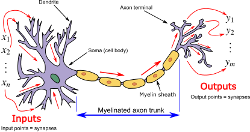
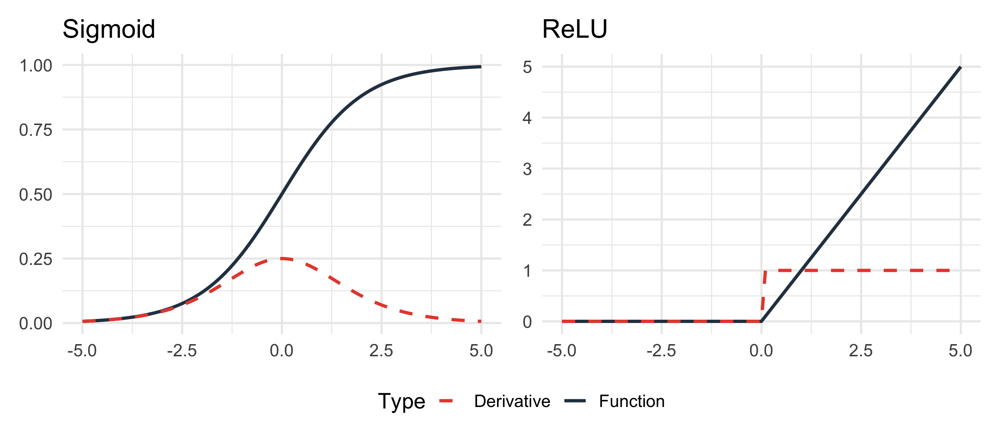
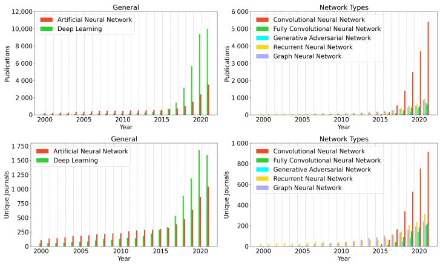
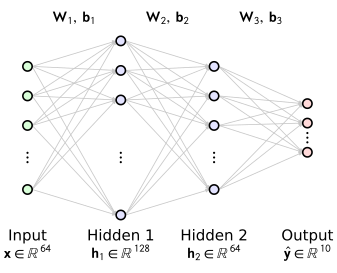
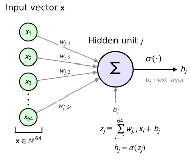

```{python}
#| include: false
import sys
sys.path.append('utils')
import matplotlib.pyplot as plt
from ann_plots import *
```


## Overview: Neural networks

::: {.callout-note icon=false title="Learning objectives"}
- describe a feed-forward network as a composition of layers
- derive the backward pass for a dense and a sigmoid layer
- map each backprop formula to a line of code
- train a small network to classify handwritten digits
:::

* [Neural networks: Review](#ann-intro)
* [ANN Architecture](#ann)
* [Toy example](#toy)
* [Matrix calculus](#matrixc)
* [Backpropagation with matrix notation](#backprop)
* [Gradient descent](#gradient)
* [Python implementation](#python)


## ANNs: Overview {#ann-intro}

::: {.columns}
::: {.column width="50%"}

```{python}
#| echo: false
#| fig-align: center
plot_neural_net(figsize=(8,5))
plt.show()
```

:::

::: {.column width="50%"}

- An artificial neural network (ANN) is a **function** composed of neurons, weights, and activation functions
- Neurons are grouped into three main categories of layers:
    - **Input layer**: Raw features of input data
    - **Hidden layers**: intermediate representations
    - **Output layer**: The prediction
- Each edge is a learnable **weight**
- Naming convention for an N-layer ANN
    - N-1 layers of hidden units
    - 1 output layer
    - In this figure, we have 2 hidden layers + output = **3-layer ANN**

:::
:::

## Neuron


:::: {.columns}
::: {.column width="50%"}

```{python}
#| echo: false
#| fig-align: center
fig = plot_neuron(figsize=(6, 6))
plt.show()
```

::: {layout-align="center"}
{width=50% fig-align="center"}
:::
::: {.tiny-credit}
image credit: <https://en.wikipedia.org/wiki/Biological_neuron_model>
:::

:::
::: {.column width="50%"}

::: {.callout-important  icon=false title="Neuron"}
Each neuron computes a **weighted sum** of its inputs (the input values, or the activations of the previous layer), adds a **bias**, and applies a **non-linear activation function**.
:::

$$
\begin{align*}
z &= \sum_{i=1}^{n} w_i x_i + b = \mathbf{w}^T\mathbf{x} + b
\\
h &= \sigma(z)
\end{align*}
$$ 

- $w_i$: weights, $b$: bias. Both are **learnable**
- $z$: the pre-activation, $h$: the activation
- A layer in which every neuron receives every output of the previous layer is called a **fully connected** (dense, linear) layer

:::
::::

## Activation functions

* Without a non-linearity, a stack of dense layers collapses into a single linear map: e.g., $\mathbf{W}_2(\mathbf{W}_1\mathbf{x}) = (\mathbf{W}_2\mathbf{W}_1)\mathbf{x}$.
* Activation functions add non-linearity, enabling ANNs to learn complex patterns

<br/>

:::: {.columns}
::: {.column width="48%"}
**Sigmoid**

$$ 
\sigma(z) = \frac{1}{1 + e^{-z}} 
$$ {#eq-sigmoid}

:::
::: {.column width="48%"}
**ReLU** (Rectified Linear Unit)

$$ 
f(z) = \max(0, z) 
$$ {#eq-relu}

:::
::::

{fig-align="center" width="90%"}


## Representation power


::: {.columns}
::: {.column width="55%"}
```{python}
#| echo: false
#| fig-align: center
plot_maximum_chaos(figsize=(9,4.5))
plt.show()
```

:::

::: {.column width="45%"}

::: {.callout-note icon=false title="Approximation"}
A network with one hidden layer and enough hidden units can approximate any continuous function on a bounded domain to arbitrary accuracy.^[Cybenko G (1989) Approximation by superpositions of a sigmoidal function. _Math Control Signals_ **2**:303–314]
:::

* The theorem says a good network exists. It does not say we can find it, or how many units are needed
* In practice, depth often represents complex functions far more efficiently than width
* Finding the weights is the job of backprop + gradient descent
:::
:::

## Forward pass: input → prediction → loss

```{python}
#| echo: false
#| fig-align: center
draw_nn_forward_pass(figsize=(8,5))
plt.show()
```

## Backward pass: loss → gradients

```{python}
#| echo: false
#| fig-align: center
draw_nn_backpropagation(figsize=(8,5))
plt.show()
```

* Following this, weights are updated to reduce the error

## Applications in bio-medicine

::: {layout-align="center"}
{width=65% fig-align="center"}
:::

::: {.tiny-credit}
Weiss R, et al (2022) [Applications of Neural Networks in Biomedical Data Analysis. _Biomedicines_ **10**:1469](https://pubmed.ncbi.nlm.nih.gov/35884772/).
:::

- There is hardly any topic in biomedicine that has not been modeled with ANNs of one type or another


## Review: ANN Architecture and Matrix Representation {#ann}


::: {.callout-note icon=false title="Example ANN"}

- We will review the architecture of simple ANNs using the classic digit recognition dataset available in `scikit-learn`.
- Input: $8\times 8$ grey-scale images of handwritten digits, **flattened** row by row into a vector of 64 pixel values
- Classification goal: Determine which of the digits $0,\ldots, 9$ is represented by the image ($10\times 1$ output vector)
- [HOMEWORK]{.hw-badge} You will code a simple ANN for this classification task.

:::

```{python}
#| echo: false
#| fig-width: 4
#| fig-height: 4
#| out-width: "50%"
#| fig-align: center
from matplotlib import pyplot as plt
from sklearn.datasets import load_digits

digits = load_digits()

fig = plt.figure(figsize=(4, 4))  # figure size in inches
fig.subplots_adjust(left=0, right=1, bottom=0, top=1, hspace=0.05, wspace=0.05)

for i in range(64):
    ax = fig.add_subplot(8, 8, i + 1, xticks=[], yticks=[])
    ax.imshow(digits.images[i], cmap=plt.cm.binary, interpolation='nearest')
    # label the image with the target value
    ax.text(0, 7, str(digits.target[i]), color='red')
```


## ANN Architecture

:::: {.columns}
::: {.column width="40%"}
- Input layer: $\mathbf{x}\in\mathbb{R}^{64}$ (one neuron per pixel)
- Two hidden layers: 128 and 64 neurons
- Output layer: $\hat{\mathbf{y}}\in\mathbb{R}^{10}$ (one neuron per digit)
- A **3-layer ANN** in our naming convention
:::

::: {.column width="60%"}
::: {layout-align="center"}
{width=100% fig-align="center"}

ANN Architecture: $64 \to 128 \to 64 \to 10$ (column height $\propto \sqrt{\text{layer size}}$)
:::
:::
::::


## Representing the network using matrices

::::: {.columns}
:::: {.column width="50%"}

::: {layout-align="center"}
{width=100% fig-align="center"}
:::
::: {style="font-size: 0.8em;"}
- $w_{j,i}$: **weight** from input $i$ to neuron $j$ (learnable)
- $z_j$: the weighted sum, or **pre-activation**
- $h_j$: the **activation**, passed on to the next layer
- Row $j$ of $\mathbf{W}$ holds the weights into neuron $j$
:::

::::
:::: {.column width="50%"}

$$
\mathbf{z} = \mathbf{W}\mathbf{x} + \mathbf{b}, \qquad \mathbf{h} = \sigma(\mathbf{z})
$$

::: {style="font-size: 0.85em;"}
$$
\underbrace{\begin{bmatrix}
w_{1,1} & \cdots & w_{1,64} \\
\vdots & \ddots & \vdots \\
w_{128,1} & \cdots & w_{128,64}
\end{bmatrix}}_{128\times 64}
\underbrace{\begin{bmatrix} x_1\\ \vdots \\ x_{64} \end{bmatrix}}_{64\times 1}
+
\underbrace{\begin{bmatrix} b_1\\ \vdots \\ b_{128} \end{bmatrix}}_{128\times 1}
=
\underbrace{\begin{bmatrix} z_1\\ \vdots \\ z_{128} \end{bmatrix}}_{128\times 1}
$$

followed by the element-wise activation $h_j=\sigma(z_j)$, $j=1,\ldots,128$.

$$
\underbrace{\begin{bmatrix} h_1\\ \vdots \\ h_{128} \end{bmatrix}}_{128\times 1} =
\underbrace{\begin{bmatrix} \sigma(z_1)\\ \vdots \\ \sigma(z_{128}) \end{bmatrix}}_{128\times 1}
$$

* By convention, the output of the activation function can be represented as $a_j=\sigma(z_j)$ or $h_j=\sigma(z_j)$
* In these slides, we will use $h_j=\sigma(z_j)$
:::
::::
:::::


## The Forward Pass: Step-by-Step

For layers $l = 1,\ldots,L$, starting from $\mathbf{h}_0 = \mathbf{x}$, each layer implements a three-step cycle:

:::: {.columns}
::: {.column width="50%"}
### 1. Weighted sum
$$\mathbf{z}_l = \mathbf{W}_l\,\mathbf{h}_{l-1} + \mathbf{b}_l$$

### 2. Activation
$$\mathbf{h}_l = \sigma(\mathbf{z}_l)$$
$\sigma$ is applied element-wise (like Sigmoid or ReLU)

### 3. Propagation
$\mathbf{h}_l$ becomes the input of layer $l+1$. The last activation is the prediction: $\hat{\mathbf{y}} = \mathbf{h}_L$
:::

::: {.column width="50%"}
Dimensions for our digit network ($L=3$):

| $l$ | $\mathbf{W}_l$ | $\mathbf{b}_l$ | $\mathbf{z}_l,\ \mathbf{h}_l$ |
|:-:|:-:|:-:|:-:|
| 1 | $128\times 64$ | $128\times 1$ | $128\times 1$ |
| 2 | $64\times 128$ | $64\times 1$ | $64\times 1$ |
| 3 | $10\times 64$ | $10\times 1$ | $10\times 1$ |
:::
::::


## The network as a function

:::: {.columns}
::: {.column width="50%"}
**A neuron** is a function of the previous layer's activations:
$$h_j = \sigma\!\left(\mathbf{w}_j^T\,\mathbf{h}_{l-1} + b_j\right)$$
With the sigmoid, its value lies between 0 and 1.
:::

::: {.column width="50%"}
**The network** is a function $\mathbb{R}^{64}\to\mathbb{R}^{10}$, a composition of layers:
$$\hat{\mathbf{y}} = f_3\bigl(f_2\bigl(f_1(\mathbf{x})\bigr)\bigr)$$
where $f_l(\mathbf{h}) = \sigma(\mathbf{W}_l\mathbf{h} + \mathbf{b}_l)$
:::
::::

Because the network is a composition of functions, its derivative follows from the **chain rule**. That is the basis of backprop.

## Backpropagation

::: {.callout-note icon=false title="Backpropagation"}
Backprop is the **core**  algorithm behind deep learning: an efficient way to compute the gradient of the loss with respect to **every parameter**, using the chain rule.
:::

```{python}
#| echo: false
#| fig-align: center
draw_backprop_chain(fig_size = (7, 2.5))
plt.show()
```

- Each layer is a modular block: its forward operation computes an output from its input and its parameters $\theta$. Blocks chain together into a computation graph
- Learning means finding the parameters that minimize the loss, which we do with [gradient descent]{style="color: green; font-weight: bold;"}
- Gradient descent needs $\partial\mathcal{L}/\partial\theta$ for every layer. Backprop obtains these by running the blocks in reverse


## Backprop: Toy example {#toy}

- An algorithm that efficiently calculates the gradient of the loss with respect to each  parameter in a computation graph.

```{python}
#| echo: false
#| fig-align: center
draw_toy_network(figsize=(8, 5))
plt.show()
```

- In backpropagation, we need to know how the Loss ($\mathcal{L}$) changes with respect to the weights.
- We will start off by calculating the backprop by hand with this toy network


## Backprop by hand: Forward pass equations

:::: {.columns}

::: {.column width="55%"}

* $z_1 = w_1x_1 + w_3x_2 + b_1$
* $h_1 = \sigma(z_1)$
* $z_2 = w_2x_1 + w_4x_2 + b_2$
* $h_2 = \sigma(z_2)$
* $\hat{y} = w_5h_1 +  w_6h_2 + b_3$
* $z_1$ and $z_2$ are intermediate values that form the argument to the activation function
* $x_1$, $x_2$, and $y$ are constants as far as the loss function is concerned. However, the loss will change as a function of the parameters 
$$
\mathcal{L} = \mathcal{L}(w_1,  w_2,w_3, w_4, w_5, w_6, b_1, b_2, b_3; x_1, x_2, y)
$$

* Equivalently: $\mathcal{L} = \mathcal{L}(\Theta; \mathbf{x};y)$

:::

::: {.column width="45%"}

```{python}
#| echo: false
#| fig-align: center
draw_toy_network(figsize=(8, 5))
plt.show()
```

:::{.small-text}
The parameters of the toy neural network are $\theta = (w_1,w_2,w_3,w_4,w_5,w_6,b_1,b_2,b_3)$

Goal: find the derivative of the loss function with respect to each of these parameters
:::


:::
::::


## Backprop by hand: Calculating partial derivatives

- Our network has a sigmoid activation function in the hidden layer, no activation in the output layer:

$$
\sigma(z) = \dfrac{1}{1+e^{-z}}
$$


To calculate the gradient of the loss function, $\nabla_{\Theta}\mathcal{L}$, we need all the partial derivatives -- for all weights and biases. Let's do this step by step

- derivative of the sigmoid activation function
$$
\begin{eqnarray*}
\dfrac{d\sigma(z)}{dz} =\dfrac{d}{dz} \dfrac{1}{1+e^{-z}} &=&\sigma(z) \cdot \left( 1 -\sigma(z) \right)
\end{eqnarray*}
$$

- Refer to the [previous lecture]{style="color: green; font-weight: bold;"} for details of the derivation.
- The forward pass calculates $\sigma(z)$. Using this derivation, the backward pass can __easily__ calculate the partial derivative using the value of $\sigma(z)$.

## Derivative of the loss function

- In our toy network, $\hat{y}$ is the output of the network (i.e., the *prediction*).
- $y$ is the true value
- The squared error loss function is thus 

$$
\mathcal{L}=\dfrac{1}{2}(y-\hat{y})^2
$$

- The first derivative of the loss function with respect to the output is then
$$
\dfrac{\partial \mathcal{L}}{\partial \hat{y}} = 2\cdot \dfrac{1}{2}(y-\hat{y})\cdot(-1)
= \hat{y} - y
$$


## How does the loss change as $w_6$ changes?

::: {.columns}

::: {.column width="50%"}

- We have by the chain rule:

$$
\dfrac{\partial \mathcal{L}}{\partial w_6} = 
\dfrac{\partial \mathcal{L}}{\partial \hat{y}} \cdot \dfrac{\partial \hat{y}}{\partial w_6}
$$

- from the above, we had that $\dfrac{\partial \mathcal{L}}{\partial \hat{y}} = \hat{y} - y$
- we can reuse this value and now just need $\dfrac{\partial \hat{y}}{\partial w_6}$

$$
\dfrac{\partial \hat{y}}{\partial w_6}
=
\dfrac{\partial (w_5h_1 + w_6h_2+b_3)}{\partial w_6} = h_2
$$

* We have calculated the value of $h_2$ in the forward pass, so this is easy
$$
\dfrac{\partial \mathcal{L}}{\partial w_6} =  (\hat{y} - y)h_2
$$

:::

::: {.column width="50%"}
```{python}
#| echo: false
#| fig-width: 6
#| fig-height: 5
#| fig-align: center
draw_toy_network(figsize=(8,5))
plt.show()
``` 

* Similar logic gets us $\dfrac{\partial \mathcal{L}}{\partial w_5} =  (\hat{y} - y)h_1$

:::
:::


## How does the loss change as $b_3$ changes?

::: {.columns}

::: {.column width="50%"}


We have by the chain rule

$$
\dfrac{\partial \mathcal{L}}{\partial b_3} = \dfrac{\partial \mathcal{L}}{\partial \hat{y}} \cdot \dfrac{\partial \hat{y}}{\partial b_3}
$$

- Recall that $\dfrac{\partial \mathcal{L}}{\partial \hat{y}} = \hat{y} - y$
- we can reuse this value and now just need $\dfrac{\partial \hat{y}}{\partial b_3}$

$$
\dfrac{\partial \hat{y}}{\partial b_3}
=
\dfrac{\partial (w_5h_1 + w_6h_2+b_3)}{\partial b_3} = 1
$$


* this is easy
$$
\dfrac{\partial \mathcal{L}}{\partial b_3} =  (\hat{y} - y)\cdot 1 =  \hat{y} - y
$$


:::

::: {.column width="50%"}
```{python}
#| echo: false
#| fig-width: 12
#| fig-height: 5
#| out-width: "100%"
#| fig-align: center
draw_toy_network(figsize=(8,5))
plt.show()
``` 

:::
:::


## How does the loss change as $b_2$ changes?

::: {.columns}

::: {.column width="50%"}


We have by the chain rule

$$
\dfrac{\partial \mathcal{L}}{\partial b_2} = \dfrac{\partial \mathcal{L}}{\partial \hat{y}} \cdot \dfrac{\partial \hat{y}}{\partial h_2}
\cdot \dfrac{\partial h_2}{\partial z_2}
\cdot \dfrac{\partial z_2}{\partial b_2}
$$

* We had that $\frac{\partial \mathcal{L}}{\partial \hat{y}} =  \hat{y} - y$
* $\hat{y} = w_5h_1 +  w_6h_2 + b_3$ and thus $\frac{\partial \hat{y}}{\partial h_2} = w_6$
* $h_2 = \sigma(z_2)$, and so
$$
\dfrac{\partial h_2}{\partial z_2} = \sigma^{\prime}(z_2) = \sigma(z_2)(1-\sigma(z_2)) = h_2(1-h_2)
$$

*  $z_2 = w_2x_1 + w_4x_2 + b_2$ and so $\frac{\partial z_2}{\partial b_2} = 1$
* Putting everything together, we have
$$
\dfrac{\partial \mathcal{L}}{\partial b_2} =
(\hat{y} - y)\cdot w_6 \cdot h_2(1-h_2) \cdot 1
$$

:::

::: {.column width="50%"}
```{python}
#| echo: false
#| fig-align: center
draw_toy_network()
plt.show()
``` 

:::
:::

## How does the loss change as the other parameters change?

- [HOMEWORK]{.hw-badge}  You will be asked to derive expressions for $w_1, w_2, w_3, w_4, b_1$.
- If we change the network architecture, the activation function, or the loss function, we would need to recalculate these expressions
- This manual procedure is [tedious]{.emph} and would not scale to exploring various network structures for realistic network sizes. 
- We will see it is possible to automate this procedure, but to understand that, we will show how it is possible to use __matrix calculus__ to abstract away some of the fidgety work with the indices


## Matrix calculus: Vector function with scalar argument {#matrixc}

::: {.columns}
::: {.column width="50%"}
* We will review matrix calculus before proceeding.
* Consider the function
$$
\mathbf{f}(t) = \begin{bmatrix} t \cos(t) \\ t \sin (t) \\ t \end{bmatrix}
$$

* In general, we write such functions as 

$$
\mathbf{f}(t) = \begin{bmatrix} f_1(t) \\ f_2(t) \\ \vdots \\ f_n(t) \end{bmatrix}
$$

:::
::: {.column width="50%"}

```{python}
#| echo: false
#| fig-align: center
plot_3d_spiral()
plt.show()
``` 

:::
:::

## Notation

| Object | Font | Example |
|:--|:--|:--|
| Scalar | plain italic | $b$, $x$, $f$, $\mathcal{L}$ |
| Vector (column) | bold lowercase | $\mathbf{x}\in\mathbb{R}^{n}$ |
| Matrix | bold uppercase | $\mathbf{W}\in\mathbb{R}^{m\times n}$ |


## Layout convention: numerator layout

::: {.callout-note icon=false title="Rule"}
The **numerator keeps its shape**; the **denominator is transposed**.
:::

::::: {.columns}
:::: {.column width="55%"}
::: {style="font-size: 0.7em;"}
| Derivative | Result shape |
|:--|:-:|
| $\dfrac{\partial f}{\partial x}$ scalar by scalar | $1\times 1$ |
| $\dfrac{\partial \mathbf{f}}{\partial x}$ vector ($m$) by scalar | $m\times 1$ |
| $\dfrac{\partial f}{\partial \mathbf{x}}$ scalar by vector ($n$) | $1\times n$ (**row**) |
| $\dfrac{\partial \mathbf{f}}{\partial \mathbf{x}}$ vector ($m$) by vector ($n$) | $m\times n$ (Jacobian) |
| $\dfrac{\partial f}{\partial \mathbf{X}}$ scalar by matrix ($n\times m$) | $m\times n$ |
:::
::::

:::: {.column width="45%"}
::: {style="font-size: 0.85em;"}
Example: $f(\mathbf{x}) = x_1^2 + 3x_2$
$$
\dfrac{\partial f}{\partial \mathbf{x}} = \begin{bmatrix} 2x_1 & 3 \end{bmatrix},
\qquad
\nabla f = \left(\dfrac{\partial f}{\partial \mathbf{x}}\right)^T = \begin{bmatrix} 2x_1 \\ 3 \end{bmatrix}
$$

- The derivative is a **row**; the gradient $\nabla f$ is the **column**
- Suppose $\mathcal{L}$ depends on $\mathbf{x}\in\mathbb{R}^n$ through an intermediate vector $\mathbf{u}=\mathbf{g}(\mathbf{x})\in\mathbb{R}^m$. The chain rule is then a plain matrix product, in the same order as the scalar rule; the inner dimension $m$ cancels:
$$
\underbrace{\dfrac{\partial \mathcal{L}}{\partial \mathbf{x}}}_{1\times n} = \underbrace{\dfrac{\partial \mathcal{L}}{\partial \mathbf{u}}}_{1\times m}\,\underbrace{\dfrac{\partial \mathbf{u}}{\partial \mathbf{x}}}_{m\times n}
$$
:::
::::
:::::

::: {style="font-size: 0.65em;"}
Many machine learning texts use the opposite **denominator layout**, where $\partial f/\partial\mathbf{x}$ is a column. Both are fine if used consistently.
:::

## Tangent vector

::: {.callout-note icon=false title="Tangent vector"}
The derivative of $\mathbf{f}(t)$ is called the **tangent vector**. It is obtained by differentiating each component of $\mathbf{f}(t)$.
:::

::::: {.columns}
:::: {.column width="50%"}
::: {style="font-size: 0.8em;"}
$$
\dfrac{\partial \mathbf{f}}{\partial t}
=
\begin{bmatrix} \dfrac{\partial f_1}{\partial t} \\ \dfrac{\partial f_2}{\partial t} \\ \vdots \\ \dfrac{\partial f_n}{\partial t} \end{bmatrix}^{n\times 1}
$$ {#eq-vec-by-scalar}

For our curve:
$$
\dfrac{\partial \mathbf{f}}{\partial t}
=
\begin{bmatrix} \cos t - t\sin t \\ \sin t + t\cos t \\ 1 \end{bmatrix}
$$

:::
::::

:::: {.column width="50%"}
```{python}
#| echo: false
#| fig-align: center
plot_3d_spiral(t0=8.5*np.pi)
plt.show()
```
::::
:::::

## Matrix calculus: Scalar function with vector argument


::: {.callout-note title="Scalar field" }

A function taking a vector argument and returning a scalar is called a __scalar field__: 
$f: \mathbb{R}^n \rightarrow \mathbb{R}$

:::

::: {.columns}
::: {.column width="50%"}

In numerator layout, the derivative is a **row** vector:
$$
\dfrac{\partial f(\mathbf{x})}{\partial \mathbf{x}} = 
\begin{bmatrix} \dfrac{\partial f}{\partial x_1} & \dfrac{\partial f}{\partial x_2} & \cdots & \dfrac{\partial f}{\partial x_n} \end{bmatrix}  
$$ {#eq-scalar-by-vec}


::: 
::: {.column width="50%"}


Another commonly encountered notation is the __gradient__, which by convention is represented as a column vector

$$
\nabla f(\mathbf{x}) = 
\begin{bmatrix} \dfrac{\partial f}{\partial \mathbf{x}} \end{bmatrix}^T
=
\begin{bmatrix} \dfrac{\partial f}{\partial x_1}\\ \dfrac{\partial f}{\partial x_2} \\ \vdots \\ \dfrac{\partial f}{\partial x_n} \end{bmatrix}  
$$ {#eq-gradient}

:::
:::

- Example: $f(\mathbf{x}) = \|\mathbf{x}\|^2 = x_1^2+\cdots+x_n^2$. Then $\dfrac{\partial f}{\partial \mathbf{x}} = 2\mathbf{x}^T$ and $\nabla f = 2\mathbf{x}$
- The gradient points in the direction of steepest ascent of $f$, so **gradient descent** moves along $-\nabla f$

## Matrix calculus: Vector function with vector argument

::: {.callout-note icon=false title="Jacobian"}
For a function $\mathbf{f}: \mathbb{R}^n \rightarrow \mathbb{R}^m$, the first derivative is the $m\times n$ **Jacobian** matrix. Row $i$ holds the derivatives of output $f_i$; column $j$ holds the derivatives with respect to input $x_j$.
:::
$$
\dfrac{\partial \mathbf{f}}{\partial \mathbf{x}}
=
\underbrace{\begin{bmatrix}
\dfrac{\partial f_1}{\partial x_1} & \cdots & \dfrac{\partial f_1}{\partial x_n} \\
\vdots & \ddots & \vdots \\
\dfrac{\partial f_m}{\partial x_1} & \cdots & \dfrac{\partial f_m}{\partial x_n}
\end{bmatrix}}_{m\times n}
=
\begin{bmatrix}
\nabla f_1(\mathbf{x})^T \\ \vdots \\ \nabla f_m(\mathbf{x})^T
\end{bmatrix}
$$ {#eq-jacobian}

- Each row is a transposed gradient (c.f. @eq-gradient): the Jacobian stacks the gradients of the output components
- Example: $\mathbf{f}(\mathbf{x}) = \begin{bmatrix} x_1x_2 \\ x_2+x_3 \end{bmatrix}$ gives $\dfrac{\partial \mathbf{f}}{\partial \mathbf{x}} = \begin{bmatrix} x_2 & x_1 & 0 \\ 0 & 1 & 1 \end{bmatrix}$, a $2\times 3$ matrix


## Matrix calculus: Scalar function with matrix argument

::: {.callout-note icon=false title="Scalar function of a matrix"}
$f: \mathbb{R}^{n\times m}\rightarrow \mathbb{R}$. In numerator layout the denominator is transposed, so if $\mathbf{X}$ is $n\times m$, then $\dfrac{\partial f}{\partial \mathbf{X}}$ is $m\times n$.
:::

::: {style="font-size: 0.85em;"}
$$
\dfrac{\partial f}{\partial \mathbf{X}}
=
\underbrace{\begin{bmatrix}
\dfrac{\partial f}{\partial x_{11}} & \dfrac{\partial f}{\partial x_{21}} & \cdots & \dfrac{\partial f}{\partial x_{n1}} \\
\dfrac{\partial f}{\partial x_{12}} & \dfrac{\partial f}{\partial x_{22}} & \cdots & \dfrac{\partial f}{\partial x_{n2}} \\
\vdots & \vdots & \ddots & \vdots \\
\dfrac{\partial f}{\partial x_{1m}} & \dfrac{\partial f}{\partial x_{2m}} & \cdots & \dfrac{\partial f}{\partial x_{nm}}
\end{bmatrix}}_{m\times n}
$$ {#eq-scalar-by-matrix}
:::

- Compare with a vector: for $\mathbf{x}\in\mathbb{R}^n$, $\dfrac{\partial f}{\partial \mathbf{x}}$ is a $1\times n$ row, ordered like $\mathbf{x}^T$. In the same way, $\dfrac{\partial f}{\partial \mathbf{X}}$ is ordered like $\mathbf{X}^T$: its entry $(j,i)$ is $\partial f/\partial x_{ij}$
- Example: for $f(\mathbf{X}) = \mathbf{a}^T\mathbf{X}\,\mathbf{b}$ with $\mathbf{a}\in\mathbb{R}^n$, $\mathbf{b}\in\mathbb{R}^m$, we get $\dfrac{\partial f}{\partial \mathbf{X}} = \mathbf{b}\,\mathbf{a}^T$, an $m\times n$ matrix

## Backpropagation with matrix notation {#backprop}

A fully connected network is a chain of two kinds of vector-valued layers. In our code, each kind is its own layer class.

:::: {.columns}
::: {.column width="50%"}
**Dense layer** ($\mathbb{R}^n \to \mathbb{R}^m$)
$$
\underbrace{\mathbf{z}_l}_{m\times 1} = \underbrace{\mathbf{W}_l}_{m\times n}\,\underbrace{\mathbf{h}_{l-1}}_{n\times 1} + \underbrace{\mathbf{b}_l}_{m\times 1}
$$
:::

::: {.column width="50%"}
**Activation layer** ($\mathbb{R}^m \to \mathbb{R}^m$)
$$
\mathbf{h}_l = \sigma(\mathbf{z}_l) = \begin{bmatrix} \sigma(z_1) \\ \vdots \\ \sigma(z_m) \end{bmatrix}
$$
$\sigma$ is applied element-wise
:::
::::

- **Forward pass:** $\mathbf{h}_0=\mathbf{x}$; each layer's output is the next layer's input; the final output is the prediction $\hat{\mathbf{y}}$
- The prediction and the label $\mathbf{y}$ give the scalar loss $\mathcal{L} = L(\hat{\mathbf{y}}, \mathbf{y})$
- **Backward pass:** move $\partial\mathcal{L}/\partial(\cdot)$ **backwards**, layer by layer, and collect $\partial\mathcal{L}/\partial\mathbf{W}_l$ and $\partial\mathcal{L}/\partial\mathbf{b}_l$ on the way

## Backprop derivatives

- Every layer receives, from the layer after it, the derivative of the loss with respect to **its output**. It must pass on the derivative with respect to **its input**
- The chain rule connects the two as a matrix product:
$$
\underbrace{\dfrac{\partial \mathcal{L}}{\partial(\text{input})}}_{1\times n} = \underbrace{\dfrac{\partial \mathcal{L}}{\partial(\text{output})}}_{1\times m}\;\underbrace{\dfrac{\partial(\text{output})}{\partial(\text{input})}}_{m\times n}
$$
- For our two kinds of layers:

| Layer | $\partial\mathcal{L}/\partial(\text{output})$ | $\partial\mathcal{L}/\partial(\text{input})$ |
|:--|:-:|:-:|
| Dense | $\partial\mathcal{L}/\partial\mathbf{z}_l$ | $\partial\mathcal{L}/\partial\mathbf{h}_{l-1}$ |
| Activation | $\partial\mathcal{L}/\partial\mathbf{h}_l$ | $\partial\mathcal{L}/\partial\mathbf{z}_l$ |

- The Jacobian $\partial(\text{output})/\partial(\text{input})$ differs for the two layer types. For an activation layer it is diagonal, and that is where the element-wise product ($\odot$) comes from


## Backprop: derivative of the loss

::: {.callout-note icon=false title="Where backprop starts"}
The backward pass starts with $\partial\mathcal{L}/\partial\hat{\mathbf{y}}$, the derivative of the loss with respect to the network's output. Its form depends on the loss function.
:::


- We use the squared-error loss. For one example, with prediction $\hat{\mathbf{y}}$ and label $\mathbf{y}$ (both $10\times 1$ for our digit network):
$$
\mathcal{L} = \tfrac{1}{2}\lVert \hat{\mathbf{y}} - \mathbf{y}\rVert^2 = \tfrac{1}{2}\sum_{k=1}^{10}(\hat{y}_k - y_k)^2
$$ {#eq-mse}
- Differentiating with respect to each component gives $\partial\mathcal{L}/\partial\hat{y}_k = \hat{y}_k - y_k$. Since $\hat{\mathbf{y}}$ is a column vector, numerator layout stacks these into a **row** vector:
$$
\dfrac{\partial \mathcal{L}}{\partial \hat{\mathbf{y}}}
= \underbrace{\begin{bmatrix} \hat{y}_1 - y_1 & \hat{y}_2 - y_2 & \cdots & \hat{y}_{10} - y_{10} \end{bmatrix}}_{1\times 10}
= (\hat{\mathbf{y}} - \mathbf{y})^T
$$ {#eq-mse-prime}


## The Jacobian of the activation layer

- The activation layer maps $\mathbf{z}\in\mathbb{R}^m$ to $\mathbf{h}=\sigma(\mathbf{z})\in\mathbb{R}^m$, applying $\sigma$ to each element separately
- Since $h_i$ depends only on $z_i$ (and on no other $z_j$), we have $\partial h_i/\partial z_j = 0$ for $i\neq j$: the Jacobian is **diagonal**

$$
\dfrac{\partial \mathbf{h}}{\partial \mathbf{z}} =
\begin{bmatrix}
\dfrac{\partial h_1}{\partial z_1} & \cdots & \dfrac{\partial h_1}{\partial z_m} \\
\vdots & \ddots & \vdots \\
\dfrac{\partial h_m}{\partial z_1} & \cdots & \dfrac{\partial h_m}{\partial z_m}
\end{bmatrix}
=
\begin{bmatrix}
\sigma'(z_1) & & 0 \\
& \ddots & \\
0 & & \sigma'(z_m)
\end{bmatrix}
$$

- The matrix is square ($m\times m$). For the sigmoid, $\sigma'(z_i) = h_i(1-h_i)$, which we already know from the forward pass


## Backprop through an activation layer

The derivative at the layer's input $\mathbf{z}$ follows from the derivative at its output $\mathbf{h}$ by the chain rule: a row vector times the diagonal Jacobian.

$$
\begin{aligned}
\frac{\partial \mathcal{L}}{\partial \mathbf{z}} &= \frac{\partial \mathcal{L}}{\partial \mathbf{h}} \cdot \frac{\partial \mathbf{h}}{\partial \mathbf{z}} \\
&= \begin{bmatrix} \dfrac{\partial \mathcal{L}}{\partial h_1} & \cdots & \dfrac{\partial \mathcal{L}}{\partial h_m} \end{bmatrix}
\begin{bmatrix} \sigma'(z_1) & & 0 \\ & \ddots & \\ 0 & & \sigma'(z_m) \end{bmatrix} \\
&= \begin{bmatrix} \dfrac{\partial \mathcal{L}}{\partial h_1}\sigma'(z_1) & \cdots & \dfrac{\partial \mathcal{L}}{\partial h_m}\sigma'(z_m) \end{bmatrix}
\end{aligned}
$$

- This is the element-wise (Hadamard) product ($\odot$) of two row vectors:
$$
\frac{\partial \mathcal{L}}{\partial \mathbf{z}} = \frac{\partial \mathcal{L}}{\partial \mathbf{h}} \odot \sigma'(\mathbf{z})^T
$$ {#eq-sigmoid-p}
- Multiplying by a diagonal matrix costs $O(m)$ operations instead of the $O(m^2)$ of a full matrix–vector product


## Backprop through a dense layer: the input

For $\mathbf{z}_l = \mathbf{W}_l\mathbf{h}_{l-1} + \mathbf{b}_l$, the chain rule gives
$$
\begin{aligned}
\frac{\partial \mathcal{L}}{\partial \mathbf{h}_{l-1}} &= \frac{\partial \mathcal{L}}{\partial \mathbf{z}_l}\,\frac{\partial \mathbf{z}_l}{\partial \mathbf{h}_{l-1}} \\
&= \frac{\partial \mathcal{L}}{\partial \mathbf{z}_l}\,\frac{\partial (\mathbf{W}_l\mathbf{h}_{l-1}+\mathbf{b}_l)}{\partial \mathbf{h}_{l-1}} \\
&= \frac{\partial \mathcal{L}}{\partial \mathbf{z}_l}\,\mathbf{W}_l
\end{aligned}
$$ {#eq-bp-fully-conn}

- The Jacobian $\partial\mathbf{z}_l/\partial\mathbf{h}_{l-1}$ is $\mathbf{W}_l$ (derivation on the next slide). The bias does not depend on $\mathbf{h}_{l-1}$, so it drops out
- The shapes match, with no transpose needed:
$$
\underbrace{\frac{\partial \mathcal{L}}{\partial \mathbf{z}_l}}_{1\times m}\;\underbrace{\mathbf{W}_l}_{m\times n} = \underbrace{\frac{\partial \mathcal{L}}{\partial \mathbf{h}_{l-1}}}_{1\times n}
$$


## Derivative of the dense layer: derivation

Dropping the layer index for readability, $\mathbf{z} = \mathbf{W}\mathbf{h} + \mathbf{b}$ with $\mathbf{h}\in\mathbb{R}^n$ and $\mathbf{z}\in\mathbb{R}^m$. Written out, the first output is
$$
z_1 = w_{11}h_1 + w_{12}h_2 + \dots + w_{1n}h_n + b_1
$$

Its derivative with respect to the first input $h_1$ is
$$
\frac{\partial z_1}{\partial h_1} = w_{11}
$$

- In general, $\dfrac{\partial z_i}{\partial h_j} = w_{ij}$: output $i$ depends on input $j$ only through the single term $w_{ij}h_j$
- Row $i$ of the Jacobian collects these for all inputs $j$, so stacking the rows gives the weight matrix:
$$
\frac{\partial \mathbf{z}}{\partial \mathbf{h}} = \begin{bmatrix} w_{11} & \cdots & w_{1n}\\ \vdots & \ddots & \vdots\\ w_{m1} & \cdots & w_{mn}\end{bmatrix} = \mathbf{W} \qquad (m\times n)
$$


## Partial derivatives of the bias

- So far we have passed the derivative $\partial\mathcal{L}/\partial\mathbf{z}_l$ backward from layer to layer
- The goal of backprop is the derivative with respect to each **bias** and **weight** (how would a change in the parameter affect the loss?), which **gradient descent** uses to update them
- For the bias, the chain rule gives
$$
\begin{aligned}
\dfrac{\partial \mathcal{L}}{\partial \mathbf{b}_l} &= \dfrac{\partial \mathcal{L}}{\partial \mathbf{z}_l}\,\dfrac{\partial \mathbf{z}_l}{\partial \mathbf{b}_l} \\
&= \dfrac{\partial \mathcal{L}}{\partial \mathbf{z}_l}\,\dfrac{\partial (\mathbf{W}_l\mathbf{h}_{l-1}+\mathbf{b}_l)}{\partial \mathbf{b}_l}\\
&= \dfrac{\partial \mathcal{L}}{\partial \mathbf{z}_l}\,(\mathbf{0} + \mathbf{I} )\\
&= \dfrac{\partial \mathcal{L}}{\partial \mathbf{z}_l}
\end{aligned}
$$ {#eq-partial-deriv-bias}
- The bias gradient is the derivative that has just arrived at the layer's output, so there is nothing more to compute

## Partial derivatives of the weights: derivation

- Write $\mathbf{h}=\mathbf{h}_{l-1}$. Output $i$ of the dense layer uses only row $i$ of $\mathbf{W}_l$:
$$
z_i = \sum_{j=1}^{n} w_{ij}h_j + b_i
$$
- So the weight $w_{ij}$ affects only $z_i$, and
$$
\dfrac{\partial z_k}{\partial w_{ij}} = \begin{cases} h_j & k = i \\ 0 & k\neq i \end{cases}
$$
- The chain rule, summed over all outputs $z_k$, then gives
$$
\dfrac{\partial \mathcal{L}}{\partial w_{ij}} = \sum_{k=1}^{m}\dfrac{\partial \mathcal{L}}{\partial z_k}\,\dfrac{\partial z_k}{\partial w_{ij}} = \dfrac{\partial \mathcal{L}}{\partial z_i}\,h_j
$$
- Differentiating a vector by a matrix would need a three-index array. Working one weight at a time avoids it

## Partial derivatives of the weights: result

Let $\delta_i = \partial\mathcal{L}/\partial z_i$, so that $\dfrac{\partial \mathcal{L}}{\partial \mathbf{z}_l} = \begin{bmatrix}\delta_1 & \cdots & \delta_m\end{bmatrix}$. Then $\partial\mathcal{L}/\partial w_{ij} = \delta_i h_j$, and in numerator layout entry $(j,i)$ of $\partial\mathcal{L}/\partial\mathbf{W}_l$ is $h_j\delta_i$:

$$
\underbrace{\dfrac{\partial \mathcal{L}}{\partial \mathbf{W}_l}}_{n\times m}
=
\underbrace{\begin{bmatrix} h_1\\ \vdots\\ h_n \end{bmatrix}}_{\mathbf{h}_{l-1},\; n\times 1}
\underbrace{\begin{bmatrix} \delta_1 & \cdots & \delta_m \end{bmatrix}}_{\partial\mathcal{L}/\partial\mathbf{z}_l,\; 1\times m}
=
\begin{bmatrix} h_1\delta_1 & \cdots & h_1\delta_m\\ \vdots & \ddots & \vdots\\ h_n\delta_1 & \cdots & h_n\delta_m \end{bmatrix}
$$ {#eq-partial-deriv-weights}

- The gradient is an **outer product**: the layer's input times the derivative at its output
- $\mathbf{W}_l$ is $m\times n$ but its gradient is $n\times m$ (the denominator is transposed). In the Python code we will store $\mathbf{W}_l^T$, so the gradient has exactly the shape of the stored matrix


## Backprop algorithm: Summary 
The entire backprop algorithm can be summarized as follows:

1. **Forward pass:** compute $\hat{\mathbf{y}}$ layer by layer, storing every layer's input and output
2. Compute $\partial\mathcal{L}/\partial\hat{\mathbf{y}}$ from $\hat{\mathbf{y}}$ and the label $\mathbf{y}$ (this depends on the loss function)
3. **Backward pass:** go through the layers in reverse order. Each layer takes the derivative with respect to its output, returns the derivative with respect to its input, and (for dense layers) collects $\partial\mathcal{L}/\partial\mathbf{W}_l$ and $\partial\mathcal{L}/\partial\mathbf{b}_l$

```{python}
#| echo: false
#| fig-align: center
draw_backprop_chain(fig_size = (10, 3.6))
plt.show()
```


## Gradient descent {#gradient}


- See the [previous lecture]{style="color: green; font-weight: bold;"} for an introduction to gradient descent in the setting of logistic regression.

```{python}
#| echo: false
#| fig-align: center
plot_gd(figsize=(8, 5))
plt.show()
``` 

## Stochastic gradient descent

* The loss over a training set of $N$ examples is the average of the per-example losses:
$$
\mathcal{L}(\theta) = \dfrac{1}{N}\sum_{i=1}^{N}\mathcal{L}_i(\theta), \qquad \mathcal{L}_i(\theta) = L(\theta; \mathbf{x}_i, \mathbf{y}_i)
$$
* Gradient descent needs $\nabla_\theta\mathcal{L}$, which is obtained by backprop
* __batch training__ refers to averaging over all $N$ training examples for each step
* As the volume of training data increased, it became less sensible to pass all data to the model for each gradient descent step
* __minibatch training__ refers to using a subset of the data for each gradient descent step
* Because this procedure is noisy compared to full batch training, we refer to it as __stochastic gradient descent__ (SGD). The noise may even be an advantage, because it may help avoid falling into local minima
* The minibatch size is a hyperparameter. Typically the order of the examples is randomized and chunks of data are used until all samples have been seen (one pass is an __epoch__). Our code simply draws a fresh random minibatch for every step


## Gradient descent (GD): Momentum

* See [previous lecture]{style="color: green; font-weight: bold;"} for introduction to GD
* Plain GD can be slow on flat regions and can oscillate across narrow valleys. __Momentum__ adds inertia to the update: each step keeps part of the direction of the previous steps (and may carry the parameters past shallow local minima)

* Recall that the standard update step is
$$
\theta \leftarrow \theta - \eta\,\nabla_\theta\mathcal{L}
$$

* With momentum, this becomes

$$
\begin{aligned}
v &\leftarrow \mu v - \eta\,\nabla_\theta\mathcal{L}\\
\theta &\leftarrow \theta + v
\end{aligned}
$$

* $v$ is the velocity (usually initialized to zero) and $\mu\in[0,1]$ is the momentum coefficient. Each step adds back a fraction $\mu$ of the previous one, which tends to keep things going in the same direction


## FFN in Python: Dimensions and orientations {#python}

- In the theory slides, vectors are **columns**. For a dense layer (dropping the layer index):
$$
\underbrace{\mathbf{z}}_{m \times 1} = \underbrace{\mathbf{W}}_{m \times n} \underbrace{\mathbf{h}}_{n \times 1} + \underbrace{\mathbf{b}}_{m \times 1}
$$
- Frameworks such as **scikit-learn** and **PyTorch** work with **row** vectors. Transposing both sides gives the form we implement:
$$
\begin{aligned}
\mathbf{z}^T &= (\mathbf{W}\mathbf{h} + \mathbf{b})^T = (\mathbf{W}\mathbf{h})^T + \mathbf{b}^T \\
\underbrace{\mathbf{z}^T}_{1 \times m} &= \underbrace{\mathbf{h}^T}_{1 \times n} \underbrace{\mathbf{W}^T}_{n \times m} + \underbrace{\mathbf{b}^T}_{1 \times m}
\end{aligned}
$$
- Our code stores $\mathbf{W}^T$ (shape $n\times m$) directly, as scikit-learn does. The gradients are rows as well (numerator layout), so the backprop formulas carry over almost line by line

## The Rules of Transposition

To go from the column-vector theory to the row-vector implementation (as in PyTorch or scikit-learn), we rely on these fundamental properties:


| Rule Name | Mathematical Definition | Logic / Description |
|:---|:---:|:---|
| **Sum/Difference** | $(A \pm B)^T = A^T \pm B^T$ | The transpose of a sum is the sum of the transposes. |
| **Product Rule** | $(AB)^T = B^T A^T$ | The order of multiplication **reverses**. This is why $\mathbf{Wx}$ becomes $\mathbf{x}^T\mathbf{W}^T$. |
| **Scalar Rule** | $(\alpha A)^T = \alpha A^T$ | A scalar $\alpha$ is unaffected by the transpose operation. |
| **Involution** | $(A^T)^T = A$ | Transposing a matrix twice returns it to its original form. |
| **Dimensions** | $(m \times n)^T = (n \times m)$ | Rows become columns; columns become rows. |


## From Vectors to Batches in Python

In practice, we rarely compute one sample at a time. We use **batches** to leverage GPU parallelism.

**1. The "flat" array notation `(n,)`.** In NumPy/scikit-learn, a 1D array has the shape `(n,)`.

* It is neither a row nor a column matrix.
* **However**, when you use `dot()` or `@`, Python treats it as a **row vector** by default:
  * $\text{Shape } (n,) \times \text{Shape } (n, m) \rightarrow \text{Shape } (m,)$ is like $\mathbf{x}^{1\times n}\mathbf{W}^{n\times m} \rightarrow \mathbf{y}^{1\times m}$

**2. Batch representation (the design matrix).** For a batch of $k$ samples, we stack the row vectors $\mathbf{x}^T$ into a **design matrix** $\mathbf{X}$:

$$
\underbrace{\mathbf{Y}}_{k \times m} = \underbrace{\mathbf{X}}_{k \times n} \underbrace{\mathbf{W}^T}_{n \times m} + \underbrace{\mathbf{b}^T}_{1 \times m}
$$


::: {.callout-tip}
## Broadcasting the Bias
Note that $\mathbf{b}^T$ is $1 \times m$, but $\mathbf{Y}$ is $k \times m$. NumPy and PyTorch use **broadcasting** to automatically "stretch" the bias vector so it is added to every single row in the batch.
:::


## FFN in Python

::: {.callout-note icon=false title="Toy FFN"}

To help illustrate the concepts in this lecture, we close with the demonstration of a toy Python implementation we will use to predict 
the identity of hand-written digits

:::

- Let's begin with the encoding of our activation function (sigmoid; See @eq-sigmoid). We want the function to accept an $n\times 1$ vector as input and to return a vector of the same size

```{python}
#| fig-align: center
#| echo: true
#| eval: false
def sigmoid(x: npt.NDArray[np.float64]) -> npt.NDArray[np.float64]:
    """Computes the sigmoid of x (our activation function)."""
    return 1.0 / (1.0 + np.exp(-x))
```


- The datatype of the argument is NumPy (`np.float64`). Therefore, the function is __vectorized__. If the argument is a scalar (single number), it returns a single number; if the argument is a vector, it returns a vector of the same dimension and applies the same function to each element of the vector.

- [HOMEWORK]{.hw-badge} Write similar functions for `sigmoid_prime` (the first derivative), `mse` (mean-squared error), and `mse_prime`(first derivative of the mse)


## FFN in Python (2)

- We use a class called `Network` to keep track of everything

```{python}
#| fig-align: center
#| echo: true
#| eval: false
Layer = typing.Union[FullyConnectedLayer, ActivationLayer]
ArrayOfFloats = npt.NDArray[np.float64]

class Network:
    def __init__(self, verbose=True):
        self.verbose = verbose
        self.layers = []

    def add(self, layer: Layer) -> None:
        self.layers.append(layer)

    def predict(self, input_data: ArrayOfFloats) -> typing.List[ArrayOfFloats]:
        result = []
        for i in range(input_data.shape[0]):
            output = input_data[i]
            for layer in self.layers:
                output = layer.forward(output)
            result.append(output)
        return result
        
    def fit(self,  x_train,  y_train, minibatches, learning_rate, batch_size) -> None:
        # see following slides!

```

- Let's start by examining the `predict` method. 
- The first axis of `input_data` indexes the examples (one image is 64 pixel values). It returns a list with one array per example, each of shape `(1,10)`: the ten **scores** for the digits $0,\ldots, 9$. The largest score gives the predicted class


## The classification task

- Let's understand what we are trying to predict
- We are using the sklearn digits dataset
- Images of handwritten digits $0,\ldots, 9$
- Our task is to predict which digit is represented by an image


```{python}
#| fig-align: center
#| echo: true
#| eval: true
import numpy as np
import numpy.typing as npt
from sklearn import datasets
import typing
import matplotlib.pyplot as plt
from sklearn.model_selection import train_test_split


digits = datasets.load_digits()
first_digit = digits.data[0] # type: ignore
first_digit
```

## Digits dataset

- The first original image is a zero and looks like this:

```{python}
#| fig-align: center
#| echo: false
#| eval: true
plt.imshow(first_digit.reshape(8,8), cmap='gray')
plt.axis('off')
plt.show()
```

```{python}
#| fig-align: center
#| echo: true
#| eval: true
target0 = digits.target[0] # type: ignore
print(f"Class of the first image: '{target0}'")
```


## Preparing the dataset

- We need to reshape the input data to conform to Python conventions.
- Let us first examine the shape of the original data from sklearn

```{python}
#| fig-align: center
#| echo: true
#| eval: true

print(f"Shape of digits: '{digits.data.shape}'")
print(f"Shape of an element: '{digits.data[0].shape}'")
```


- We have 1797 examples of input data points that have a dimension of 64


```{python}
#| fig-align: center
#| echo: true
#| eval: true
X = digits.data.reshape(-1, 1, 64)
print(f"Shape of X: '{X.shape}'")
print(f"Shape of an element: '{X[0].shape}'")
```

- We have transformed the elements of `X` from `(64,)` into `(1, 64)`, i.e., a row vector with 64 columns, to work with numpy


## Preparing the dataset


```{python}
#| fig-align: center
#| echo: true
#| eval: true

y = digits.target # type: ignore
print(f"Shape of y: '{y.shape}'")
print("First ten values of y:")
print(y[:10])
```

- Currently, the vector y contains the actual digit we are trying to predict.
- The output of our network will be a ten-element vector of scores for $0,\ldots, 9$
- It is convenient to code the target values using one-hot encoding to simplify the calculation of loss
-  One-Hot Encoded (e.g., 3 becomes [0,0,0,1,0,0,0,0,0,0] and 0 becomes [1,0,0,0,0,0,0,0,0,0])

```{python}
#| fig-align: center
#| echo: true
#| eval: true
from sklearn.preprocessing import OneHotEncoder
enc = OneHotEncoder()
y_reshaped = enc.fit_transform(y.reshape(-1, 1)).toarray()
print("first element of y_reshaped")
print(y_reshaped[0])
```

## Test/Training split {#network-setup}

```{python}
#| fig-align: center
#| echo: true
#| eval: true
X_train, X_test, y_train, y_test = train_test_split(X, y_reshaped, test_size=0.2, random_state=42)

print(f"Training set size: {X_train.shape[0]}")
print(f"Testing set size: {X_test.shape[0]}")
```

- Setting up the network. [HOMEWORK]{.hw-badge} Examine the code, explore effects of different network configurations.
- We will return to the fit method subsequently, but we will start by examine the predict method (which runs the trained network on a new example)

```{python}
#| fig-align: center
#| echo: true
#| eval: false
network = Network()
network.add(FullyConnectedLayer(64, 128))
network.add(ActivationLayer())
network.add(FullyConnectedLayer(128, 64))
network.add(ActivationLayer())
network.add(FullyConnectedLayer(64, 10))
network.add(ActivationLayer())

network.fit(X_train, y_train, minibatches=40000, learning_rate=0.5)
```

## Predict

If we run the following code to predict the class of a single example

```{python}
#| fig-align: center
#| echo: true
#| eval: false
xt = X_test[0]
out = network.predict(xt)
print(out)
print(y_test[0])
```

We obtain
```text
[array([[1.07617827e-03, 9.50165598e-04, 6.77312110e-04, 2.18282629e-04,
        3.00226634e-03, 5.60243267e-04, 9.97963158e-01, 9.64276212e-05,
        1.48108902e-03, 6.76962776e-07]])]
[0. 0. 0. 0. 0. 0. 1. 0. 0. 0.]
```
- The output is a list holding one array of ten numbers, one per digit. The highest, $9.98\times 10^{-1}$ (over 99%), is at index 6 (counting from 0)
- Thus, we predict the digit 6, which matches the label: `y_test[0]` is a one-hot vector with its 1 at index 6


## Predict (Fully connected layer)

- Let's carefully examine the predict method

```{python}
#| fig-align: center
#| echo: true
#| eval: false
 def predict(self, input_data: ArrayOfFloats) -> typing.List[ArrayOfFloats]:
    result = []
    for i in range(input_data.shape[0]):
        output = input_data[i]
        for layer in self.layers:
            output = layer.forward(output)
        result.append(output)
    return result
```

- `input_data` has shape `(1, 64)`: one example as a row. `input_data.shape[0]` is the number of examples (1 here), so `output = input_data[i]` is the first row, a 1-D array of shape `(64,)` (`np.dot` treats it like a row vector)
- The first layer was created by `FullyConnectedLayer(64, 128)`. Its `forward` is:

```{python}
#| fig-align: center
#| echo: true
#| eval: false
def forward(self, input_data: npt.NDArray[np.float64]) -> npt.NDArray[np.float64]:
    self.input = input_data
    return np.dot(self.input, self.weights) + self.bias
```

- `self.weights` is $\mathbf{W}^T$ with shape `(64, 128)` and `self.bias` has shape `(1,128)`. `np.dot` returns `(128,)`, and adding the bias broadcasts the result to `(1,128)`:
$$
\underbrace{\mathbf{z}^T}_{1\times 128} = \underbrace{\mathbf{h}^T}_{1\times 64}\,\underbrace{\mathbf{W}^T}_{64\times 128} + \underbrace{\mathbf{b}^T}_{1\times 128}
$$

## Predict (Activation layer)

- The predict method now iterates to the next layer, which we initiated as `ActivationLayer()` 

```{python}
#| fig-align: center
#| echo: true
#| eval: false
 def predict(self, input_data: ArrayOfFloats) -> typing.List[ArrayOfFloats]:
    result = []
    for i in range(input_data.shape[0]):
        output = input_data[i]
        for layer in self.layers:
            output = layer.forward(output)
        result.append(output)
    return result
```

The `forward`method of this class is as follows:

```{python}
#| fig-align: center
#| echo: true
#| eval: false
def forward(self, input_data: npt.NDArray[np.float64]) -> npt.NDArray[np.float64]:
    self.input = input_data
    return sigmoid(input_data)
```

- Our `input_data` (which is the output of the previous fully connected layer) has shape `(1,128)`.
- As mentioned, the `sigmoid` function is vectorized and returns an array of the same shape `(1,128)`.

## Making the actual prediction

- In the above, we sent just a single example to the `predict` function. 
- Therefore, the function returned a list with a single `(1,10)` row vector of scores for the digits $0,\ldots, 9$. 
- The largest score gives the predicted digit
- In the following code block, we evaluate all test examples together

```{python}
#| fig-align: center
#| echo: true
#| eval: false
out = network.predict(X_test)
cm = np.zeros((10,10), dtype="uint32") # confusion matrix
for i in range(len(y_test)):
    # Convert the One-Hot ground truth back to an integer (0-9)
    true_label = np.argmax(y_test[i])
    # Convert the network output (scores) to an integer (0-9)
    predicted_label = np.argmax(out[i])
    cm[true_label, predicted_label] += 1
print()
print(np.array2string(cm))
print()
print("Accuracy = %0.7f" % (np.diag(cm).sum() / cm.sum()))

[[33  0  0  0  0  0  0  0  0  0]
 [ 0 28  0  0  0  0  0  0  0  0]
 [ 0  0 33  0  0  0  0  0  0  0]
 [ 0  0  0 33  0  1  0  0  0  0]
 [ 0  0  0  0 46  0  0  0  0  0]
 [ 0  0  0  0  0 45  1  0  0  1]
 [ 0  0  0  0  0  1 34  0  0  0]
 [ 0  0  0  0  0  0  0 33  0  1]
 [ 0  0  0  0  0  1  0  0 29  0]
 [ 0  0  0  0  0  0  0  0  1 39]]

Accuracy = 0.9805556
```


## Making the actual prediction

```{python}
#| fig-align: center
#| echo: true
#| eval: false
out = network.predict(X_test)
```

- In this case, `X_test`has shape `(360,1,64)`, i.e., there are 360 examples


```{python}
#| fig-align: center
#| echo: true
#| eval: false
ArrayOfFloats = npt.NDArray[np.float64]
def predict(self, input_data: ArrayOfFloats) -> typing.List[ArrayOfFloats]:
    result = []
    for i in range(input_data.shape[0]):
        output = input_data[i]
        for layer in self.layers:
            output = layer.forward(output)
        result.append(output)
    return result
```

In our first example, `input_data.shape[0]` was 1. For the combined data, it is 360. 
- The remaining steps are performed 360 times (basically the same as before)
- `out` now becomes a list of 360 elements, each of with is a `(1,10)` vector as before.

## Backprop

- Now let us examine the `fit` method, which trains the network using back propagation


```{python}
#| fig-align: center
#| echo: true
#| eval: false
Layer = typing.Union[FullyConnectedLayer, ActivationLayer]
ArrayOfFloats = npt.NDArray[np.float64]
def fit(self,  x_train: ArrayOfFloats, y_train: npt.NDArray[np.float64], 
        minibatches: int,  learning_rate: float, batch_size: int=64) -> None:
    for i in range(minibatches):
        idx = np.argsort(np.random.random(x_train.shape[0]))[:batch_size]
        x_batch = x_train[idx]
        y_batch = y_train[idx]
        for j in range(batch_size):
            output = x_batch[j]
            for layer in self.layers:
                output = layer.forward(output)
            error = mse_prime(y_batch[j], output)
            for layer in reversed(self.layers):
                error = layer.backward(error)
        for layer in self.layers:
            layer.step(learning_rate)
```

- We will examine this step by step

## Minibatches


```{python}
#| fig-align: center
#| echo: true
#| eval: false
#| code-line-numbers: "6-9"
Layer = typing.Union[FullyConnectedLayer, ActivationLayer]
ArrayOfFloats = npt.NDArray[np.float64]
def fit(self,  x_train: ArrayOfFloats, y_train: npt.NDArray[np.float64], 
        minibatches: int,  learning_rate: float, batch_size: int=64) -> None:
    for i in range(minibatches):
        idx = np.argsort(np.random.random(x_train.shape[0]))[:batch_size]
        x_batch = x_train[idx]
        y_batch = y_train[idx]
        for j in range(batch_size):
            output = x_batch[j]
            for layer in self.layers:
                output = layer.forward(output)
            error = mse_prime(y_batch[j], output)
            for layer in reversed(self.layers):
                error = layer.backward(error)
        for layer in self.layers:
            layer.step(learning_rate)
```

- `X_train` has shape `(1437, 1, 64)`, i.e., 1437 examples. Correspondingly, `y_train` has the same number of expected outcomes coding using one-hot vectors : `(1437, 10)`
- __line 6__: `idx` is a row vector, i.e., `(64,)` of randomly chosen indices for the current minibatch
- __line 7__:  `x_batch` has shape `(64, 1, 64)`, 
- __line 8__: `y_batch` has shape `(64,10)`
- __line 9__: We now iterate through each of the examples of the minibatch 


## Forward pass

```{python}
#| fig-align: center
#| echo: true
#| eval: false
#| code-line-numbers: "10-12"
Layer = typing.Union[FullyConnectedLayer, ActivationLayer]
ArrayOfFloats = npt.NDArray[np.float64]
def fit(self,  x_train: ArrayOfFloats, y_train: npt.NDArray[np.float64], 
        minibatches: int,  learning_rate: float, batch_size: int=64) -> None:
    for i in range(minibatches):
        idx = np.argsort(np.random.random(x_train.shape[0]))[:batch_size]
        x_batch = x_train[idx]
        y_batch = y_train[idx]
        for j in range(batch_size):
            output = x_batch[j]
            for layer in self.layers:
                output = layer.forward(output)
            error = mse_prime(y_batch[j], output)
            for layer in reversed(self.layers):
                error = layer.backward(error)
        for layer in self.layers:
            layer.step(learning_rate)
```

- __lines 10-12__: This snippet of code performs the forward just like with `predict`


## Gradient of error with respect to output

```{python}
#| fig-align: center
#| echo: true
#| eval: false
#| code-line-numbers: "13"
Layer = typing.Union[FullyConnectedLayer, ActivationLayer]
ArrayOfFloats = npt.NDArray[np.float64]
def fit(self,  x_train: ArrayOfFloats, y_train: npt.NDArray[np.float64], 
        minibatches: int,  learning_rate: float, batch_size: int=64) -> None:
    for i in range(minibatches):
        idx = np.argsort(np.random.random(x_train.shape[0]))[:batch_size]
        x_batch = x_train[idx]
        y_batch = y_train[idx]
        for j in range(batch_size):
            output = x_batch[j]
            for layer in self.layers:
                output = layer.forward(output)
            error = mse_prime(y_batch[j], output)
            for layer in reversed(self.layers):
                error = layer.backward(error)
        for layer in self.layers:
            layer.step(learning_rate)
```

- __line 13__: `mse_prime` computes $\partial\mathcal{L}/\partial\hat{\mathbf{y}}$, the derivative of the loss with respect to the network output. Here `output` is $\hat{\mathbf{y}}$ (shape `(1,10)`) and `y_batch[j]` is the label $\mathbf{y}$
- The result is @eq-mse-prime, the row vector $(\hat{\mathbf{y}} - \mathbf{y})^T$ of shape `(1,10)`
- In our toy implementation we process one example at a time and accumulate the gradients within the `FullyConnectedLayer` class to be able to perform gradient descent
- [HOMEWORK]{.hw-badge} You will code the `mse_prime` function. It should match @eq-mse-prime, including the factor $\tfrac{1}{2}$ in the loss and no division by 10


## Backprop

```{python}
#| fig-align: center
#| echo: true
#| eval: false
#| code-line-numbers: "14-15"
Layer = typing.Union[FullyConnectedLayer, ActivationLayer]
ArrayOfFloats = npt.NDArray[np.float64]
def fit(self,  x_train: ArrayOfFloats, y_train: npt.NDArray[np.float64], 
        minibatches: int,  learning_rate: float, batch_size: int=64) -> None:
    for i in range(minibatches):
        idx = np.argsort(np.random.random(x_train.shape[0]))[:batch_size]
        x_batch = x_train[idx]
        y_batch = y_train[idx]
        for j in range(batch_size):
            output = x_batch[j]
            for layer in self.layers:
                output = layer.forward(output)
            error = mse_prime(y_batch[j], output)
            for layer in reversed(self.layers):
                error = layer.backward(error)
        for layer in self.layers:
            layer.step(learning_rate)
```

- __line 14__: Iterate over the layers in **reverse** order (see [Network Setup slide](#network-setup))
- __line 15__: `layer.backward(error)` takes the derivative with respect to the layer's output and returns the derivative with respect to its input, which becomes `error` for the next layer
- We explain `backward` for the activation layer and the dense layer (`FullyConnectedLayer`) in the following slides

## Backprop: Activation

This is the full class for the Activation Layer
```{python}
#| fig-align: center
#| echo: true
#| eval: false
#| code-line-numbers: "1|4-6|8-9|11-12"
class ActivationLayer:
    input: typing.Optional[npt.NDArray[np.float64]]

    def forward(self, input_data: npt.NDArray[np.float64]) -> npt.NDArray[np.float64]:
        self.input = input_data
        return sigmoid(input_data)

    def backward(self, output_error: npt.NDArray[np.float64]) -> npt.NDArray[np.float64]:
        return sigmoid_prime(self.input) * output_error # type: ignore (We know self.input will be npt.NDArray[np.float64]
    
    def step(self, eta: float) -> None:
        return
```

- The `forward` pass stores the input (`self.input`, which is $\mathbf{z}$) and returns its sigmoid, $\mathbf{h}=\sigma(\mathbf{z})$
- The `backward` pass multiplies the derivative of the sigmoid at the stored input, `sigmoid_prime(self.input)`, element-wise by the `output_error` it receives
- This implements @eq-sigmoid-p. Here `output_error` is $\partial\mathcal{L}/\partial\mathbf{h}$ and the returned value is $\partial\mathcal{L}/\partial\mathbf{z}$:
$$
\frac{\partial \mathcal{L}}{\partial \mathbf{z}} = \frac{\partial \mathcal{L}}{\partial \mathbf{h}} \odot \sigma'(\mathbf{z})^T
$$
- `step` does nothing: the sigmoid has no parameters to update

## Backprop:  Dense layer (FullyConnectedLayer)

```{python}
#| fig-align: center
#| echo: true
#| eval: false
for layer in reversed(self.layers):
    error = layer.backward(error)
``` 

* $\frac{\partial \mathcal{L}}{\partial \mathbf{x}}$ from the activation layer becomes $\frac{\partial \mathcal{L}}{\partial \mathbf{y}}$ for the Fully Connected Layer that is called on the next (reversed) iteration
* The `error` that was returned from activation layer had a dimension of $1\times 10$; this is passed to the `layer.backward` method in the next iteration.

```{python}
#| fig-align: center
#| echo: true
#| eval: false
class FullyConnectedLayer:
    weights: npt.NDArray[np.float64]
    bias: npt.NDArray[np.float64]
    delta_w: npt.NDArray[np.float64]
    delta_b: npt.NDArray[np.float64]
    passes: int
    input: typing.Optional[npt.NDArray[np.float64]]

    def __init__(self, input_size: int, output_size: int):
        (... omitted ...)

    def forward(self, input_data: npt.NDArray[np.float64]) -> npt.NDArray[np.float64]:
        (... omitted ...)

    def backward(self, output_error: npt.NDArray[np.float64]) -> npt.NDArray[np.float64]:
        input_error = np.dot(output_error, self.weights.T)
        weights_error = np.dot(self.input.T, output_error) # type: ignore (We know self.input will be npt.NDArray[np.float64]

        #  accumulate the error over the minibatch
        self.delta_w += weights_error
        self.delta_b += output_error
        self.passes += 1
        return input_error

    def step(self, eta: float) -> None:
       (... omitted ...)
```


## backward method of `FullyConnectedLayer`


```{python}
#| fig-align: center
#| echo: true
#| eval: false
#| code-line-numbers: "2-3"
def backward(self, output_error: npt.NDArray[np.float64]) -> npt.NDArray[np.float64]:
    input_error = np.dot(output_error, self.weights.T)
    weights_error = np.dot(self.input.T, output_error)
    self.delta_w += weights_error
    self.delta_b += output_error
    self.passes += 1
    return input_error
```


::: {style="font-size: 0.85em;"}
- The first backward step is the last `ActivationLayer()`; the dense layer `FullyConnectedLayer(64, 10)` comes next. Its `output_error` is $\partial\mathcal{L}/\partial\mathbf{z}$ with shape `(1,10)`, and `self.weights` is $\mathbf{W}^T$ with shape `(64, 10)`
- __line 2__: `np.dot(output_error, self.weights.T)` is $\dfrac{\partial \mathcal{L}}{\partial \mathbf{z}}\,\mathbf{W}$, with shapes $(1\times 10)(10\times 64) = (1\times 64)$: see @eq-bp-fully-conn. (`self.weights.T` is $\mathbf{W}$ itself, shape `(10, 64)`)
- __line 3__: `np.dot(self.input.T, output_error)` is $\mathbf{h}_{l-1}\,\dfrac{\partial \mathcal{L}}{\partial \mathbf{z}}$, with shapes $(64\times 1)(1\times 10) = (64\times 10)$: see @eq-partial-deriv-weights. This is exactly the shape of `self.weights`, so it can be used for the update
- For the bias, @eq-partial-deriv-bias gives $\partial\mathcal{L}/\partial\mathbf{b} = \partial\mathcal{L}/\partial\mathbf{z}$, so there is nothing to calculate: `delta_b += output_error`
:::


## backward method of `FullyConnectedLayer`


```{python}
#| fig-align: center
#| echo: true
#| eval: false
#| code-line-numbers: "4-6"
def backward(self, output_error: npt.NDArray[np.float64]) -> npt.NDArray[np.float64]:
    input_error = np.dot(output_error, self.weights.T)
    weights_error = np.dot(self.input.T, output_error)
    self.delta_w += weights_error
    self.delta_b += output_error
    self.passes += 1
    return input_error
```

- __lines 4-5__: we **accumulate** the gradients for the weights (`self.delta_w`) and the bias (`self.delta_b`). The `+=` is there because the gradients of all examples in a minibatch are summed before the update
- __line 6__: we increment the number of passes, so that `step` can divide by it
- __line 7__: `input_error` is returned and becomes the `output_error` of the previous layer

## Gradient descent


```{python}
#| fig-align: center
#| echo: true
#| eval: false
#| code-line-numbers: "6-7"
Layer = typing.Union[FullyConnectedLayer, ActivationLayer]
ArrayOfFloats = npt.NDArray[np.float64]
def fit(self,  x_train: ArrayOfFloats, y_train: npt.NDArray[np.float64], 
        minibatches: int,  learning_rate: float, batch_size: int=64) -> None:
    for i in range(minibatches):
        idx = np.argsort(np.random.random(x_train.shape[0]))[:batch_size]
        x_batch = x_train[idx]
        y_batch = y_train[idx]
        for j in range(batch_size):
            output = x_batch[j]
            for layer in self.layers:
                output = layer.forward(output)
            error = mse_prime(y_batch[j], output)
            for layer in reversed(self.layers):
                error = layer.backward(error)
        for layer in self.layers:
            layer.step(learning_rate)
```

- Lines 6–8 draw a random minibatch. We perform the steps in __lines 10-15__ (forward pass, `mse_prime`, backward pass) for **each example** in the minibatch. At the end of this loop, the `self.delta_w += weights_error` command on the previous slide has accumulated the gradients of all the examples
- __lines 16-17__ implement gradient descent: `layer.step(learning_rate)` is called once per minibatch
- As mentioned, there is nothing to change in the activation layers, so we only need to look at the `step` method of the dense layer

## Gradient descent


```{python}
#| fig-align: center
#| echo: true
#| eval: false
#| code-line-numbers: "6-7|9-11"
class FullyConnectedLayer:

    (..omitted...)

    def step(self, eta: float) -> None:
        self.weights -= eta * self.delta_w / self.passes
        self.bias -= eta * self.delta_b / self.passes
        #  reset for the next minibatch
        self.delta_w = np.zeros(self.weights.shape)
        self.delta_b = np.zeros(self.bias.shape)
        self.passes = 0
```

- eta ($\eta$) is the learning rate
- `self.delta_w += weights_error`, `self.delta_b += output_error` and `self.passes += 1` were called once for each example in the minibatch, so `self.passes` is the minibatch size
- __line 6__ updates the stored matrix: $\mathbf{W}^T \leftarrow \mathbf{W}^T - \eta\,\overline{\partial\mathcal{L}/\partial\mathbf{W}}$, where the bar is the **average gradient** over the minibatch (`delta_w / passes`). In terms of $\mathbf{W}$ itself this is $\mathbf{W} \leftarrow \mathbf{W} - \eta\,(\partial\mathcal{L}/\partial\mathbf{W})^T$; because we store $\mathbf{W}^T$, no transpose is needed
- __line 7__ does the same for the bias: $\mathbf{b}^T \leftarrow \mathbf{b}^T - \eta\,\overline{\partial\mathcal{L}/\partial\mathbf{b}}$
- __lines 9-11__ reset the accumulators for the next minibatch


## Wrap-up

::: {.callout-note title="Game plan"}
This lecture provided a review of artificial neural networks and the matrix math behind forward and backwards propagation.
:::

- [HOMEWORK]{.hw-badge} You will be asked to study and extend the code for this simple ANN


## Further reading

*  Kneusel RT (2021) Math for Deep Learning, 	No Starch Press, 2021
* Parr T and Howard J The Matrix Calculus You Need For Deep Learning: [Web resource](https://explained.ai/matrix-calculus/)
* Baydin AG et al (2018)  Automatic differentiation in machine learning: a survey [arXiv](https://arxiv.org/abs/1502.05767)
* [Detailed tutorial on ANNs and Backprop (Andrej Karpathy)](https://www.youtube.com/watch?v=VMj-3S1tku0)
